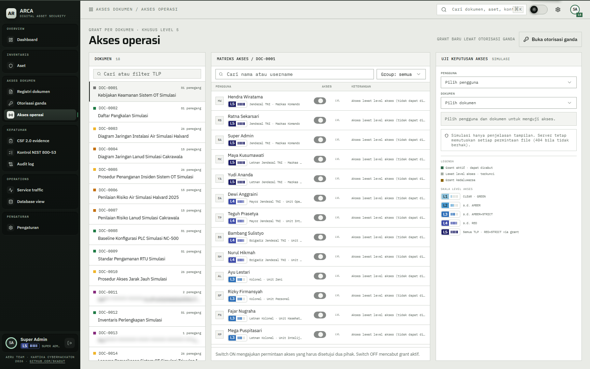
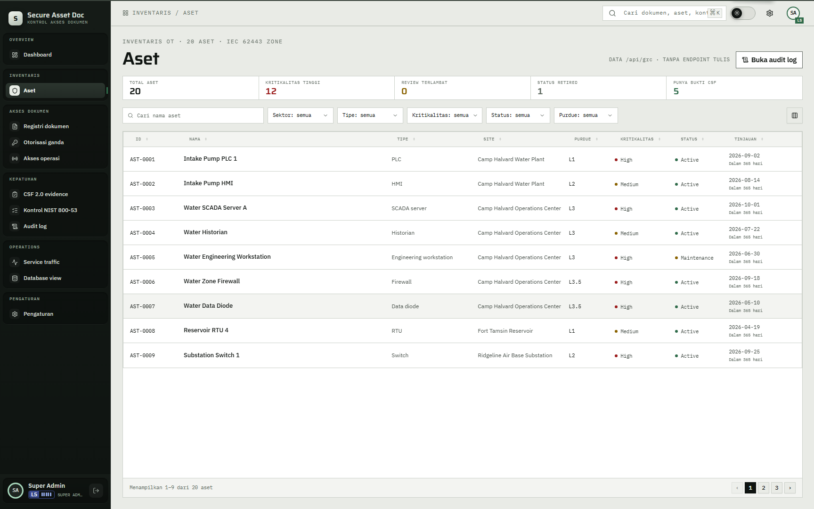
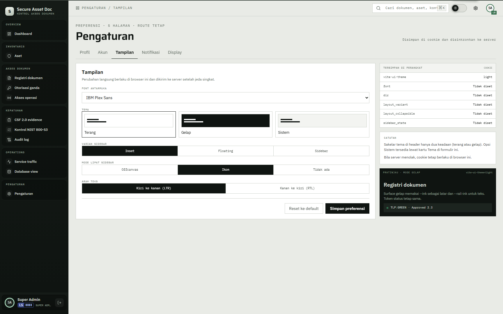
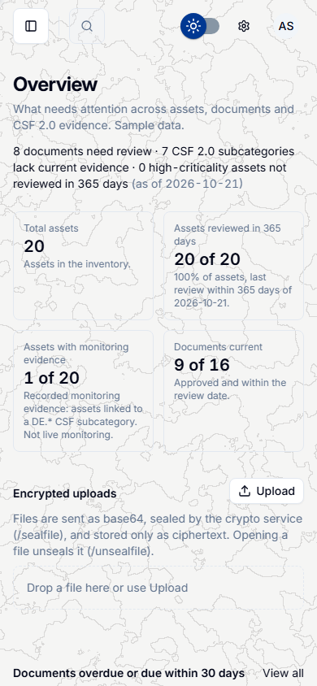

# Secure Asset Doc

A fictional GRC dashboard for secure assets and controlled documents. It tracks OT-style assets, documents with TLP labels and version history, and 21 NIST CSF 2.0 subcategories linked to evidence. Document files are protected through crypto-api and a TPM-rooted key hierarchy; the blueprint is [docs/tpm-development-crypto-service.md](docs/tpm-development-crypto-service.md).

The sample content is in Indonesian and is framed as the documents of a simulated military unit. It is marked `SIMULASI DEMO - BUKAN DOKUMEN RESMI TNI` ("simulation demo, not an official TNI document").

> **Disclaimer.** All data is fictional. The app is not an official document, not a NIST compliance or assessment tool, and its cryptography is not FIPS 140-3 validated. Do not enter real personal, operational, or classified information.

## Live demo

Open [https://skadut-hack.tail9e496c.ts.net/](https://skadut-hack.tail9e496c.ts.net/). The demo is served through Tailscale Funnel from the VPS in vTPM mode. Log in with a demo account. Account names and the shared password (`<DEMO_USER_PASSWORD>`) are provided separately.

## Preview

<table>
  <tr>
    <td></td>
    <td></td>
  </tr>
  <tr>
    <td align="center">Dashboard, light</td>
    <td align="center">Dashboard, dark</td>
  </tr>
</table>

<table>
  <tr>
    <td></td>
    <td></td>
    <td></td>
  </tr>
  <tr>
    <td align="center">Registry with TLP labels</td>
    <td align="center">Detail and version history</td>
    <td align="center">Secure viewer</td>
  </tr>
  <tr>
    <td></td>
    <td></td>
  </tr>
  <tr>
    <td align="center">Encrypted upload (<code>/sealfile</code>)</td>
    <td align="center">Encrypted uploads, decrypted on open (<code>/unsealfile</code>)</td>
  </tr>
  <tr>
    <td></td>
    <td></td>
    <td></td>
  </tr>
  <tr>
    <td align="center">Dual authorization</td>
    <td align="center">Access operations</td>
    <td align="center">Audit log</td>
  </tr>
  <tr>
    <td></td>
    <td></td>
    <td></td>
  </tr>
  <tr>
    <td align="center">CSF 2.0 evidence</td>
    <td align="center">NIST 800-53 controls</td>
    <td align="center">Assets</td>
  </tr>
  <tr>
    <td></td>
    <td></td>
    <td></td>
  </tr>
  <tr>
    <td align="center">Service traffic</td>
    <td align="center">Database view</td>
    <td align="center">Settings</td>
  </tr>
  <tr>
    <td></td>
    <td></td>
    <td></td>
  </tr>
  <tr>
    <td align="center">Login</td>
    <td align="center">Device check</td>
    <td align="center">Mobile dashboard</td>
  </tr>
  <tr>
    <td></td>
    <td></td>
    <td></td>
  </tr>
  <tr>
    <td align="center">404</td>
    <td align="center">503</td>
    <td></td>
  </tr>
</table>

## What it does

- **Assets:** 20 sample OT assets with type, sector, Purdue level, IEC 62443 zone, criticality, status, and last review.
- **Document registry:** 18 sample documents with version history, TLP labels (CLEAR to RED+STRICT), linked assets, and CSF evidence. PDF and XLSX preview. Uploads are encrypted through crypto-api `/sealfile` before storage and decrypted only on open through `/unsealfile`; they are separate from registry versions.
- **Secure viewer:** time-limited viewing session bound to the user and document, with a watermark and a countdown. RED and RED+STRICT get the shortest window.
- **Dual authorization:** a RED+STRICT grant requires one commander (level 5) and one security officer, in any order.
- **Access operations:** per-document access matrix, request, revoke, and an access-decision tester.
- **Level change workflow:** raise or lower a user's access level through a request with justification, screening, agreement, and review-date fields.
- **CSF 2.0 evidence:** 21 subcategories across six functions. Covered when an approved document is within its review date, Partial when evidence is linked without a current approved document, Gap when none is linked.
- **NIST 800-53 controls:** control rows with implementation notes and code locations.
- **Audit log:** append-only `audit_events` table, enforced by a trigger. PATI can purge entries older than a cutoff date; see [RUN.md](docs/RUN.md#audit-log-retention).
- **Service traffic:** live map of the request path and crypto-api calls. Metadata only. Super admin only.
- **Database view:** read-only table browser, super admin only.
- **Settings:** account, appearance, display, and notification preferences.
- **Themes:** light and dark modes with flat surfaces and a dark sidebar rail, following the secure.pen design. Responsive down to a 390 px viewport.

## How it's secured

**Access model.** Rank and access level are separate. Rank decides write permissions; `users.access_level` (1-5) plus per-document grants decide reads. A level reads TLP up to `min(level, 4)`, so RED+STRICT is never readable by level alone, not even level 5. A grant is active while not revoked and not expired, and is created only through dual authorization. The file route returns 404, not 403, above the ceiling, so document existence is not revealed. A super admin without a grant sees unreadable documents as token-only stubs: title stays masked or tokenised, versions empty, viewer 404. A security officer sees restricted documents as metadata only (`id`, `tlp`, `createdAt`, `versionCount`, `grantees`), with no title, file name, or content. Details in [SECURITY-DESIGN.md](docs/SECURITY-DESIGN.md#access-levels-and-document-grants) and [docs/access-levels.md](docs/access-levels.md).

**Authentication.** Username and password, then a 6-digit TOTP code validated by crypto-api `/totpvalidate`. The login screen has five steps: notice, password, code, device check, confirmation. Account lockout after 5 failed attempts for 15 minutes, plus a per-IP request limit. Sessions are a random token in an HttpOnly `SameSite=Strict` cookie; only its SHA-256 hash is stored. Hard session limit 30 minutes, idle lock after 5 minutes.

**Data protection.** Every document file, CLEAR included, is sealed with AES-256-GCM through crypto-api `/sealfile` and stored as ciphertext. Titles and file names for non-CLEAR documents are tokenised (`<masked>:<sealed>`) so the database holds no readable titles. Sensitive asset and workflow fields are sealed or tokenised by `db/scripts/protect-fields.mjs`. The read path verifies the integrity tag before sending bytes and fails closed on crypto errors.

**Keys.** MSK is generated inside the TPM and never leaves it. The KEK is wrapped under the MSK and stored as a file. DEKs are wrapped under the KEK and live in keyd memory for at most 300 seconds. keyd generates a fresh RSA-3072 delivery key at every start; `tpm-msk serve` shows its fingerprint and requires manual approval (or a matching `TPM_MSK_APPROVE_FP`) before delivering any KEK. If the key zone is unavailable, crypto calls return 503 and nothing falls back to plaintext. Key hierarchy and zeroization details: [SECURITY-DESIGN.md](docs/SECURITY-DESIGN.md#key-hierarchy).

**Audit.** `audit_events` rejects UPDATE, DELETE, and TRUNCATE through a trigger; the only deletion path is `purge_audit_events` and purge rows are never deleted. Each crypto service also writes a separate SHA-256 hash-chained JSONL log, verifiable with `tpm-msk audit verify`.

## Architecture and how it works

| Zone | Containers | Host ports |
| --- | --- | --- |
| App | `frontend` (nginx), `backend` (Node 24) | `frontend` 127.0.0.1:8088; backend none |
| Data | `db` (PostgreSQL 17) | 127.0.0.1:5432 |
| Crypto | `crypto-api` (mTLS), keyd | 127.0.0.1:2896 to container 2796; keyd no host port |
| Key zone | `tpm-msk serve`, TPM 2.0, MSK | 127.0.0.1:2798 |

The VPS deployment loads `cryptography-service/compose.vps.yaml`, which runs `swtpm` and `tpm-msk` in containers; the MSK is sealed to vTPM state held in a persistent volume. The native laptop path uses the hardware TPM 2.0 through TBS.

**How a document read works.** The frontend asks the backend for `/api/grc`; the backend filters the payload by access level, grants, officer role, and super-admin role, detokenises readable titles, and drops hidden documents and their evidence, asset, and audit references. Opening a document creates a time-limited viewer session. Fetching the file (`/api/files/:doc/:ver`) checks the ceiling and grant, then the backend calls crypto-api `/unsealfile`. crypto-api asks keyd over the Unix socket; keyd either uses a cached DEK or fetches a freshly wrapped KEK from `tpm-msk` over mTLS, decrypts the DEK, and wipes the KEK. Any failure in the key zone returns 503 and no bytes are sent. Full sequences: [SECURITY-DESIGN.md](docs/SECURITY-DESIGN.md#tpm-mode-decrypt).

## Documentation map

| Document | Contents |
| --- | --- |
| [docs/RUN.md](docs/RUN.md) | Setup, start and stop, seeding, demo accounts, TPM operations, development, tests, deployment, retention, hardware |
| [docs/SECURITY-DESIGN.md](docs/SECURITY-DESIGN.md) | Crypto API modes and endpoints, key hierarchy, zeroization, DB role, protection by TLP, access model, constraints, blueprint conformance |
| [docs/access-levels.md](docs/access-levels.md) | Access model, TLP, grants, level change, operations (Indonesian) |
| [docs/tpm-development-crypto-service.md](docs/tpm-development-crypto-service.md) | TPM-rooted KEK and DEK blueprint |
| [docs/service-traffic-visualization.md](docs/service-traffic-visualization.md) | Traffic map guide |
| [cryptography-service/tpm-services/TUTORIAL.md](cryptography-service/tpm-services/TUTORIAL.md) | Operator tutorial: build, one-time setup, run, reset (Indonesian) |
| [cryptography-service/README.md](cryptography-service/README.md) | Crypto service parts, laptop hardening, build notes |
| [db/CREDENTIALS.md](db/CREDENTIALS.md) | Demo account list and old-to-new username mapping |
| [DEMO.md](DEMO.md) | Five-minute demo script (Indonesian) |
| [docs/versi-lama/README.pre-split.md](docs/versi-lama/README.pre-split.md) | Previous single-file README, archive |

## Security notes and known limits

- **Sessions:** token hash in `sessions`, 30-minute hard limit and 5-minute idle lock. No `Secure` cookie flag, because the stack runs plain HTTP inside compose.
- **Writes:** non-GET/HEAD requests need an allowed `Origin` (`APP_ORIGINS`) and a JSON content type.
- **Known gaps:** `POST /api/uploads` has no explicit authorize call (all tiers hold `upload.c` today). `/api/grc` returns audit events to any session, filtered by document readability. No audit-read permission exists. The write-side `authorize()` policy in `backend/auth.mjs` is not wired to document routes yet.
- **Traffic and database view:** super admin only. `/api/traffic` is rate limited and metadata only.
- **File bytes:** after `protect-documents.mjs`, every version with a file is `encrypted`, stored in `content_ciphertext` with `content_base64` NULL; only rows not yet migrated keep plaintext base64. Files are buffered in memory (25 MiB limit).
- **Audit log:** not tamper-proof against the table owner or a superuser. `sad_app` can call `purge_audit_events` directly, bypassing the app-layer PATI check.
- **Version sort** is lexical, so versions 10 and above sort incorrectly.
- **Single-laptop deployment:** no zone separation. A Windows administrator, an attacker controlling keyd, or a compromised app with a valid certificate is out of scope. Full list: [SECURITY-DESIGN.md](docs/SECURITY-DESIGN.md#security-notes-and-known-limits) and blueprint section 12.

## License and credits

The dashboard UI started from [satnaing/shadcn-admin](https://github.com/satnaing/shadcn-admin) (MIT, Copyright (c) 2024 Sat Naing) and was adapted for this project. The repository is distributed under the MIT License. See [LICENSE](LICENSE).

Modified shadcn/ui components and RTL-related changes are in `frontend/src/components/ui/`. Third-party appearance references, their sources, and their licenses are listed in [THIRD_PARTY_NOTICES.md](THIRD_PARTY_NOTICES.md).
