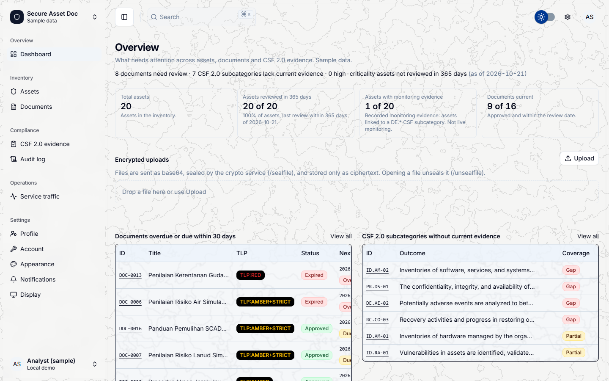
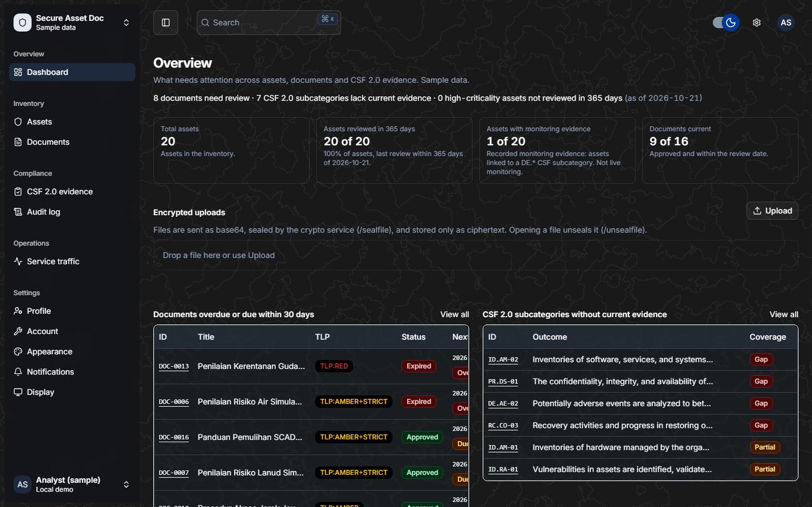
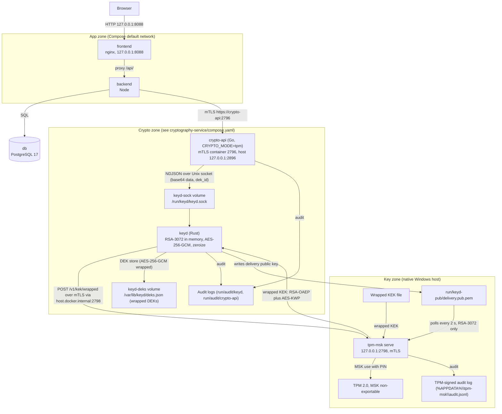
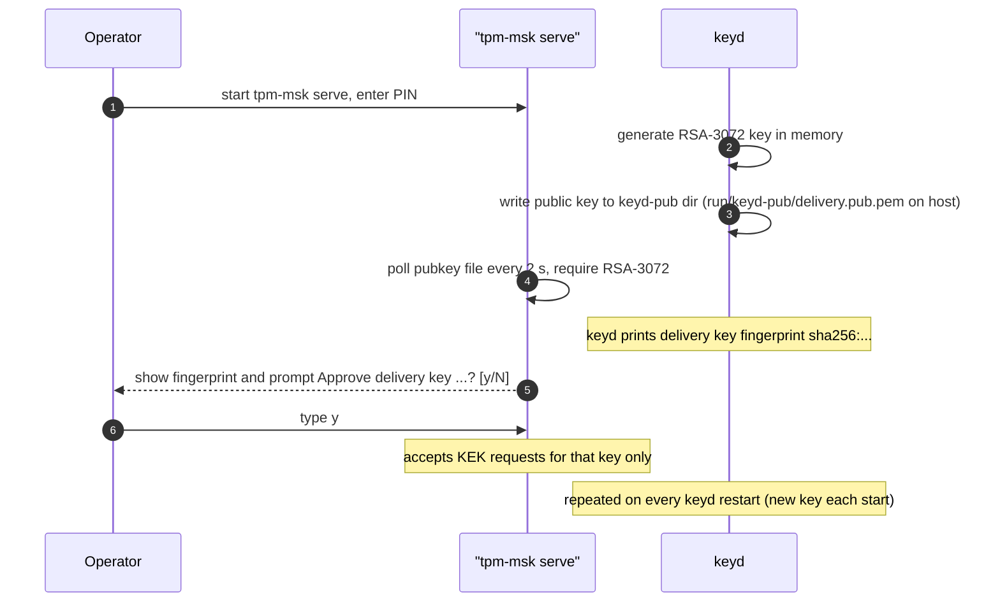
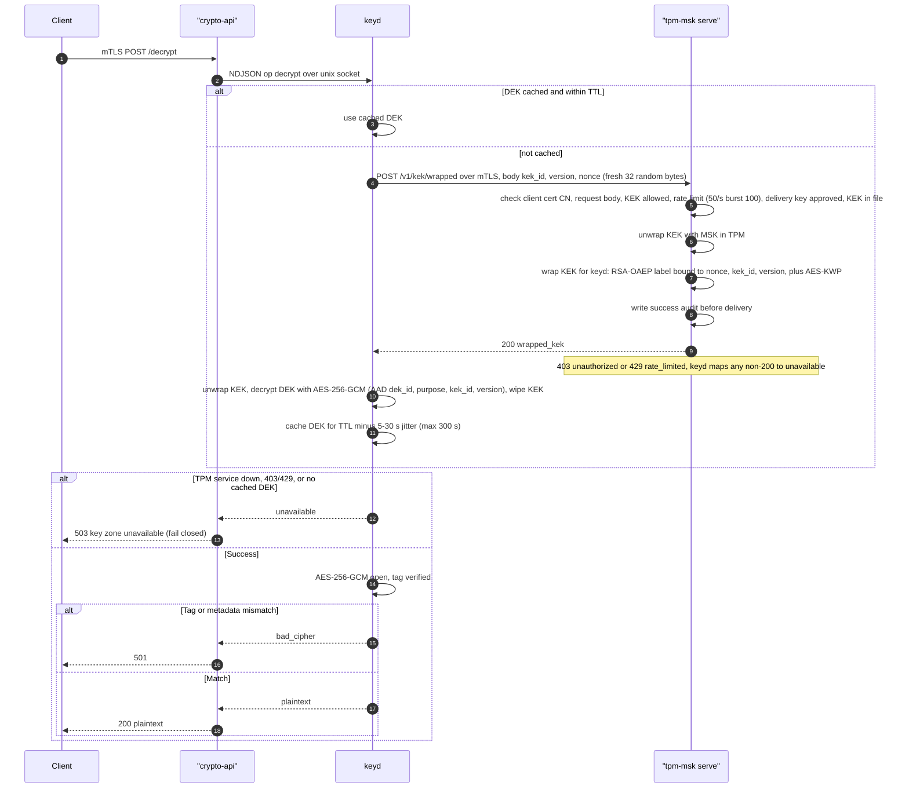

# Secure Asset Doc

A fictional GRC dashboard for secure assets and controlled documents. It tracks OT-style assets, documents with TLP labels and version history, and 21 NIST CSF 2.0 subcategories linked to evidence. The TPM blueprint ([docs/tpm-development-crypto-service.md](docs/tpm-development-crypto-service.md)) describes the crypto-api and keyd path for protected document data.

The sample content is in Indonesian and is framed as the documents of a simulated military unit. It is marked `SIMULASI DEMO - BUKAN DOKUMEN RESMI TNI` ("simulation demo, not an official TNI document").

> **Disclaimer.** All data is fictional. The app is not an official document, not a NIST compliance or assessment tool, and its cryptography is not FIPS 140-3 validated. Do not enter real personal, operational, or classified information.

## Preview

<table>
  <tr>
    <td></td>
    <td></td>
  </tr>
  <tr>
    <td align="center">Dashboard, light</td>
    <td align="center">Dashboard, dark</td>
  </tr>
</table>

- [Documents](docs/screenshots/documents.png): filterable list with TLP, status, type, and owner.
- [Document detail](docs/screenshots/document-detail.png): version history and inline PDF preview.
- [Assets](docs/screenshots/assets.png): inventory with sector, Purdue level, IEC 62443 zone, and criticality.
- [CSF 2.0 evidence](docs/screenshots/evidence.png): coverage per function (Covered, Partial, Gap).
- [Service traffic](docs/screenshots/traffic.png): live service map, refreshed every 2 seconds.
- [Mobile dashboard](docs/screenshots/mobile-dashboard.png): 390 px wide layout.

## Features

- **Overview:** asset review status, CSF evidence gaps, and documents due or overdue.
- **Assets:** 20 sample assets with type, sector, Purdue level, IEC 62443 zone, criticality, status, and last review.
- **Documents:** 16 sample documents with TLP labels (CLEAR to RED+STRICT), versions, linked assets, and CSF evidence. PDF and XLSX preview.
- **CSF 2.0 evidence:** 21 subcategories across six functions. A subcategory is Covered when an approved document is within its review date, Partial when evidence is linked but no current approved document exists, and Gap when none is linked.
- **Audit log:** `audit_events` table. Append-only, enforced by a trigger. PATI can purge entries older than a cutoff date (see Audit log retention).
- **Service traffic:** live map of the request path and the crypto-api calls. Metadata only.
- **Themes:** light and dark modes with glass-style panels over a textured background. Responsive layout.

## Architecture

The root stack uses the TPM-rooted crypto-api topology.



| Zone | Containers | Networks | Host ports |
| --- | --- | --- | --- |
| App | `frontend` (nginx), `backend` (Node 24) | Compose default network | `frontend` 127.0.0.1:8088; backend none |
| Data | `db` (PostgreSQL 17) | Compose default network | 127.0.0.1:5432 |
| Crypto | `crypto-api` (container, mTLS) | See `cryptography-service/compose.yaml` | 127.0.0.1:2896 to container 2796 |
| Key zone native host | `tpm-msk serve`, TPM 2.0, MSK | Host loopback | `tpm-msk serve` 127.0.0.1:2798 |
| keyd | Docker, socket volume `keyd-sock` | See `cryptography-service/compose.yaml` | No host port |

## Crypto API

`crypto-api` (Go, Gin; `CRYPTO_MODE=tpm`) serves mTLS on container port 2796, published as 127.0.0.1:2896. See the [TPM blueprint](docs/tpm-development-crypto-service.md).

### Modes

The deployed crypto-api uses `CRYPTO_MODE=tpm`. Ciphertext and HMAC values use the `skadut-t1:` format.

| Aspect | `tpm` |
| --- | --- |
| Key source | keyd over Unix socket (`KEYD_SOCKET`, default `/run/keyd/keyd.sock`) |
| Ciphertext `versionkey` | `skadut-t1:<DEK id>` |
| Seal output | `skadut-t1:<DEK id>:<b64 iv+ct>` |
| HMAC output | `skadut-t1:<DEK id>:<b64 tag>` |
| Crypto unavailable | 503, fail closed |

Tokenize output is the masked text followed by the sealed original.

### Key hierarchy

**TPM hierarchy:** MSK (inside the TPM, non-exportable) > KEK (wrapped under the MSK, stored in a file) > DEK (wrapped under the KEK, held in keyd memory at most 5 minutes). See [blueprint section 4](docs/tpm-development-crypto-service.md#4-key-hierarchy).

keyd also holds an RSA-3072 delivery key. It is generated in memory at keyd start (`cryptography-service/key-container/src/main.rs:42`), never written to disk, and new on every start. The MSK is generated inside the TPM by `tpm-msk init` by default. `tpm-msk init --import` takes 32 to 64 bytes of hex on stdin instead. The Shamir shares printed by `serve` are demo only and do not restore the MSK.

| Key (TPM project) | Stored as | Plaintext location | Lifetime |
| --- | --- | --- | --- |
| MSK | TPM keyedHash object, TPM-bound (`fixedTPM`, `fixedParent`), no export | Inside the TPM only | Not applicable |
| KEK | Envelope file, AES-256-GCM under a key derived from the MSK | `tpm-msk` during unwrap, keyd while in use | Wiped after use |
| DEK | Wrapped under the KEK in `deks.json` (volume `keyd-deks`) | keyd memory only | At most 300 s, minus 5 to 30 s jitter |
| RSA-3072 delivery key | Public key PEM in `run/keyd-pub/delivery.pub.pem` | keyd memory only | Until keyd stops |

The TPM design calls for AAD that binds tenant, record, and schema version. TPM mode binds AAD: see [Blueprint conformance](#blueprint-conformance) section 8.


#### TPM-mode startup



#### TPM-mode decrypt



### Zeroization

- **TTL:** `CRYPTO_KEY_TTL` defaults to `5m`. Values above `5m` or at or below zero stop startup. On expiry the DEK is wiped (`zeroize reason=ttl count=N`) and the next call unwraps a new one.
- **TPM mode:** keyd enforces `KEYD_DEK_TTL`, valid range 31 to 300 s, default 300 (`cryptography-service/key-container/src/main.rs:41`). It subtracts 5 to 30 s of jitter and uses single-flight loading. Expiry also trips on realtime clock jumps, covering suspend. See [keyd TTL](cryptography-service/key-container/README.md#key-ttl).
- **Per call:** every per-call key buffer is wiped with `defer`.
- **Key-zone error:** keyd wipes cached DEKs on key-service errors and returns 503. The legacy service's error reason is documented with the archived implementation.
- **Panic:** the recovery middleware returns 500 and purges the DEK cache (`zeroize reason=panic`).
- **Shutdown:** on SIGINT or SIGTERM, cached DEKs are purged (`zeroize reason=shutdown`), then the master key is wiped.
- **Memory and core dumps:** `mlock` is best-effort. If it fails, the log shows `mlock unavailable` once. The container has `cap_add: IPC_LOCK`. Core dumps are off through `ulimits.core: 0` and `setrlimit(RLIMIT_CORE, 0)` on Linux at startup.

### Endpoints

All endpoints accept POST only. Crypto-api serves mTLS on container port 2796, published as 127.0.0.1:2896. `GET /` is not implemented and returns 404. Request bodies are limited to 20 MiB, and `CountByte` is limited to 1024.

| Endpoint | Request body | Response key |
| --- | --- | --- |
| `/genrand` | `{"CountByte":8}` | `Random` (hex string) |
| `/encrypt` | `{"Plaintext":[{"Text":"data 1"}]}` | `Ciphertext`: list of `versionkey` (`skadut-t1:<DEK id>`), `text`, `mac`, `iv` |
| `/decrypt` | `{"Ciphertext":[{"versionkey":"t1:<DEK id>","text":"...","mac":"...","iv":"..."}]}` | `Plaintext`: list of `text` |
| `/seal` | `{"Plaintext":[{"Text":"data 1"}]}` | `Ciphertext`: list of `text` (`skadut-t1:`-prefixed) |
| `/unseal` | `{"Ciphertext":[{"text":"t1:<DEK id>:..."}]}` | `Plaintext`: list of `text` |
| `/sealfile` | `{"Data":"<base64>"}` | `Ciphertext` (`skadut-t1:`-prefixed) |
| `/unsealfile` | `{"Ciphertext":"t1:..."}` | `Data` (base64) |
| `/hmac` | `{"Message":"password"}` | `Value` (tag, `skadut-t1:<DEK id>:<b64 tag>`) |
| `/verifyhmac` | `{"Message":"password","HMACstring":"t1:<DEK id>:<b64 tag>"}` | `Value` (bool) |
| `/tokenize` | `{"Masking":[{"Format":"LEFT","Length":3,"Text":"..."}]}` | `Ciphertext`: list of `text` |
| `/detokenize` | `{"Masking":[{"text":"***...:t1:<DEK id>:<b64 iv+ct>"}]}` | `Ciphertext`: list of `text` |

`skadut-` is an output label only. It is not part of AAD or HMAC input. Inputs accept values with or without the label.

`Format` for `/tokenize` is `LEFT` or `RIGHT` with `Length`, `MID` with `Position` as `start:end`, or a per-character pattern where `$` is masked and `%` is shown. Example for an ID number:

This payload sketch requires the crypto-api client certificate from `run\pki` in the PowerShell request; TLS 1.3 mTLS is required.

```powershell
$body = '{"Masking":[{"Format":"%$%%%%%%%%%$%%%$","Text":"3302271000000001"}]}'
Invoke-RestMethod -Uri https://127.0.0.1:2896/tokenize -Method Post -ContentType 'application/json' -Body $body
```

Each request writes one log line with method, path, status, duration, and client IP. Bodies, query strings, and headers are not logged.

### App database role

The backend connects to PostgreSQL as `sad_app`, a non-superuser role. Its password is `APP_DB_PASSWORD` in root `.env` (placeholder in `.env.example`).

- Grants from `005_app_role.sh`: `CONNECT` on the database and `USAGE` on `public`. `SELECT` on `assets`, `documents`, `document_versions`, `csf_subcategories`, `evidence_links`, `asset_document_links`, `audit_events`. `SELECT` and `INSERT` on `uploaded_files`.
- Grants from `006_rbac.sql`:
  - `SELECT` on `ranks`.
  - `SELECT`, `INSERT`, `UPDATE`, `DELETE` on `users` and `sessions`.
  - `INSERT`, `UPDATE`, `DELETE` on `documents`, `document_versions`, `assets`.
  - `INSERT`, `DELETE` on `asset_document_links`, `evidence_links`.
  - `DELETE` on `uploaded_files`, and `UPDATE` on its `name` column.
  - `EXECUTE` on `log_audit` and `log_access_denied`.
- `EXECUTE` on `purge_audit_events` from `007_audit_purge.sql`.
- Grants from `008_access_levels.sql`: `SELECT` on `document_access_grants` and `EXECUTE` on `revoke_document_access`. `010_red_strict_dual_auth.sql` revokes `EXECUTE` on `grant_document_access` from `sad_app`; grants are written only through the dual-approval functions. `sad_app` has `EXECUTE` on the 010 request functions (`request_document_access`, `decide_access_request`) and `revoke_document_access`, and no `EXECUTE` on `grant_document_access`.
- `010_red_strict_dual_auth.sql` adds the dual-authorization request tables and functions and a CHECK that a security officer is never level 5. `011_level_change.sql` adds the level-change request, decide, and lower functions. `010` also adds `users.unit`; `012_unit_head.sql` adds `users.unit_head` with a partial unique index (one head per unit).
- `audit_events`: `SELECT` only. No direct `INSERT`, `UPDATE`, `DELETE`, or `TRUNCATE`. Audit rows are written through `log_audit`.
- No `TRUNCATE` grant and no `CREATE` grant.
- `006_rbac.sql` runs after `005_app_role.sh` on fresh-volume init. For the clean-start workflow, see [Fresh start](#fresh-start).
- Created by `db/init/005_app_role.sh` on a fresh init. Postgres init scripts run only on an empty volume.
- Admin role `sad` (`POSTGRES_USER`) is used only by the `db` service and migration scripts.

### Document protection by TLP

| TLP | Stored in `document_versions` | Integrity | Confidentiality |
|---|---|---|---|
| CLEAR | `content_base64` (plaintext base64) | HMAC tag in `integrity_tag` (crypto `/hmac`) | none (public) |
| GREEN, AMBER, AMBER+STRICT, RED, RED+STRICT | `content_ciphertext` (`skadut-t1:` AES-256-GCM via crypto-api `/sealfile`), `content_base64` NULL | HMAC tag in `integrity_tag` | encrypted |

`protection` values: `none` (plaintext, not protected: no `integrity_tag`, no `content_ciphertext`), `integrity`, `encrypted`. Schema: `db/init/004_document_protection.sql`. A shape CHECK enforces the valid combinations.

The read path `/api/files/:doc/:ver` verifies the tag over the recovered base64:

- Integrity check fails: HTTP 500 `{"error":"integrity check failed"}`. Bytes are never sent.
- Crypto unavailable: 503.
- Other crypto failure: 502.

### Tokenized titles

For TLP other than CLEAR, `documents.title` and `document_versions.file_name` are stored as `<masked>:<sealed>` tokens. The mask keeps the first 3 characters, spaces, and punctuation, and hides the rest. The sealed part is the original value, sealed by crypto-api.

- `db/scripts/tokenize-titles.mjs` tokenizes plaintext rows. It is run by hand (see [Fresh start](#fresh-start)). Rows that are already tokens are skipped. New rows need a re-run.
- `/api/grc` detokenizes readable documents in one `/detokenize` call. If crypto-api is unavailable or returns an error, readable documents fall back to the masked part, never the token. Unreadable documents are dropped from the payload (`filterGrc` in `backend/grc-filter.mjs`); their evidence links, asset links, and audit references are removed too.
- The tokenize script uses crypto-api `/tokenize` and `/detokenize` for each row and reports failures by row. A crypto-api error causes the script to exit 1 if any row fails.

### Protection migration

Seeded or new files stay plaintext (`protection='none'`) until migrated. After a fresh `docker compose up`, run the dry run first:

```powershell
docker compose run --rm --no-deps -v "./db/scripts/protect-documents.mjs:/app/protect-documents.mjs:ro" -e PGUSER=<POSTGRES_USER> -e PGDATABASE=<POSTGRES_DB> -e PGPASSWORD=<POSTGRES_PASSWORD> backend node /app/protect-documents.mjs --dry-run
```

The real run is the same command without `--dry-run`. Values in `<...>` come from root `.env`. Real values must never be pasted into docs or shell history.

- Re-running is safe: only `protection='none'` rows are touched.
- Exit code is 1 if any row failed.
- Limit: sealfile accepts up to 10 MiB decoded per file. Larger files stay `none` and are reported as failed.
- If a document's TLP changes later, re-running does not re-protect or un-protect existing versions. This is out of scope; handle it manually.

### Backup before migration

Back up before any protection migration. Backup files contain plaintext. Keep them outside the repo and never commit them.

```powershell
New-Item -ItemType Directory -Force "$env:USERPROFILE\secure-asset-doc-backups" | Out-Null
docker compose exec db sh -c 'pg_dump -U "$POSTGRES_USER" -d "$POSTGRES_DB" -t document_versions -t documents -f /tmp/sad-backup.sql'
docker compose cp db:/tmp/sad-backup.sql "$env:USERPROFILE\secure-asset-doc-backups\documents-backup.sql"
docker compose exec db rm /tmp/sad-backup.sql
```

## Seeding after fresh start

A fresh volume gets schema only (`db/init`, 0 rows). Seed order after a fresh start: `db/seed/*.sql`, then `seed-users`, then `protect-documents`, then `tokenize-titles`. Commands and checks are in [Fresh start](#fresh-start) and [TUTORIAL step 5](cryptography-service/tpm-services/TUTORIAL.md#5-reset-data-dari-nol).

## Service traffic

- **Edges recorded:** `client>crypto-service` is recorded by crypto-api. `frontend>backend` and `backend>db` are recorded by backend. Backend merges crypto-api's data by fetching `http://crypto-api:2797/internal/traffic`.
- **Response of `GET /api/traffic`:** `{"ts":...,"edges":[{"source","target","rps","errorRate","avgMs"}],"down":[...]}`. `down` lists `crypto-service` if its internal fetch fails and `db` if `SELECT 1` fails. All known edges are always present, with zero defaults.
- **Window:** 10 seconds, in memory. Metadata only: IDs, counts, durations, and status classes. Resets on restart.
- **Rate limits:** nginx allows 5 requests/s with burst 10 for `/api/traffic` and returns 429. Backend also applies a 5 requests/s token bucket and returns 429 `{"error":"rate_limited"}`.
- **Authentication:** session required.

Crypto-api internal port 2797 serves only `GET /internal/traffic` and is not published to the host.

## Repository layout

| Path | Contents |
| --- | --- |
| `frontend/` | Vite, React 19, TanStack Router and Table, Tailwind CSS 4, shadcn/ui on Radix, Recharts. `nginx.conf` proxies `/api/` to `backend:3000`. Dockerfile builds to nginx-unprivileged. Ships no sample data; hydrates from `/api/grc`. Also `public/`, `scripts/` (`make-sample-xlsx.py`), `demo/` |
| `backend/` | Node 24 `node:http` API (`server.mjs`), `pg` client, traffic recorder (`traffic.mjs`), file protection (`protection.mjs`), uploads (`uploads.mjs`), self-checks |
| `db/` | `init/001_schema.sql` to `init/012_unit_head.sql`. `compose.yaml` mounts `init/` to `/docker-entrypoint-initdb.d`. The postgres image runs these on first init of an empty `pgdata` volume (image behavior; `001` and `003` headers have no run-timing statement. `004` header says it runs after `002_seed`). All init files `001`-`012` run on first init of an empty `pgdata` volume; `010_red_strict_dual_auth.sql`, `011_level_change.sql`, and `012_unit_head.sql` are also applied to an existing volume by hand as admin (their headers say so). `006_rbac.sql`, `007_audit_purge.sql`, and `008_access_levels.sql` are also applied on fresh-volume init (see Audit log retention). `scripts/seed-db.mjs` (regenerates the seed), `scripts/protect-documents.mjs` (protection migration), `scripts/seed-users.mjs` (demo accounts, access levels, DOC-0017 grants), `scripts/tokenize-titles.mjs` (title and file name tokenization) |
| `db/seed-files/` | Sample files used by the seed (`db/scripts/seed-db.mjs`). Not served by the app |
| `cryptography-service/encryption-services/` | TPM-only Go crypto API, tests, `Dockerfile`, `README.md` |
| `docs/versi-lama/crypt-module-vault/` | Legacy Vault crypto module, `docker-compose.yml`, `functional.ps1`, `setup.sh`, and README |
| `cryptography-service/tpm-services/` | Go module `tpm-msk` (TPM 2.0 CLI and delivery service): `cmd/`, `internal/`, own `README.md` |
| `cryptography-service/key-container/` | Rust keyd, the key container for TPM-rooted mode. Run `cargo test` |
| `cryptography-service/compose.yaml` | TPM-rooted topology, project `crypto-tpm`, included by root `compose.yaml` |
| `cryptography-service/e2e.sh` | End-to-end test with a software TPM harness |
| `cryptography-service/hw-acceptance.ps1` | Hardware acceptance walkthrough with a real TPM and PIN |
| `docs/versi-lama/key-zone/` | Legacy Vault configuration, archive only |
| `docs/` | `service-traffic-visualization.md` (traffic map guide), `tpm-development-crypto-service.md` (TPM blueprint), `screenshots/`, `versi-lama/` (pre-blueprint Vault docs) |
| `ref/` | Reference image (`details style.jpg`) |
| `.verification/` | Review screenshots and their capture scripts (`access-capture.mjs`, `contrast-probe.mjs`) |
| `.github/` | CI and stale workflows, issue and PR templates, `CONTRIBUTING.md`, `CODE_OF_CONDUCT.md` |
| `compose.yaml` | Root compose includes `cryptography-service/compose.yaml`; TPM-only stack, no Vault services |
| `DEMO.md` | Five-minute demo script (Indonesian) |
| `.env.example` | Template for root `.env`, copied in Quick start |
| `CHANGELOG.md`, `cz.yaml` | Changelog and Commitizen config |
| `LICENSE`, `THIRD_PARTY_NOTICES.md` | MIT license and third-party notices |

The three parts under `cryptography-service/` (`encryption-services/`, `tpm-services/`, `key-container/`) are described in [cryptography-service/README.md](cryptography-service/README.md).

## TPM operations

The design is in [TPM blueprint](docs/tpm-development-crypto-service.md). Command steps are in [Quick start](#quick-start).

If the TPM service stops, crypto operations fail closed once loaded DEKs expire, within 5 minutes.

Each service writes a hash-chained JSONL audit log (SHA-256 chain). From `cryptography-service\tpm-services`, run `& .\bin\tpm-msk.exe audit verify ..\run\audit\keyd\audit.jsonl`, `& .\bin\tpm-msk.exe audit verify ..\run\audit\crypto-api\audit.jsonl`, and `& .\bin\tpm-msk.exe audit verify "$env:APPDATA\tpm-msk\audit.jsonl"`. These logs are separate from the `audit_events` database table.

`[DEMO]` Shamir shares: `tpm-msk serve` prints them by default (`--demo-ceremony`, default true). They are split from a throwaway random secret, not the MSK, and cannot recover the MSK. `init` does not print them.

Laptop hardening is manual, not performed by tooling: BitLocker on the system drive (`manage-bde -status`), `powercfg /h off`, `swap=0` under `[wsl2]` in `%UserProfile%\.wslconfig`, and stop keyd before sleep with `docker compose -f compose.yaml stop keyd`. See [cryptography-service README](cryptography-service/README.md#laptop-hardening-blueprint-section-9).

This single-laptop setup is for development and demonstrations, with no zone separation. Malware with Windows administrator rights, an attacker controlling the running keyd container, and a compromised application using its own valid certificate are not protected against. See blueprint section 12, Security boundaries.

The backend calls crypto-api in TPM mode through the root compose. `cryptography-service/e2e.sh` exercises the path with a software TPM harness. A real-TPM run via `cryptography-service/hw-acceptance.ps1` has not been done yet.

Never paste real PIN values or secrets into docs, commands, or shell history.

## Blueprint conformance

Maps each section of [docs/tpm-development-crypto-service.md](docs/tpm-development-crypto-service.md) to the code in `cryptography-service/`. Status values: **Implemented**, **Partial**, **Deviation**, **Not built**, **Open**. Code paths are relative to `cryptography-service/`.

#### §1 Purpose

- MSK in TPM, non-exportable: **Implemented** (`tpm-services/internal/tpm/tpm.go`).
- KEK stored as a file wrapped under the MSK: **Implemented**.
- DEK wrapped under the KEK, in keyd memory for at most 300 s: **Implemented** (see [Zeroization](#zeroization)).

#### §2 Assumptions

| Assumption | Status |
| --- | --- |
| Architecture in §3 used as drawn | **Partial**: TPM service, keyd and crypto-api run as drawn. The app backend calls crypto-api over mTLS. |
| Single laptop, TPM 2.0, Docker Desktop WSL2, BitLocker on | Operator setup, not enforced by tooling. Non-admin `selftest` passed on an STMicro ST33 TPM 2.0 (see §16). |
| Applications reach port 2796 only with mTLS | **Implemented** for crypto-api: `127.0.0.1:2896` maps to container port 2796, mTLS required. |
| Root-stack crypto-api integration | **Implemented**: the root stack runs crypto-api only; Vault is not part of the stack |
| Initial Shamir ceremony complete, MSK imported | **Not met**: `init --import` exists, but no real shares are produced. Demo only (§11.1). |
| Recovery optional, only if TPM cleared or replaced | **Not built** (§11.3). |

#### §3 Architecture

- Diagram: [Architecture](#architecture), TPM-rooted project.
- **Implemented** as drawn: keyd calls the TPM service over mTLS, crypto-api connects to keyd over the Unix socket.
- **Deviation:** the TPM service is the Go `tpm-msk` prototype (see §13). keyd reaches it through `host.docker.internal:2798`.

#### §4 Key hierarchy

- Table and details: see [Key hierarchy](#key-hierarchy), TPM project paragraph and table.
- **Implemented**: MSK remains a TPM object; the KEK envelope is stored in the configured file; DEKs are stored wrapped in the `keyd-deks` volume. The delivery private key is in keyd memory; its public key PEM is published to the configured file.

#### §5 Components

| Component | "Must never" | Status |
| --- | --- | --- |
| TPM | Export the MSK | **Implemented**: the MSK is a TPM object with `fixedTPM`, `fixedParent`. |
| TPM service | Return a plaintext KEK | **Implemented**: only the wrapped KEK is returned (`tpm-services/internal/service/service.go:196`). |
| keyd (Rust container) | Log or export keys | **Implemented**: audit records hold IDs, versions and results only. stderr prints only the fingerprint and memlock status. |
| crypto-api (Go container) | Hold a KEK, DEK or RSA private key | **Partial**: holds no key bytes, but plaintext request and response data passes through Go strings, which cannot be wiped. |

#### §6 Operational flows

**§6.1 Startup**

- PIN at least 6 bytes (`tpm-services/cmd/tpm-msk/main.go:508-510`). Wrong PINs count toward TPM lockout (`tpm.go:300-307`).
- keyd prints `delivery key fingerprint: sha256:<SPKI DER hex>` to stderr (`key-container/src/main.rs:46`) and writes the PEM by temp file and rename (`main.rs:100-106`).
- `tpm-msk serve` polls the pubkey file every 2 s and requires RSA-3072 (`serve.go:296,342`). It prints `Delivery key fingerprint: sha256:...` to stdout (`serve.go:356`).
- Prompt: `Approve delivery key sha256:<hex>? [y/N]` (`serve.go:354-357`). Only the line `y` approves.
- Any change to the pubkey file, including deletion, revokes the active key (`pubkey.revoke`, `serve.go:329`) and cancels a pending prompt (`pubkey.cancel`). One active key at a time.

**§6.2 KEK delivery**

- Request body: `kek_id`, `version`, `nonce` (32 random bytes, base64) (`key-container/src/tls.rs:13,72-73`).
- TPM service check order (`tpm-services/internal/service/service.go:81-166`): path and method, client CN `crypto-service` (`:109`), body (4096 B max, unknown fields rejected), KEK allow-list (`--allow-kek`), rate limit (`--rate`, default 50/s, burst 100), delivery key approved, KEK lookup in file.
- Rejections: 403 `{"error":"unauthorized"}` (details in audit), 429 `rate_limited`, 400 `bad_request`.
- Success audit `kek.request ok` is written before the response (`service.go:205-211`). If the audit write fails, the response is 503 `unavailable` and no KEK is sent.
- keyd negative cache: after a failed fetch, all KEK fetches return `unavailable` for 2 s (`key-container/src/main.rs:157-163`). The gate is global, not per KEK.
- keyd maps any non-200 from the TPM service to `unavailable` (`tls.rs:46`). crypto-api returns 503 `key zone unavailable`.

**§6.3 DEK lifecycle**

- Expiry is TTL minus 5 to 30 s random jitter (`store.rs:143`). Expiry trips on CLOCK_BOOTTIME or realtime (`time.rs:28-33`, `store.rs:127-152`). A backwards realtime jump counts as expired.
- Activity does not extend the TTL.
- In-flight requests hold an `Arc`. The key is zeroized when the last reference drops (`crypto.rs:71-77`).
- Deviation: `dek.expire` and `dek.zeroize` audit records are written at sweep time (`main.rs:68`), not at last drop. A request in flight can still hold the key after the log line.
- New requests after expiry reload the DEK single-flight, with a fresh KEK delivery.
- SIGTERM or SIGINT: `cache.clear()` logs `dek.zeroize` per DEK, then `container.stop` (`main.rs:93-97`).
- SIGKILL: no wipe. Mitigations: mlock (best effort), `RLIMIT_CORE` 0 and `PR_SET_DUMPABLE` 0 (`main.rs:33-34`), and compose `memswap_limit: 256m` equal to `mem_limit` (`compose.yaml`).

**§6.4 Rotation**

| Key | Status |
| --- | --- |
| DEK | Deviation: a fresh DEK is selected by UTC year per purpose (`data`, `mac`) (`main.rs:183-189`, `store.rs:67-69`). Data DEKs are also rotated at 2^32 − 2^20 = 4,293,918,720 uses (`main.rs:167`). The counter is per process and not shared across instances (ponytail note at `main.rs:165`). |
| KEK | Partial: `tpm-msk kek create --id kek-01` increments the version and keeps old versions in the file (`tpm-services/internal/tpm/kek.go:117-121`). keyd uses `KEK_VERSION` (default 1, `main.rs:40`) for new DEKs. **Not built**: no rewrap tool; old DEKs must be rewrapped by hand. |
| RSA delivery key | **Implemented**: new key each keyd start. Old key revoked on file change (`serve.go:313-331`). |

#### §7 TPM service API

- Only `POST /v1/kek/wrapped` exists. Other paths return 404 `not_found`, other methods 405 `method_not_allowed` (`service.go:81-90`).
- 200 body: `{kek_id, version, wrapped_kek}`, base64, header `Cache-Control: no-store` (`service.go:209-216`).
- Errors: 400 `bad_request`, 403 `unauthorized`, 429 `rate_limited`, 503 `unavailable` (`service.go:37-43`).
- `X-Request-ID` must match `^[A-Za-z0-9-]{8,64}$`. Otherwise the service generates 16 random bytes as hex. It is echoed in the response (`service.go:34,79-80,232-241`).
- TLS 1.3, `RequireAndVerifyClientCert`, CA `keyzone-ca`, separate from the `api` CA (`crypto-api-ca`). Client CN must be `crypto-service` (`tpm-services/internal/pki/pki.go:33-39`, `cmd/tpm-msk/serve.go:236-248`).
- Flags: `--listen` default `127.0.0.1:2798`, `--allow-kek` default `kek-01` (`serve.go:36,39`).
- No endpoint accepts a public key. The key comes only from `--pubkey-file` and console approval (`serve.go:38`).

#### §8 Cryptographic specification

| Purpose | Code |
| --- | --- |
| MSK | HMAC-SHA256 keyed-hash TPM object, `fixedTPM`, `fixedParent`, `UserWithAuth`. Auth is SHA-256(PIN). No PCR binding. No `noDA`, so TPM dictionary-attack protection applies (`tpm.go:44-52,107-127`). |
| MSK key ID | Hex of HMAC(MSK, `tpm-msk/key-id/v1`)[:16] (`tpm.go:291`). Same MSK, same ID. |
| TPM session | Salted to the SRK, AES-128 parameter encryption. |
| KEK at rest | Per-envelope key = HMAC(MSK, `tpm-msk/kek/v1` 0x00 label 0x00 nonce32), used as AES-256-GCM with a 12-byte IV. AAD = `tpm-msk/v1` followed by label. Label = `kek/<id>/<version>` (`internal/tpm/envelope.go:27-28,128-144`, `kek.go:129`). |
| KEK delivery | Temp 32-byte AES key wrapped with RSA-OAEP-SHA256 (384 B), KEK wrapped with AES-256-KWP (40 B). Total 424 B (`key-container/src/crypto.rs:15,143-151`, `tpm-services/internal/delivery/delivery.go:17,87-97`). |
| Delivery binding | OAEP label = `tpm-msk/delivery/v1` 0x00 nonce kek_id 0x00 u32be(version). No separator between nonce and kek_id. |
| DEK at rest | AES-256-GCM, 12-byte IV, AAD = `dek_id` 0x00 purpose 0x00 `kek_id` 0x00 u32be(kek_version) (`key-container/src/crypto.rs:131-140`, `store.rs:77,82-84`). |
| Application data (TPM mode) | AES-256-GCM, random 12-byte IV, AAD = `dek_id` bytes (`key-container/src/main.rs:224-225,237`). |

- KEK delivery follows the `CKM_RSA_AES_KEY_WRAP` construction. PKCS#11 compliance is not claimed.
- The 2^32 limit is handled by the rotation threshold in §6.4, per process only.

#### §9 Security requirements

**Key zone**

- **Implemented:** `127.0.0.1:2798`, reached from containers via `host.docker.internal` (`serve.go:36`, `main.rs:58`).
- **Not enforced by tooling:** Windows Firewall inbound block.
- KEK in locked memory: **Implemented** in the TPM service, which returns 503 if `LockMemory` fails (`service.go:184-188`). **Deviation** in keyd: mlock is best effort and only warns once.

**Service zone (keyd and crypto-api)**

- keyd: read-only filesystem, `cap_drop: ALL`, `cap_add: IPC_LOCK`, `no-new-privileges`, core limit 0, memlock 64 MiB, `mem_limit` and `memswap_limit` 256m, no `pid: host`, distroless uid 65532 (`compose.yaml`, `key-container/Dockerfile`). **Implemented.**
- Socket mode 0600 plus `SO_PEERCRED`. Connections from a uid other than `KEYD_ALLOWED_UID` (default 65532) are dropped (`main.rs:76,122-124`). **Implemented.**
- crypto-api: read-only, `cap_drop: ALL`, core 0, socket mounted `:ro` (`compose.yaml`). **Implemented.**
- No cgo: crypto-api builds with `CGO_ENABLED=0`. keyd is Rust. **Implemented.**
- **Deviation:** network `crypto-tpm-net` is a plain bridge, not `internal` (`compose.yaml:102-104`).
- Laptop hardening: see [cryptography-service README](cryptography-service/README.md#laptop-hardening-blueprint-section-9). Manual, not enforced by tooling.

**Audit events**

| Service | Actions in code | Notes |
| --- | --- | --- |
| TPM service | `service.start`, `service.stop`, `pin.fail`, `pubkey.approve`, `pubkey.reject`, `pubkey.cancel`, `pubkey.revoke`, `kek.request`, `authz.fail`, `audit.sign` | Recovery ceremony events: not built. |
| keyd | `container.start`, `container.stop`, `kek.delivery`, `dek.create`, `dek.load`, `dek.unwrap_fail`, `dek.expire`, `dek.zeroize`, `op.encrypt`, `op.decrypt`, `op.hmac`, `authz.fail`, `conn.reject` | Lifecycle events have empty `request_id`. |
| crypto-api | `op.encrypt`, `op.decrypt`, `op.seal`, `op.unseal`, `op.hmac`, `op.verifyhmac`, `op.tokenize`, `op.detokenize`, `op.sealfile`, `op.unsealfile`, `op.genrand`, `authz` | |

- Record fields: time, request_id, service, identity, key_id, key_version, action, result, prev_hash, hash (`tpm-services/internal/audit/audit.go:33-44`). SHA-256 chain, genesis all zeros (`audit.go:46-50`).
- Request ID flows `X-Request-ID` to keyd `id` to the TPM header. e2e shows one ID in all three logs.
- Fail-closed: crypto-api returns 503 `audit unavailable` if it cannot write (`encryption-services/audit.go:243-268`). TPM success audit (`kek.request ok`) is fail-closed: if it cannot be written, no KEK is sent (`service.go:205-211`). keyd returns `unavailable` if its success record fails. TPM denial records (`authz.fail`, `kek.request` denied or error) are best effort: write errors are ignored (`service.go:101-107`). keyd failure and lifecycle records are best effort.
- `audit.sign`: HMAC over `tpm-msk/audit-sign/v1` and the previous hash, every 60 s or 100 records (`audit.go:46,48,175-179`).
- **Deviation:** `audit verify` checks the chain only, not the signatures (`audit.go:218`).
- **Deviation:** separate copy not met. Logs are bind-mounted and writable by the container. Only the TPM log is signed.
- Sensitive data: no key material, PINs or plaintext in logs. Demo shares are never audited (`serve.go:141-162`).

#### §10 Failure behavior

| Event | Code behavior |
| --- | --- |
| TPM service stops | Cached DEKs keep working until expiry (at most 300 s). After that, requests return 503 `key zone unavailable`. |
| Wrong PIN | `pin.fail` audit. Counts toward TPM lockout (`tpm.go:300-307`). |
| TPM lockout | Startup fails with a dictionary-attack lockout message (`tpm.go:300-307`). |
| keyd restart | Keys lost from memory. New delivery key, re-approval required. |
| Many DEKs expire together | 5 to 30 s jitter (`store.rs:143`), single-flight reload, 2 s negative cache. |
| TPM cleared or replaced | All wrapped KEKs unrecoverable. No recovery tool (§11). |
| Hard kill of keyd | No wipe. Mitigations as in §6.3. |

#### §11 Backup and recovery

- **§11.1 Demo ceremony:** `tpm-msk serve` prints the demo shares to stdout by default (`--demo-ceremony`, default true, `serve.go:46,141-162`). They come from a throwaway secret. They are not printed by `init`, and never audited. **Demo only**: the real MSK is not split. Ceremony confirmation is open (§16).
- **§11.2 Backups:** `msk.key` is TPM-bound, so a copy works only on the same TPM. Back up the KEK file and the `keyd-deks` volume. **Deviation:** no MSK verification value exists.
- **§11.3 Recovery ceremony:** **Not built.**
- **§11.4 Share access rules:** **Not built** (no PIN per share, TOTP, Argon2id, or share unlock).
- **§11.5 Demo limitation:** demo shares recover nothing.

#### §12 Security boundaries

| Item | Status |
| --- | --- |
| Copied wrapped KEK and DEK files | Protected. KEK file is MSK-wrapped and works only on the same TPM. DEK file is wrapped under the KEK. |
| Network traffic container to TPM service | Protected: TLS 1.3 mTLS, and the KEK is wrapped for keyd. |
| Stolen client certificate alone | Protected: the attacker gets only a 424 B wrapped KEK (e2e). |
| Stolen powered-off laptop, BitLocker on, PIN unknown | Protected, if BitLocker is enabled. BitLocker is manual. |
| Zeroized memory | Test exists (`key-container/src/memdump_test.rs`, Linux only). PASS in last `cargo test` run (17/17, `rust:1.85-bookworm`). |
| Malware with Windows admin, attacker controlling keyd, valid-certificate application | Not protected, as in the blueprint. |
| Physical zone separation | Not met: everything runs on one laptop. |

#### §13 Language decisions

- TPM service: Go prototype (`tpm-msk`). **Deviation:** blueprint wants Rust for real use. Not done.
- Key container: Rust (keyd). **Implemented.**
- API service: Go (crypto-api). **Implemented.**

#### §14 Implementation phases

| Phase | Status |
| --- | --- |
| 1. Validate the TPM | **Partial**: non-admin `selftest` passed on STMicro ST33 TPM 2.0. Full admin `selftest` not recorded. MSK key ID fixed (`tpm.go:291`). |
| 2. Build the TPM service | **Implemented**: service mode, KEK file, wrapping, fingerprint approval, audit, demo ceremony. |
| 3. Build the Rust key container | **Implemented**. |
| 4. Connect the Go API | **Implemented** in crypto-api (`CRYPTO_MODE=tpm`). App backend wired via root compose. |
| 5. Harden | **Implemented** per §9, with deviations listed above. |
| 6. Test | **Partial**: e2e 22/22 with software TPM. `hw-acceptance.ps1` not yet run on real hardware. |
| 7. Recovery tool (optional) | **Not built**. |

#### §15 Acceptance tests

| Test | Status |
| --- | --- |
| MSK export | **Partial**: TPM object attributes checked (`fixedTPM`, `fixedParent`) by `hw-acceptance.ps1` selftest. |
| Unknown client | e2e: no cert and wrong CA rejected. |
| Stolen client certificate | e2e: 424 B wrapped KEK, unusable. |
| Replayed response | Unit test in keyd. PASS in last `cargo test` run. |
| Swapped wrapped DEK | e2e: 501. |
| 5-minute expiry | e2e: `docker pause` suspend, 200 then 503 then reload with `kek.delivery`. `hw-acceptance.ps1` sleep test (at least 6 min) not run. |
| Memory dump | `memdump_test.rs`, Linux only. PASS in last `cargo test` run: test KEK, DEK and tail hits 1 before zeroize, 0 after. |
| TPM service outage | e2e: 503. |
| Audit trace | e2e: one request ID across three logs. |
| Audit tampering | e2e: edit and delete detected. |
| Audit content | e2e: secret scan. |
| Recovery rows (optional) | **Not built**. |
| Wrong PIN, lockout, hard kill, reboot | Not covered. |
| TPS | e2e checks at least 1 req/s only. No target defined (§16). |

#### §16 Open items

| Item | Status |
| --- | --- |
| Fix MSK key ID | **Fixed** in code (`tpm.go:291`). |
| Confirm initial ceremony | **Open**: demo only. |
| `selftest` on real hardware | **Partial**: non-admin pass on STMicro ST33 TPM 2.0, not Intel PTT. Full admin `selftest` not recorded. |
| Retire Vault containers | **Done**: Vault is not part of the stack. Data starts from zero (no rekey). |
| TPM service port | **Set**: 2798. |
| Peak decrypt TPS target | **Open**: undefined. |
| Separate production hosts | **Open**. |

## Quick start

### First-time setup (once)

Requires Docker Desktop (Compose v2) and the TPM service on the Windows host. From repo root, copy `.env.example` to `.env`, then replace the sample values with secrets for `POSTGRES_PASSWORD` and `APP_DB_PASSWORD` (16+ characters). `APP_DB_PASSWORD` must not be empty; see `db/init/005_app_role.sh`. Never put `.env` values in docs or shell history.

```powershell
Copy-Item .env.example .env
```

From `cryptography-service\tpm-services\` (after building `bin\tpm-msk.exe` as described in [TPM service setup](cryptography-service/tpm-services/README.md#build-tpm-mskexe)):

```powershell
& .\bin\tpm-msk.exe pki --out ..\run\pki
& .\bin\tpm-msk.exe init
& .\bin\tpm-msk.exe kek create --id kek-01
New-Item -ItemType Directory -Force ..\run\audit\keyd, ..\run\audit\crypto-api | Out-Null
```

### Each start

1. On the host, from `cryptography-service\tpm-services\`, run `& .\bin\tpm-msk.exe serve --pki-dir ..\run\pki --pubkey-file ..\run\keyd-pub\delivery.pub.pem`; enter a PIN of at least 6 characters.
2. From repo root, run `docker compose up -d --build`.
3. Run `docker compose logs keyd` and read the `delivery key fingerprint: sha256:...` line.
4. Compare the fingerprint, then type `y` at the `tpm-msk serve` console.
5. Open http://127.0.0.1:8088. Re-approval is needed after each keyd restart.

On a fresh install, follow [Fresh start](#fresh-start).

### Fresh start

All data starts from zero. The stack is TPM-only; there is no rekey and no migration from Vault. Operator steps (optional backup, `docker compose down -v`, seeding, SQL checks) are in [TUTORIAL step 5, Reset data dari nol](cryptography-service/tpm-services/TUTORIAL.md#5-reset-data-dari-nol).

> **Warning:** `docker compose down -v` deletes all DB data and old Vault volumes. Run it only for a deliberate reset. For normal stops, use `docker compose down` (data kept).

### Stop

`docker compose down` (data kept). Before sleep: `docker compose -f cryptography-service/compose.yaml stop keyd`.

### Demo accounts

Every demo account uses the password in `DEMO_USER_PASSWORD` from `.env`. Usernames are the person's first and last name, for example `hendra.wiratama`; every account is fictional. The script seeds 80 accounts across 22 ranks and sets `access_level` per rank. For the full account list and old-to-new username mapping, see [db/CREDENTIALS.md](db/CREDENTIALS.md). To seed these accounts, follow [Fresh start](#fresh-start); `DEMO_USER_PASSWORD` must be at least 16 characters. Sign in at http://127.0.0.1:8088.

Access level is independent of rank. For example, `sersan-mayor` is Bintara but has level 2.

| Golongan | Ranks | Level | Access |
| --- | --- | --- | --- |
| PATI | `jenderal-tni`, `letnan-jenderal-tni` | 5 | Full CRUD on uploads, documents, assets, and accounts. Approve documents. Purge audit-log entries older than a chosen date. |
| PATI | `mayor-jenderal-tni`, `brigadir-jenderal-tni` | 4 | Full CRUD on uploads, documents, assets, and accounts. Approve documents. Purge audit-log entries older than a chosen date. |
| PAMEN | `kolonel`, `letnan-kolonel`, `mayor` | 3 | CRUD on uploads and assets. Create, update, and approve documents. Read accounts. |
| PAMA | `kapten`, `letnan-satu`, `letnan-dua` | 2 | Upload and view uploads. Create and update draft documents. Create, read, and update assets. |
| Bintara | `sersan-mayor` | 2 | Upload. Read assets and update own. |
| Bintara Tinggi | `pembantu-letnan-satu`, `pembantu-letnan-dua` | 1 | Upload. Read assets and update own. |
| Bintara | `sersan-kepala`, `sersan-satu`, `sersan-dua` | 1 | Upload. Read assets and update own. |
| Tamtama Kepala | `kopral-kepala`, `kopral-satu`, `kopral-dua` | 1 | Upload. Read assets. |
| Tamtama | `prajurit-kepala`, `prajurit-satu`, `prajurit-dua` | 1 | Upload. Read assets. |

The Access column lists rank-based permissions only. Document reads depend on access level and grants, not rank. See [Access levels and document grants](#access-levels-and-document-grants).

The table shows the permission matrix from `can()`, not every endpoint. `ROUTES` in `backend/server.mjs` has no account or asset write routes. Its write routes are `POST /api/login`, `POST /api/logout`, `POST /api/uploads`, `POST /api/audit/purge`, `POST /api/documents/:id/access-requests`, `POST /api/access-requests/:id/decision`, `POST /api/users/:username/level-requests`, `POST /api/level-requests/:id/decision`, `DELETE /api/documents/:id/grants/:username`, and `POST /api/documents/:id/derive`.

**Quick pick:** one account per golongan for testing: `hendra.wiratama` (PATI), `rizky.firmansyah` (PAMEN), `wahyu.hidayat` (PAMA), `surya.pratama` (Bintara Tinggi), `kusnadi.hartono` (Bintara), `agus.rusdiana` (Tamtama Kepala), `samsul.bahri` (Tamtama).

Ranks are fictional demo data.

## Development

Frontend:

```powershell
cd frontend
npm ci
npm run dev
npm run lint
npm run build
```

The Vite dev server proxies `/api` to `http://localhost:3000`. Compose does not publish the backend port, so run the backend locally as well:

```powershell
cd backend
npm ci
$env:PGHOST = '127.0.0.1'; $env:PGPORT = '5432'; $env:PGDATABASE = 'secure_asset_doc'; $env:PGUSER = 'sad_app'
$env:PGPASSWORD = '<APP_DB_PASSWORD from .env>'
node server.mjs
```

Regenerate the seed from `frontend/src/test-utils/grc-fixture.ts` and the sample files in `db/seed-files/`:

```powershell
node --experimental-strip-types db/scripts/seed-db.mjs
Get-ChildItem db\seed\*.sql | Sort-Object Name | ForEach-Object { Get-Content -Raw $_.FullName } | docker compose exec -T db sh -c 'psql -v ON_ERROR_STOP=1 -U "$POSTGRES_USER" -d "$POSTGRES_DB"'
```

psql as `sad` above is admin access for maintenance. It is not backend runtime, which connects as `sad_app`.

The seed uses `ON CONFLICT DO NOTHING`. Re-applying it adds missing rows but does not update existing ones. Do not use `docker compose down -v`; it deletes named volumes.

## Tests

| Area | Command | Last result |
| --- | --- | --- |
| Frontend self-checks | `node --experimental-strip-types src/lib/grc.check.ts` (same for `src/lib/xlsx.check.ts`, `src/features/dashboard/stats.check.ts`, `src/features/traffic/graph.check.ts`, `src/features/documents/version-history.check.ts`, run from `frontend/`) | 5 of 5 PASS (2026-10-27) |
| Backend self-checks | `node backend/<name>.check.mjs` for `audit-purge`, `auth`, `csf-order`, `protection`, `session`, `traffic`, `uploads` | `csf-order` and `traffic` PASS (2026-10-27). Predates RBAC, not re-run. No recorded result for the other five |
| Frontend lint and build | `npm run lint`, `npm run build` (in `frontend/`) | Build PASS. Lint 0 errors, 2 `react-refresh` warnings (2026-10-26) |
| Frontend browser tests | `npm test` (in `frontend/`, Vitest with headless Chromium) | 107 of 109 PASS. 2 failures in `src/context/search-provider.test.tsx`: expect search options "Tasks" (no such item in sidebar data) and "Settings Account" (label built from sidebar parent and sub-item in `command-menu.tsx`; failure cause not re-verified) (2026-10-26) |
| Crypto Go unit tests | `docker run --rm -v "${PWD}\cryptography-service\encryption-services:/src" -w /src golang:1.21-alpine sh -c "go vet ./... && go test -count=1 -v ./..."` | `go vet` PASS. Seven `main_test.go` tests PASS (2026-10-26). The 2026-10-26 record does not list results for the eight `traffic_test.go` tests |
| Crypto Go unit tests | `go test ./...` from `cryptography-service/encryption-services/` | TPM mode tests recorded separately; see cryptography-service README |
| Integration | Stack healthy, `127.0.0.1:8088` 200, `/api/health` 200, `/api/grc` 200, file download 200 | PASS (2026-10-26). Predates session/RBAC, not re-run. `/api/grc` and file download now return 401 without a session |
| TPM-rooted e2e (software TPM harness) | `bash e2e.sh` (run from `cryptography-service/`) | 22/22 PASS on last run |
| keyd unit tests, including `acceptance_memory_dump_kek_dek_absent_after_zeroize` (`key-container/src/memdump_test.rs`, Linux only) | `cargo test` (in `cryptography-service/key-container/`) | 17/17 PASS on last run (`rust:1.85-bookworm` container) |
| Hardware acceptance (operator, real TPM with PIN) | `.\hw-acceptance.ps1` (run from `cryptography-service/`) | Not yet run |

configure.sh prints PASS and FAIL lines only. It never prints shares, the root token, private keys, the role ID, or plaintext DEKs.

## Audit log retention

- PATI can purge audit-log entries older than a cutoff date from the audit log page.
- The purge requires typing `PURGE AUDIT BEFORE YYYY-MM-DD` exactly.
- Before the purge, the user can optionally download the matching entries as CSV. The download runs in the browser.
- Each purge writes a `purge` audit record with the actor, cutoff, and deleted count. Purge records cannot be deleted.
- The database enforces the rule. Function `purge_audit_events(text, timestamptz)` in `db/init/007_audit_purge.sql` is the only path that deletes `audit_events` rows. Trigger function `reject_audit_mutation()` rejects UPDATE, DELETE, and TRUNCATE unless the function sets `audit.purge_ok`, and never allows deleting `purge` rows. Role `sad_app` has SELECT only on `audit_events` and no direct DELETE. It can execute the function.
- Known limit: the PATI check is in the app layer (`backend/audit-purge.mjs`). Role `sad_app` can call `purge_audit_events` directly, bypassing that check.
- Apply `007_audit_purge.sql` manually to a live database, as admin, as the file header states.

## Access levels and document grants

Rank and access level are separate. Rank decides what a user can change. Access level and grants decide which documents a user can read.

- **Rank (golongan):** six tiers, mapped by `TIER` in `backend/auth.mjs`. Rank decides create, update, approve, delete, and purge permissions (`can()` in `backend/auth.mjs`). Rank does not decide read access.
- **Access level:** each user has `users.access_level`, from 1 to 5. It is separate from rank.
- **Read:** CLEAR is readable by all. A user at level L reads TLP up to min(L, 4):

| Level | Readable TLP |
| --- | --- |
| 1 | CLEAR, GREEN |
| 2 | CLEAR to AMBER |
| 3 | CLEAR to AMBER+STRICT |
| 4 | CLEAR to RED |
| 5 | CLEAR to RED. RED+STRICT is never readable by level; a grant is required. |

RED+STRICT is index 5 in `TLP_ORDER`; `canReadLevel` caps the readable index at `min(level, 4)`, so no level reads it without an active grant.

- **Grants:** a document is readable if its TLP is within the level, or the user has an active grant on it. A grant is active when it is not revoked and `expires_at` is empty or in the future. A new grant comes only through the dual-authorization request flow below; the direct `POST /api/documents/:id/grants` route no longer exists.
- **Write:** `authorize()` in `backend/auth.mjs` checks rank permission. Create requires a valid `ctx.newTlp` within the access-level ceiling; it checks the existing document ceiling only when `ctx.docTlp` is provided. Update checks `ctx.docTlp` only when provided, and checks `ctx.newTlp` against access level only when provided. An active grant lifts the existing-document ceiling for create, update, approve, and version create, but never lifts the new-TLP ceiling. Approve, delete, and version create require a valid `ctx.docTlp` within the level or grant ceiling; missing or invalid values deny them. `authorize()` is a pure policy function with no route callers yet; document create, update, approve, delete, and version routes are not wired. When wired, those routes must pass `{docTlp, newTlp, granted}` as applicable. See Known access-control gaps below.
- **Document list:** unreadable documents are dropped from the `/api/grc` payload (`filterGrc` in `backend/grc-filter.mjs`); their evidence links, asset links, and audit references are removed too. `GET /api/files/:doc/:ver` returns 404 above the ceiling with no grant. Security officers additionally receive `restrictedDocuments`: metadata only (`id`, `tlp`, `createdAt`, `versionCount`, `grantees`), no title, file name, or content. Level-5 users who are not officers do not get that list.
- **Grant API** (level 5 or security officer, `canManage`; others get 403 and an `access.denied` audit row):
  - `GET /api/documents/:id/grants`
  - `DELETE /api/documents/:id/grants/:username` is a soft revoke. It sets `revoked_at`. Rows are never deleted.
  - `GET /api/users` returns `[{username, rankName, golongan, accessLevel, unit, unitHead, securityOfficer}]`.
  - Writes require a JSON content-type, an allowed `Origin`, and a body of at most 4 KiB.
- Each grant and revoke writes an audit row (action `grant` or `revoke`, object type `document`). Revoke goes through the SECURITY DEFINER function `revoke_document_access` (`db/init/010_red_strict_dual_auth.sql`); the grant is inserted by `decide_access_request` after both approvals. `sad_app` has only SELECT on `document_access_grants` and no direct writes to that table.
- `GET /api/me` returns `accessLevel`, `tlpMax`, `securityOfficer`, `unit`, `unitHead`, and `can.access` = `{grant, request, approve, revoke}`. `grant` is level 5 only; the others are level 5 or security officer.

### Dual authorization for RED+STRICT access

- `POST /api/documents/:id/access-requests` creates a request; `GET /api/access-requests` lists; `POST /api/access-requests/:id/decision` approves or denies.
- One commander (level 5) and one security officer (`security_officer`) must each approve, in any order. The requester and the grantee cannot approve. The grant is written only after both approvals (`decide_access_request` in `010_red_strict_dual_auth.sql`).
- A deny by either role closes the request.
- Either a commander or an officer can revoke; revoke sets `revoked_at` and applies on the next request. Grants and revokes do not delete sessions.

### Level change workflow (1-5)

- `POST /api/users/:username/level-requests` (raise: officer only; lower: commander or officer), `GET /api/level-requests`, `POST /api/level-requests/:id/decision` (approve: commander; deny: either role). The DB functions are `request_level_change`, `decide_level_change` (approve applies the level), and `lower_user_level` in `011_level_change.sql`.
- Required fields: justification (AC-6), screening verified plus reference (PS-3), access agreement signed plus date (PS-6), `review_due` within 12 months (AC-2), `fips199_basis` (AC-3(2)).
- FIPS 199 mapping: level 1-2 LOW, level 3 MODERATE, level 4-5 HIGH.
- No self-change (requester, target, and approver are checked). Lowering is immediate. A raise needs officer request then commander approval.
- Sessions of the target are deleted on apply and on lower.
- Audit rows on request/approve/apply/deny/lowered carry control IDs (AC-2, AC-3(2), AC-5, AC-6, PS-3, PS-6, AU-2, AU-3).
- This mapping is a design mapping, not evidence of compliance.

### Unit and unit head

`users.unit` is a display label and is never used in an authorization path. `users.unit` is added by `010_red_strict_dual_auth.sql`. At most one head per unit is enforced by a partial unique index in `012_unit_head.sql`; the seed sets one head per unit. Security officers seeded as demo data: `teguh.prasetya` (level 4), `mega.puspitasari` (level 3), `arif.budiman` (level 2), `heru.susanto` (level 2), all Unit Intelijen. None hold level 5 (DB CHECK).

RED/AMBER/GREEN is a proposed scheme here; national classification rules take priority.

## Security notes and known limits

- **Authentication:** username and password. Passwords are stored as `hmac$<salt>$<tag>`, a per-user random salt plus a keyed HMAC from keyd via crypto-api `/hmac`. Login fails closed when crypto-api is unavailable. Five failed logins per username and IP within 5 minutes return HTTP 429.
- **Sessions:** random 32-byte token in cookie `sid` (HttpOnly, SameSite=Strict, Path=/, 8 hour TTL). Only the SHA-256 hash of the token is stored, in the `sessions` table. No Secure flag, because the stack runs plain HTTP inside compose. A session is required for all API routes except health and login.
- **Writes:** non-GET/HEAD requests need an `Origin` header in the allowed list (env `APP_ORIGINS`, defaults to the localhost 8088 and 5173 origins) and a JSON content-type. Otherwise the request gets 403 or 415.
- **RBAC:** rank-based, six tiers: `TAMTAMA`, `BINTARA`, `BINTARA_TINGGI`, `PAMA`, `PAMEN`, `PATI`, mapped from rank group by `TIER` in `backend/auth.mjs`. Permissions are defined in `can()` in `backend/auth.mjs`. Only PATI has the audit purge permission. Document reads depend on access level and grants, not rank. See [Access levels and document grants](#access-levels-and-document-grants).
- **Known access-control gaps:**
  - `POST /api/uploads` does not call an explicit `upload.c` authorize check. All tiers have `upload.c` today.
  - `/api/grc` returns audit events to any session, filtered by document readability.
  - No audit-read permission exists.
  - The write-side `authorize()` checks described above are not wired to any route.
- **`/api/traffic` requires a session** (any tier) and reveals the service topology to any signed-in user.
- **Database file bytes** are stored as plaintext base64 in `document_versions.content_base64` only for CLEAR rows and for versions still at `protection='none'` (not yet migrated). GREEN, AMBER, AMBER+STRICT, RED and RED+STRICT versions store `t1:` ciphertext in `content_ciphertext` (after `protect-documents.mjs`), with `content_base64` NULL. Each file is buffered in memory (25 MiB limit).
- **Audit log:** `reject_audit_mutation()` rejects every UPDATE, DELETE, and TRUNCATE on `audit_events`, except a DELETE of non-`purge` rows while `audit.purge_ok` is `on` for the current transaction (UPDATE and TRUNCATE are never allowed; `purge` tombstone rows are never deleted). Only `purge_audit_events` sets it (`007_audit_purge.sql:54`). `PUBLIC` has UPDATE, DELETE, and TRUNCATE revoked on the table (`001_schema.sql:97`), and EXECUTE revoked on `log_audit` and `log_access_denied` (`006_rbac.sql:90,104`) and on `purge_audit_events` (`007_audit_purge.sql:69`). `sad_app` has SELECT only on `audit_events` (`005_app_role.sh:10`) and EXECUTE on `purge_audit_events` (`007_audit_purge.sql:70`), so it can call the purge directly, bypassing the app-layer PATI check. The table comment says the log is not tamper-proof against the table owner or a superuser (`001_schema.sql:98`). The repo does not enforce anything against those roles.
- **Version sort** is lexical (`ORDER BY version DESC`), so versions 10 and above sort incorrectly.

## License and credits

The dashboard UI started from [satnaing/shadcn-admin](https://github.com/satnaing/shadcn-admin) (MIT, Copyright (c) 2024 Sat Naing) and was adapted for this project. The repository is distributed under the MIT License. See [LICENSE](LICENSE).

Modified shadcn/ui components and RTL-related changes are in `frontend/src/components/ui/`. Third-party appearance references, their sources, and their licenses are listed in [THIRD_PARTY_NOTICES.md](THIRD_PARTY_NOTICES.md).
