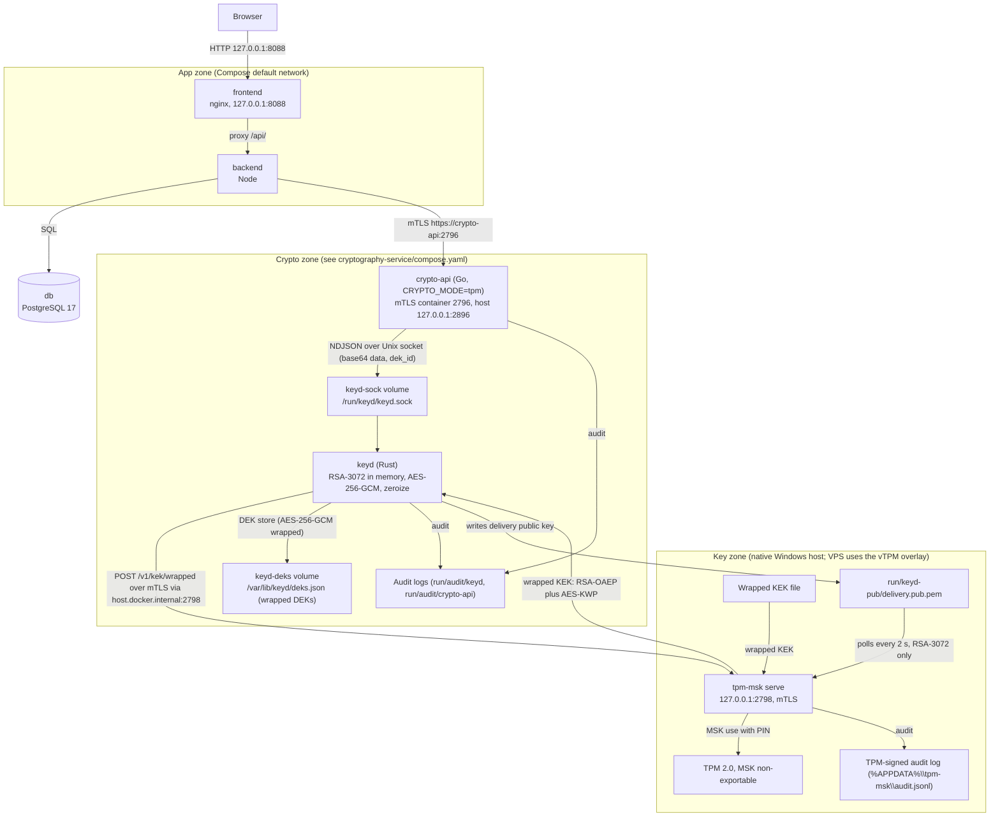

# Arsitektur sistem

Aplikasi berjalan sebagai satu stack Compose dengan tiga zona: aplikasi, data, dan kripto. `tpm-msk` berada di host Windows native atau, pada VPS, di container bersama `swtpm`.

## Zona dan port

| Zona | Container | Port host |
| --- | --- | --- |
| App | `frontend` (nginx), `backend` (Node 24) | `frontend` 127.0.0.1:8088; backend tanpa port host |
| Data | `db` (PostgreSQL 17) | 127.0.0.1:5432 |
| Crypto | `crypto-api` (mTLS), `keyd` | `crypto-api` 127.0.0.1:2896 ke container 2796; keyd tanpa port host |
| Key zone | `tpm-msk serve`, TPM 2.0, MSK | 127.0.0.1:2798 |

Backend hanya bisa dijangkau dari jaringan Compose. Frontend mem-proxy `/api/` ke `backend:3000`. crypto-api memakai mTLS dengan client certificate wajib; CN client yang tidak ada di `APP_IDENTITIES` ditolak 403.

## Deploy VPS

Deployment VPS memuat `cryptography-service/compose.vps.yaml` di atas `compose.yaml`. Overlay itu menjalankan `swtpm` sebagai TPM software dan `tpm-msk` sebagai container; MSK disegel ke state vTPM di volume `swtpm-state`. `keyd` diarahkan ke `tpm-msk:2798` lewat jaringan `crypto-tpm-net`.

## Cara baca dokumen

Frontend meminta `/api/grc`; backend memfilter dokumen berdasarkan level akses, grant, role officer, dan role super admin, lalu mendetokenkan judul yang boleh dibaca. Membuka dokumen membuat sesi viewer berbatas waktu. Saat file diminta, backend memeriksa plafon TLP dan grant, lalu memanggil crypto-api `/unsealfile`; crypto-api meminta dekripsi ke keyd lewat Unix socket, dan keyd mengambil KEK terbungkus dari `tpm-msk` bila DEK belum ada di cache. Kegagalan di zona kunci menghasilkan 503 dan tidak ada byte yang dikirim.

Urutan lengkap, termasuk perilaku per komponen dan kondisi gagal: [alur-baca-dokumen.md](alur-baca-dokumen.md).
