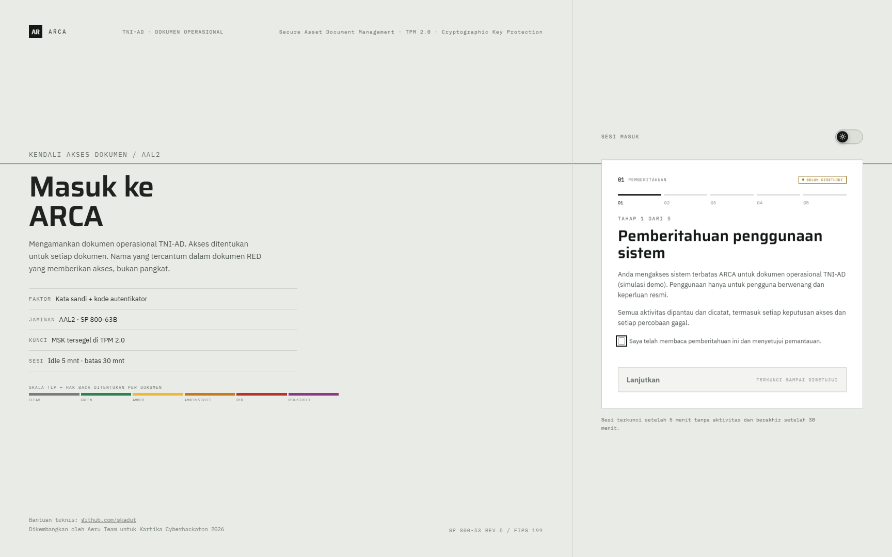
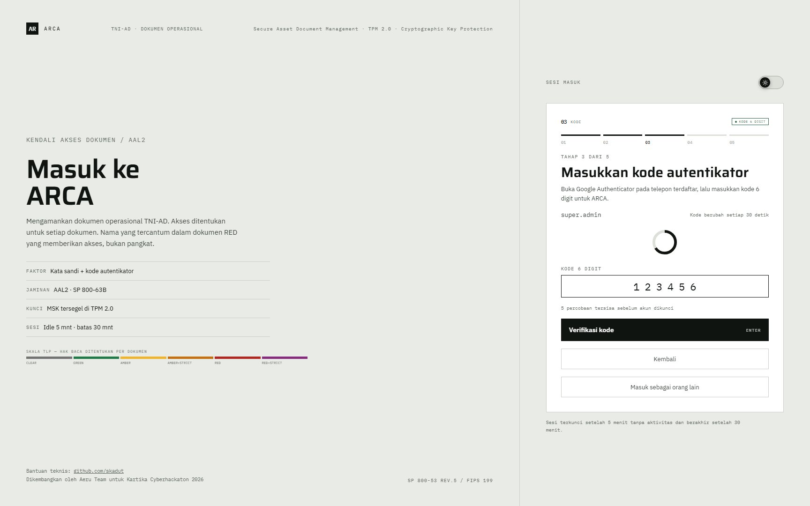
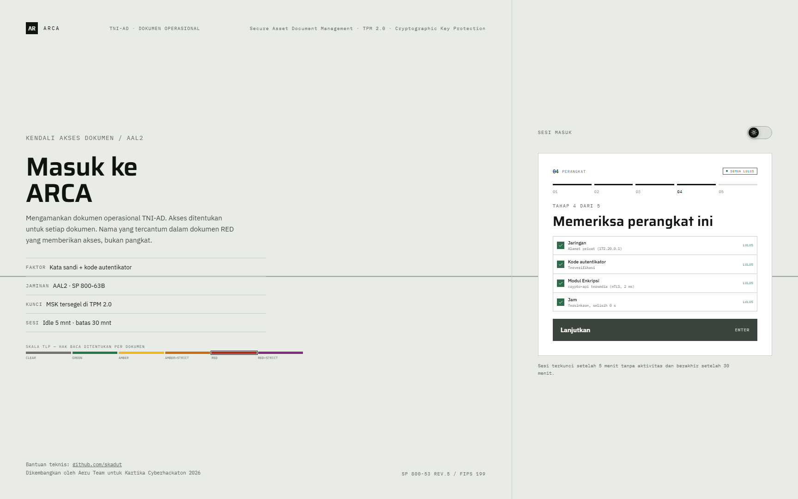

# 01 — Login lima tahap

## Tujuan

Membuktikan login memerlukan kata sandi, kode TOTP 6 digit, dan pemeriksaan perangkat sebelum sesi dibuat.

## Akun

`bagus.hartanto` — level 1, hak paling kecil. Akun ini cukup untuk membuktikan seluruh tahap login tanpa membuka data sensitif.

## Langkah

1. Buka <http://127.0.0.1:8088>. Halaman masuk menampilkan lima tahap: `PEMBERITAHUAN`, `MASUK`, `KODE`, `PERANGKAT`, `KONFIRMASI`.
2. Di tahap 1, tombol `Lanjutkan` nonaktif dan bertanda `TERKUNCI SAMPAI DISETUJUI`. Centang `Saya telah membaca pemberitahuan ini dan menyetujui pemantauan.`; tanda pada tombol berubah menjadi `ENTER`. Klik `Lanjutkan` atau tekan Enter.
3. Di tahap 2, isi `Nama pengguna` `bagus.hartanto` dan `Kata sandi` dari `DEMO_USER_PASSWORD` di `.env`. Di bawah kolom kata sandi tampil `5 percobaan tersisa sebelum akun dikunci` sejak awal; angkanya turun setiap kali gagal. Klik `Lanjutkan`.
4. Di tahap 3, masukkan kode 6 digit dari aplikasi autentikator di kolom `Kode 6 digit`; digit tampil di tengah kolom. Setiap kode berlaku 30 detik; lingkaran hitung mundur di atas kolom menunjukkan sisa waktu kode. Di bawah kolom tampil baris yang sama, `5 percobaan tersisa sebelum akun dikunci`, dengan sisa yang dibawa dari tahap 2. Klik `Verifikasi kode`.
5. Di tahap 4, tunggu baris `Jaringan`, `Kode autentikator`, `Modul Enkripsi`, dan `Jam` selesai. Klik `Lanjutkan`.
6. Di tahap 5, periksa ringkasan sesi: `Sesi 30 menit · idle 5 menit`. Klik `Masuk ke ARCA`, atau `Batal dan keluar` untuk membatalkan.
7. Setelah dashboard terbuka, diamkan 5 menit lalu klik menu apa pun. Aplikasi meminta masuk kembali.

## Hasil yang diharapkan

- Tombol utama setiap tahap menampilkan petunjuk `ENTER`. Di tahap 1, petunjuk itu baru tampil setelah pemberitahuan disetujui.
- Sesi tidak dibuat sebelum kata sandi dan kode 6 digit lolos. Server memvalidasi kode lewat crypto-api `POST /totpvalidate`, bukan di browser.
- Kode yang salah menampilkan sisa percobaan. Lima kegagalan mengunci akun 15 menit. Hitungan ini mencakup kegagalan kata sandi dan kode.
- Pemeriksaan perangkat menampilkan status `LULUS` untuk jaringan, kode autentikator, modul enkripsi, dan jam.
- Sesi berakhir setelah 30 menit sejak dibuat dan terkunci setelah 5 menit tanpa aktivitas. Keduanya diperiksa server pada setiap permintaan.
- Akun yang dikunci menampilkan layar `Akun dikunci` dan waktu aktif kembali.

## Bukti

## Catatan

Jangan mencoba lima kali gagal pada demo langsung. Akun akan terkunci 15 menit dan data demo ikut berubah. Bila perlu menguji lockout, pakai akun sekali pakai, bukan akun yang dipakai skenario lain.
