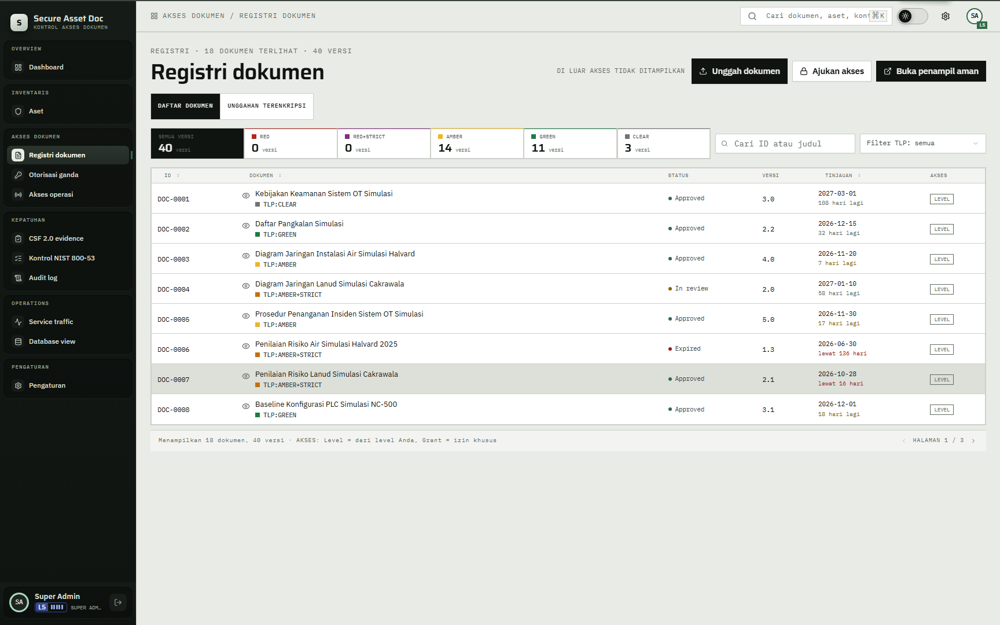
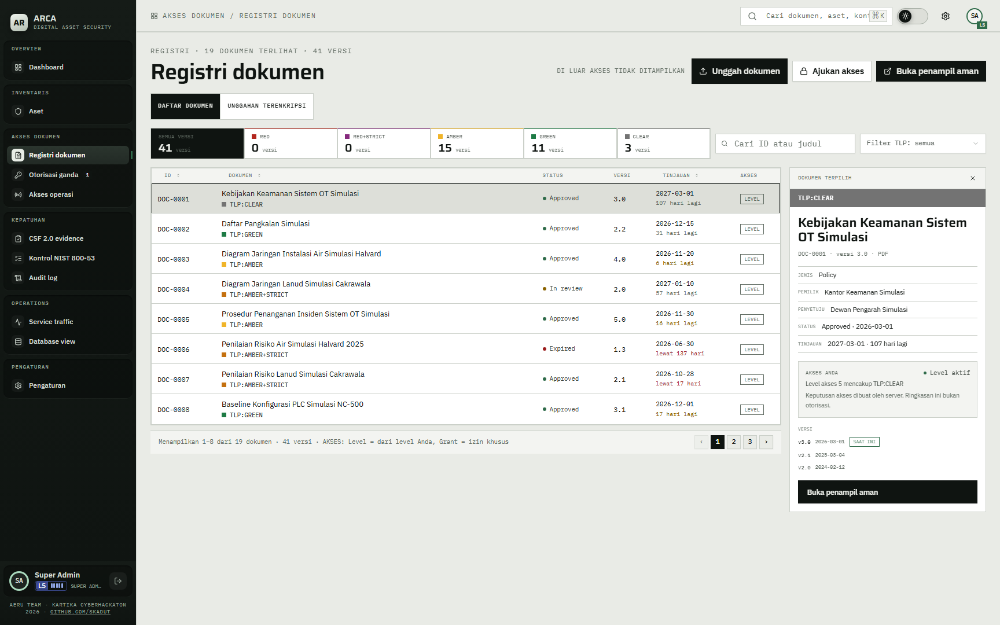
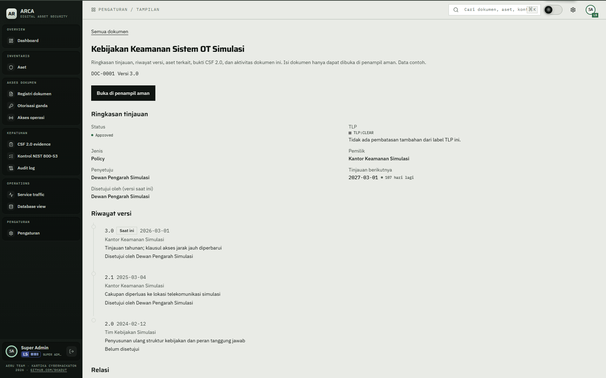

# 02 — Registri dokumen

## Tujuan

Membuktikan registri hanya mengirim dokumen yang boleh dibaca akun, dan tombol unggah mengikuti izin peran.

## Akun

- `bagus.hartanto` — level 1, hanya membaca GREEN, ditambah grant DOC-0017.
- `rizky.firmansyah` — level 3, membaca sampai AMBER+STRICT, ditambah grant DOC-0013.
- `hendra.wiratama` — level 5, membaca sampai RED.

## Langkah

1. Masuk sebagai `bagus.hartanto`, buka `Registri dokumen`.
2. Perhatikan header `Registri · N dokumen terlihat · M versi` dan catatan `Di luar akses tidak ditampilkan`.
3. Cari `DOC-0017`. Baris muncul karena grant, bukan karena level. Klik judul atau bagian lain baris: panel `Dokumen terpilih` terbuka di kanan dan halaman tetap di `/documents`. Panel menulis `Grant aktif` di kotak `AKSES ANDA`. Klik ID `DOC-0017` untuk membuka halaman detail dan lihat badge `Diberikan`.
4. Cari `DOC-0004` (AMBER+STRICT) dan `DOC-0011` (RED+STRICT). Keduanya tidak muncul di daftar.
5. Coba buka `/api/files/DOC-0011/1.4` langsung dari browser atau alat HTTP dengan sesi yang sama. Server membalas 404, bukan 403.
6. Masuk sebagai `rizky.firmansyah`. `DOC-0004` dan `DOC-0006` sekarang terlihat; `DOC-0011` hanya terlihat bila grant aktif.
7. Masuk sebagai `hendra.wiratama`. Dokumen RED terlihat, `DOC-0011` dan `DOC-0013` tetap tidak terlihat karena RED+STRICT tidak terbaca lewat level.
8. Pada akun level 1 (`bagus.hartanto`, Prajurit Satu, Tamtama), tombol `Unggah dokumen` tidak tampil. Izin `document.c` hanya untuk PAMA ke atas. Tab `Unggahan terenkripsi` juga tidak tampil. Masuk sebagai `wahyu.hidayat` (Kapten, PAMA, level 2), lalu tombol `Unggah dokumen` dan tab tersebut tampil. Langkah unggah lengkap ada di [07](../07-unggah-terenkripsi/README.md).
9. Periksa pager di bawah tabel. Halaman berisi 8 dokumen. Teks berbunyi `Menampilkan a–b dari n dokumen · v versi`, misalnya `Menampilkan 1–8 dari 19 dokumen · 41 versi` untuk super admin, lalu tombol halaman dan panah berikutnya.
10. Klik satu baris. Panel `Dokumen terpilih` menampilkan TLP, judul, jenis, pemilik, penyetuju, status, tinjauan, kotak `AKSES ANDA`, daftar versi, dan tombol `Buka penampil aman`. Untuk TLP yang punya batas sesi, tombol itu juga menampilkan batas sesi viewer, misalnya `15:00`. Tombol `×` menutup panel.

## Hasil yang diharapkan

- Dokumen di atas izin tidak dikirim ke browser. Filter berjalan di server sebelum respons `/api/grc`.
- Rute berkas mengembalikan 404 di atas izin, sehingga keberadaan dokumen tidak bocor.
- Grant menambah satu dokumen, bukan menaikkan level. Baris `DOC-0017` tetap bertanda TLP aslinya.
- Kolom `Akses` menulis `Level` untuk akses lewat level dan `Grant` untuk akses lewat grant. Dokumen di atas izin menulis `Tolak` hanya bila barisnya memang terlihat.
- Pencarian dan filter TLP tidak membuka dokumen di luar izin.

## Bukti

## Catatan

Tangkapan layar registri memakai akun super admin, sehingga angka dan barisnya lebih banyak dari yang dilihat level 1. Yang dibuktikan tetap sama: dokumen di luar izin tidak muncul.
