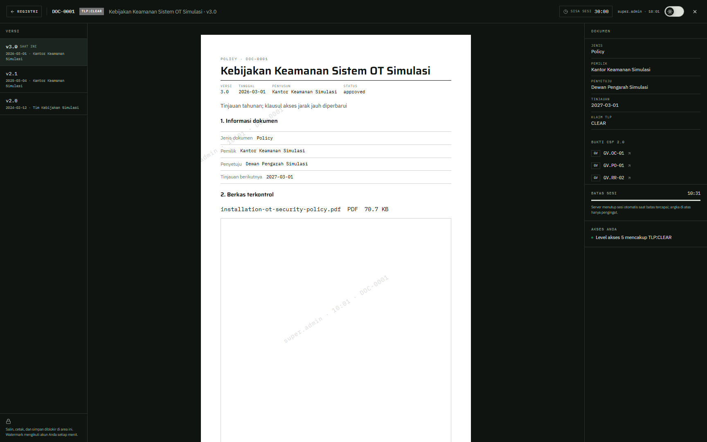

# 03 — Penampil aman

## Tujuan

Membuktikan isi dokumen hanya bisa dibuka lewat sesi viewer berbatas waktu, dengan watermark, dan ditolak di atas izin.

## Akun

- `bagus.hartanto` — level 1, untuk membuka dokumen GREEN dan grant DOC-0017.
- `ratna.sekarsari` — level 5 dengan grant DOC-0011, untuk membuka RED+STRICT.
- `hendra.wiratama` — level 5 tanpa grant DOC-0011, untuk membuktikan level saja tidak cukup.

## Langkah

1. Masuk sebagai `bagus.hartanto`, buka `Registri dokumen`, pilih `DOC-0008` (GREEN), klik `Buka penampil aman`.
2. Perhatikan header viewer: `DOC-0008`, `TLP:GREEN`, judul, dan batas sesi. Dokumen GREEN mendapat 30 menit. Watermark berisi username dan jam buka.
3. Coba `Ctrl+P`, `Ctrl+S`, dan klik kanan. Viewer menahan tindakan itu di antarmuka. Ini penghalang tampilan, bukan kontrol keamanan; server tetap memeriksa setiap permintaan.
4. Buka `/viewer?doc=DOC-0011` sebagai `bagus.hartanto`. Viewer kembali ke pemilih dengan teks `Pilih dokumen yang tersedia untuk akun Anda.`. DOC-0011 tidak ada dalam daftar, jadi ID, judul, dan TLP tidak bocor.
5. Masuk sebagai `hendra.wiratama`, buka `/viewer?doc=DOC-0011` lagi. Hasilnya sama: pemilih tanpa DOC-0011. Lewat alat HTTP, rute berkas membalas 404 karena tidak ada grant, walau level 5.
6. Masuk sebagai `ratna.sekarsari`, buka `DOC-0011`. Viewer terbuka dengan batas 10 menit.
7. Uji sesi viewer lewat alat HTTP: `POST /api/documents/DOC-0011/viewer-sessions` sebagai `bagus.hartanto` membalas 404. Sebagai `ratna.sekarsari` membalas 201 dengan `sessionId`, `expiresAt`, dan `ttlSeconds`.

## Hasil yang diharapkan

- Server membuat sesi viewer dengan batas TLP: RED dan RED+STRICT 10 menit, AMBER dan AMBER+STRICT 15 menit, GREEN dan CLEAR 30 menit.
- Rute berkas memeriksa sesi viewer. Sesi yang tidak ada, milik akun lain, atau sudah kedaluwarsa ditolak 403.
- Membuat sesi viewer untuk dokumen yang tidak boleh dibaca membalas 404, bukan 403.
- Tanpa grant, RED+STRICT tidak terbuka lewat level, termasuk level 5.
- Watermark dan penghalang salin/cetak hanya membantu tampilan. Keputusan akses tetap di server.

## Bukti

## Catatan

Sesi viewer tidak memperpanjang sesi login. Sesi login tetap terkena idle 5 menit dan batas 30 menit.
