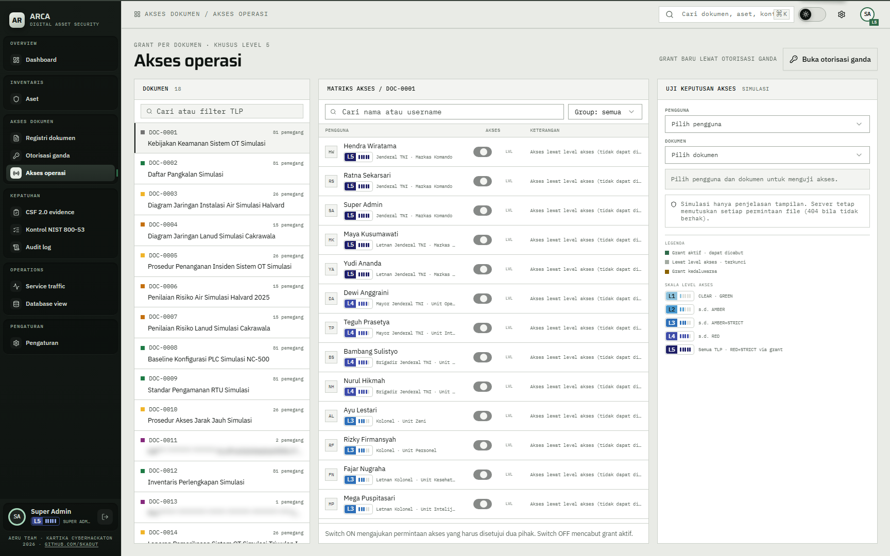

# 04 — Level dan TLP

## Tujuan

Membuktikan level akses menentukan TLP yang bisa dibaca sampai RED, sedangkan RED+STRICT hanya terbuka lewat grant.

## Akun

- `bagus.hartanto` — level 1.
- `wahyu.hidayat` — level 2.
- `rizky.firmansyah` — level 3.
- `teguh.prasetya` — level 4.
- `hendra.wiratama` — level 5.

## Langkah

1. Masuk sebagai `bagus.hartanto`, buka `Registri dokumen`, catat jumlah dokumen dan TLP yang muncul. Level 1 membaca CLEAR dan GREEN.
2. Masuk sebagai `wahyu.hidayat`. Dokumen AMBER sekarang ikut terlihat. Level 2 membaca sampai AMBER.
3. Masuk sebagai `rizky.firmansyah`. Dokumen AMBER+STRICT ikut terlihat. Level 3 membaca sampai AMBER+STRICT.
4. Masuk sebagai `teguh.prasetya`. Dokumen RED ikut terlihat. Level 4 membaca sampai RED.
5. Masuk sebagai `hendra.wiratama`. Jumlah dokumen RED sama dengan level 4. Level 5 tidak menambah TLP; ia menambah hak administratif.
6. Sebagai `hendra.wiratama`, buka `Akses operasi`, pilih `DOC-0011` (RED+STRICT), lalu uji `wahyu.hidayat` dan `hendra.wiratama` di panel `UJI KEPUTUSAN AKSES`. Keduanya `TOLAK`.
7. Uji `ratna.sekarsari` pada `DOC-0011`. Hasilnya `IZINKAN` karena grant aktif, bukan karena level.

## Hasil yang diharapkan

- Aturan kode: level L membaca TLP dengan indeks `<= min(L, 4)`. RED ada di indeks 4, RED+STRICT di indeks 5.
- RED+STRICT tidak pernah terbaca lewat level, termasuk level 5. Hanya grant aktif pada dokumen itu yang membukanya.
- Dokumen di atas izin tidak tampil di registri dan tidak dikirim ke browser.
- Panel uji menampilkan alasan keputusan. Ini penjelasan tampilan; server tetap memutuskan setiap permintaan berkas dan membalas 404 bila tidak berhak.
- Grant tidak mengubah level akun. Grant hanya berlaku untuk dokumen yang tercantum.

## Bukti

## Catatan

`super.admin` adalah pengecualian tampilan: ia menerima baris token tersamar untuk RED+STRICT tanpa grant. Isinya tetap tidak terbuka. Lihat [08 — Token super admin](../08-token-super-admin/README.md).
