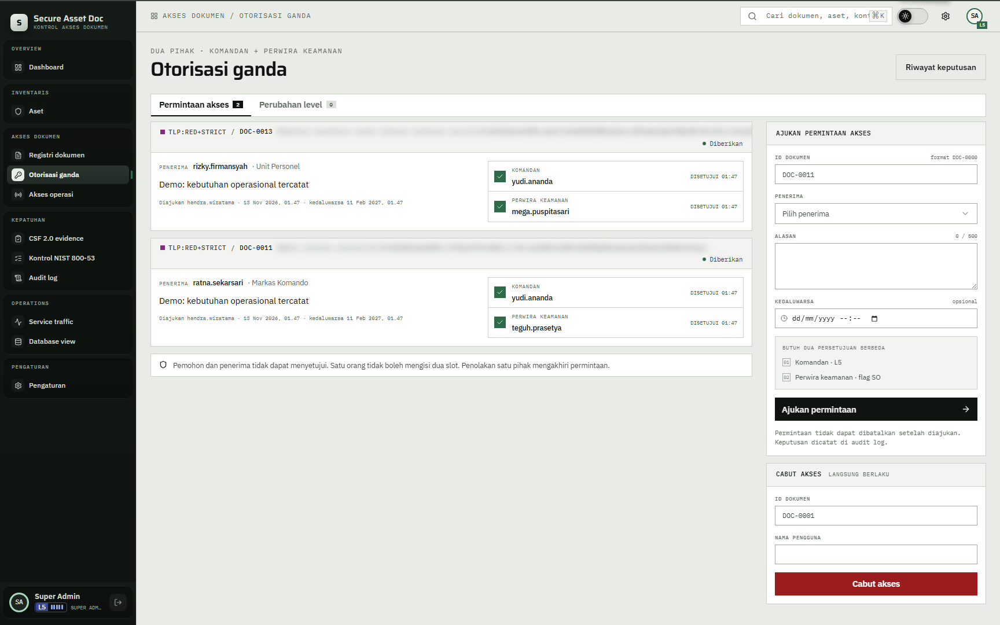
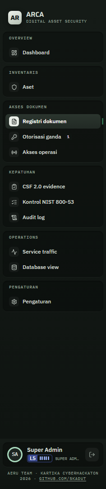

# 05 — Otorisasi ganda

## Tujuan

Membuktikan grant RED+STRICT baru aktif setelah satu komandan level 5 dan satu perwira keamanan menyetujui, dalam urutan bebas.

## Akun

- `hendra.wiratama` — level 5, pengaju permintaan.
- `yudi.ananda` — level 5, menyetujui slot `KOMANDAN`.
- `teguh.prasetya` — perwira keamanan level 4, menyetujui slot `PERWIRA KEAMANAN`.
- `mega.puspitasari` — perwira keamanan alternatif untuk percobaan urutan terbalik.
- `dimas.saputra` — calon penerima. Pilih akun yang belum punya grant pada dokumen uji.

## Langkah

1. Masuk sebagai `hendra.wiratama`, buka `Otorisasi ganda` lewat sidebar `Akses dokumen`.
2. Di panel `AJUKAN PERMINTAAN AKSES`, isi `ID DOKUMEN` `DOC-0011`, pilih `PENERIMA` yang belum punya grant, isi `ALASAN`, lalu klik `Ajukan permintaan`.
3. Kartu permintaan muncul dengan status `Menunggu 0/2`. Dua slot terlihat: `KOMANDAN` dan `PERWIRA KEAMANAN`. Di sidebar, angka di samping `Otorisasi ganda` menghitung dokumen yang punya permintaan tertunda. Angka ini hanya diambil untuk akun level 5 dan perwira keamanan, diperbarui tiap 60 detik, dan hilang bila tidak ada yang tertunda.
4. Masuk sebagai `yudi.ananda`, buka kartu yang sama, klik `Setujui`. Status menjadi `Menunggu 1/2`; grant belum dibuat.
5. Masuk sebagai `teguh.prasetya`, buka kartu, klik `Setujui`. Status menjadi `Diberikan`; grant aktif.
6. Ulangi dengan urutan terbalik pada dokumen atau penerima lain: perwira keamanan lebih dulu, lalu komandan. Hasilnya sama.
7. Coba tolak satu pihak pada permintaan baru. Status menjadi `Ditolak` dan tidak ada grant.
8. Coba setujui sebagai pengaju atau penerima. Tombol tidak tersedia dan server menolak.

## Hasil yang diharapkan

- Satu komandan level 5 dan satu perwira keamanan harus menyetujui. Keduanya harus orang berbeda; urutan bebas.
- Pengaju dan penerima tidak boleh menyetujui. Satu orang tidak boleh mengisi dua slot.
- Setelah persetujuan pertama, status tetap `Menunggu 1/2`. Grant baru dibuat setelah persetujuan kedua.
- Penolakan menutup permintaan dan tidak membuat grant.
- Grant aktif muncul di `Akses operasi` dan membuka dokumen walau level penerima di bawah TLP.
- Audit mencatat `access.request`, `access.approve`, `access.deny`, `grant`, dan `revoke`.

## Bukti

## Catatan

Seed sudah membuat grant DOC-0011 untuk `ratna.sekarsari` dan DOC-0013 untuk `rizky.firmansyah`. Untuk demo baru, pilih penerima lain yang belum punya grant. Jangan mencabut grant seed tanpa alasan; skenario lain memakainya.
