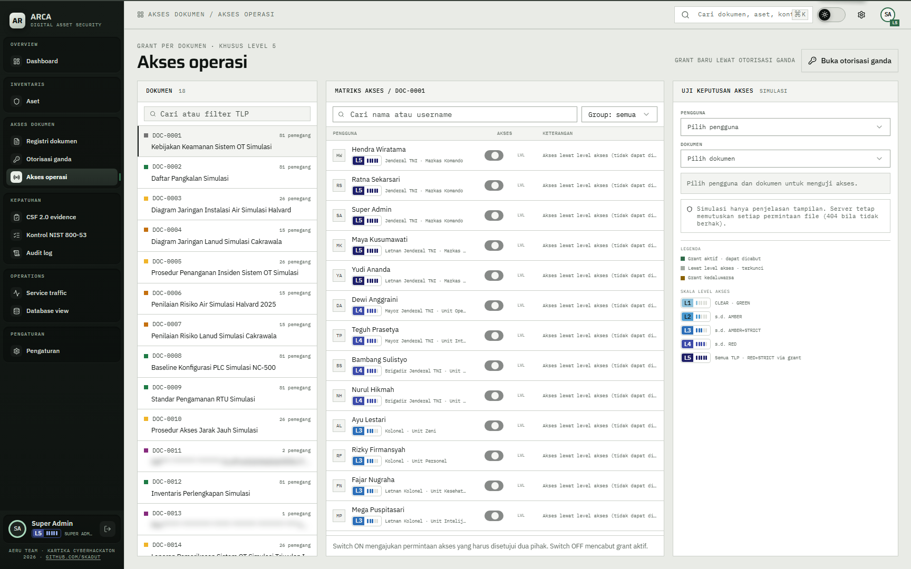

# 06 — Akses operasi

## Tujuan

Membuktikan keputusan akses per dokumen bisa diuji dan panel ini hanya terbuka untuk level 5 atau perwira keamanan.

## Akun

- `hendra.wiratama` — level 5.
- `teguh.prasetya` — perwira keamanan level 4.
- `bagus.hartanto` — level 1 tanpa peran, untuk membuktikan penolakan.

## Langkah

1. Masuk sebagai `hendra.wiratama`, buka `Akses dokumen` > `Akses operasi`.
2. Di panel `Dokumen`, pilih `DOC-0017`. Panel `Matriks akses / DOC-0017` memuat akun per level.
3. Cari `bagus.hartanto`. Barisnya menampilkan `Grant` dan `Akses lewat grant aktif`; switch menyala.
4. Cari `surya.pratama` (level 1 tanpa grant). Barisnya menampilkan `Tolak` dan `Tidak ada akses`.
5. Pilih `DOC-0011` (RED+STRICT). Cari `wahyu.hidayat` dan `hendra.wiratama`. Keduanya `Tolak`; hanya penerima grant yang `IZINKAN`.
6. Di panel `UJI KEPUTUSAN AKSES`, pilih `bagus.hartanto` dan `DOC-0017`. Hasil `IZINKAN`.
7. Ganti pengguna ke `surya.pratama` pada dokumen yang sama. Hasil `TOLAK`.
8. Masuk sebagai `bagus.hartanto`, buka `/operation` langsung. Halaman menampilkan `Tidak diizinkan`, dan sidebar tidak memuat `Akses operasi`.
9. Masuk sebagai `teguh.prasetya`. Panel terbuka karena flag perwira keamanan, walau levelnya 4.

## Hasil yang diharapkan

- Hanya level 5 atau perwira keamanan yang mendapat data pengguna dan grant untuk panel ini.
- Matriks membedakan tiga keadaan: akses lewat level, akses lewat grant aktif, dan tidak ada akses.
- Level hanya berlaku sampai RED. RED+STRICT ditandai `Grant` bila grant aktif; selain itu `Tolak`.
- `Switch ON` mengajukan permintaan akses yang harus disetujui dua pihak. `Switch OFF` mencabut grant aktif dan langsung berlaku.
- Panel uji hanya menjelaskan tampilan. Server tetap memutuskan setiap permintaan berkas; dokumen di atas izin dibalas 404.

## Bukti

## Catatan

Jangan mematikan switch pada grant seed kecuali memang ingin menguji pencabutan. Pencabutan langsung berlaku dan mengubah demo berikutnya.
