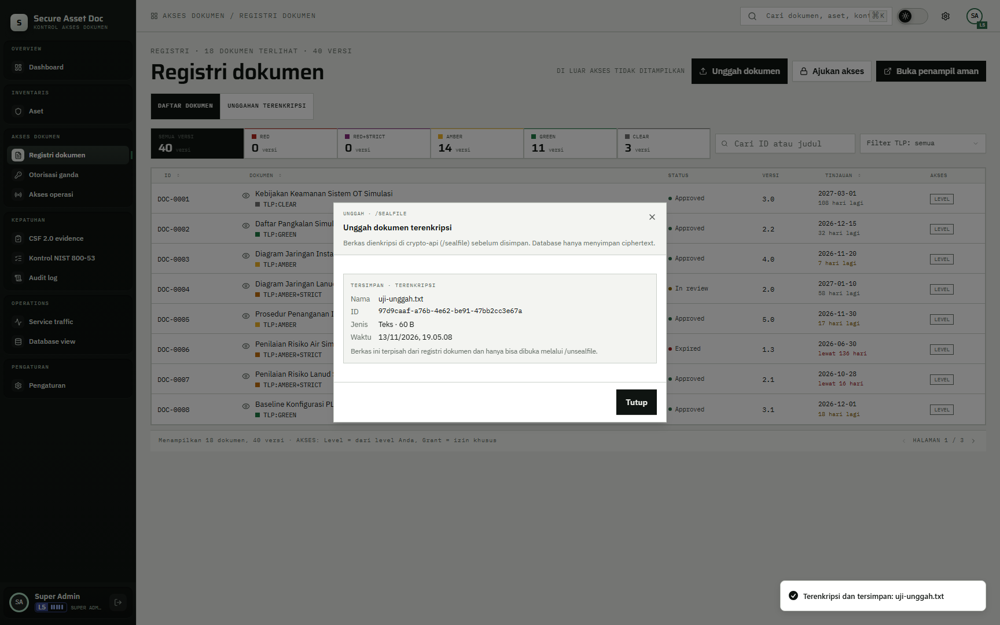
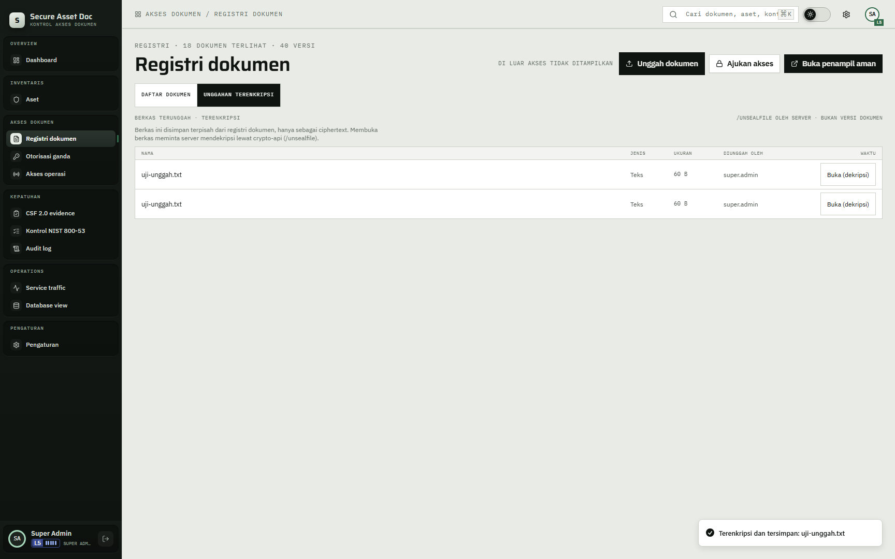

# 07 — Unggah terenkripsi

## Tujuan

Membuktikan berkas disegel sebelum disimpan, database hanya menyimpan ciphertext, dan isi dibuka lewat dekripsi di server.

## Akun

- `bagus.hartanto` — level 1, punya izin unggah tetapi belum boleh membaca daftar unggahan.
- `wahyu.hidayat` — level 2 PAMA, boleh membuka daftar dan isi unggahan.
- `hendra.wiratama` — level 5, untuk membandingkan tampilan.

## Langkah

1. Masuk sebagai `bagus.hartanto`, buka `Registri dokumen`.
2. Klik `Unggah dokumen`. Dialog `Unggah dokumen terenkripsi` terbuka dengan keterangan `Berkas dienkripsi di crypto-api (/sealfile) sebelum disimpan. Database hanya menyimpan ciphertext.`
3. Pilih berkas PDF, PNG, JPG, atau TXT berukuran paling besar 10 MB. Klik unggah.
4. Setelah selesai, dialog menampilkan `Tersimpan · terenkripsi`, nama, ID, jenis, ukuran, dan waktu. Toast berbunyi `Terenkripsi dan tersimpan: <nama>`.
5. Periksa tab `Unggahan terenkripsi`. Sebagai level 1, tab ini tidak tampil karena daftar hanya untuk PAMA ke atas.
6. Masuk sebagai `wahyu.hidayat`, buka `Registri dokumen` > `Unggahan terenkripsi`. Panel `Berkas terunggah · terenkripsi` menampilkan berkas tadi.
7. Klik `Buka (dekripsi)`. Dialog menampilkan `Mendekripsi via server…`, lalu `Berkas didekripsi.` Isi berkas tampil di browser tanpa disimpan sebagai berkas lokal.
8. Di database, periksa tabel `uploaded_files`. Kolom `ciphertext` berisi ciphertext, bukan isi berkas. Nama berkas juga tersegel, bukan teks biasa.
9. Coba unggah tipe lain atau berkas lebih dari 10 MB. Muncul pesan `Jenis berkas tidak didukung. Gunakan PDF, PNG, JPG, atau TXT.` atau `Berkas melebihi 10 MB.`

## Hasil yang diharapkan

- `POST /api/uploads` mengirim data ke crypto-api `/sealfile` dan menyimpan ciphertext. Server tidak menyimpan base64 polos.
- `GET /api/uploads/:id/content` memanggil `/unsealfile`, lalu mengirim isi dengan `Content-Disposition: inline`, `Cache-Control: no-store`, dan CSP sandbox.
- Jenis yang diterima hanya PDF, PNG, JPG, dan TXT. Server juga memeriksa magic bytes, bukan hanya ekstensi.
- Batas berkas 10 MB. Batas badan permintaan lebih besar untuk membawa base64.
- Daftar unggahan hanya untuk PAMA ke atas. Level 1 bisa mengunggah tetapi tidak bisa membaca daftar atau isi lewat API; server membalas 403.
- Berkas unggahan terpisah dari versi dokumen di registri. Tidak ada baris baru di `document_versions`.
- Bila crypto-api mati, unggahan tidak disimpan dan UI menampilkan `Modul enkripsi tidak merespons. Berkas tidak disimpan.`

## Bukti

## Catatan

Jangan mengunggah berkas berisi data pribadi atau operasional nyata. Data demo ini fiktif.
