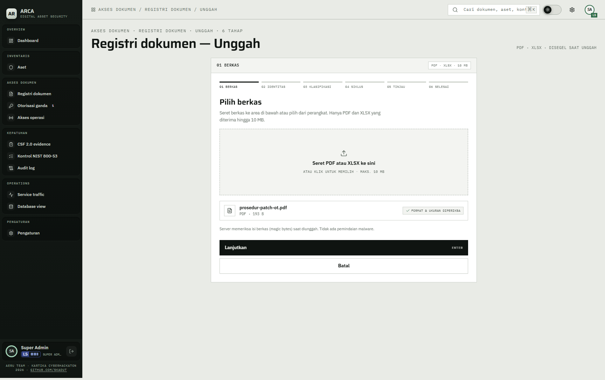
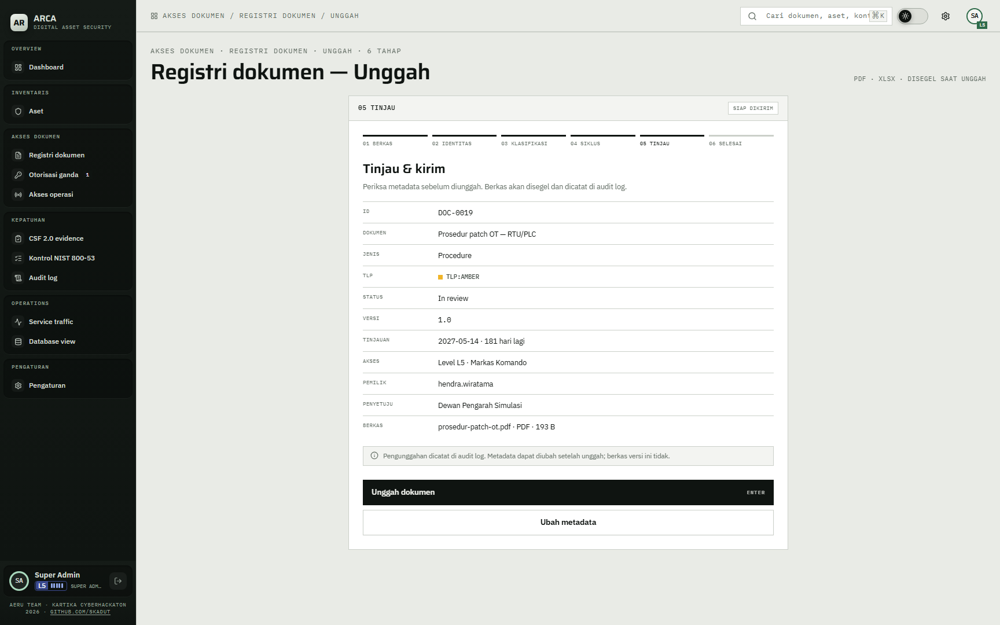
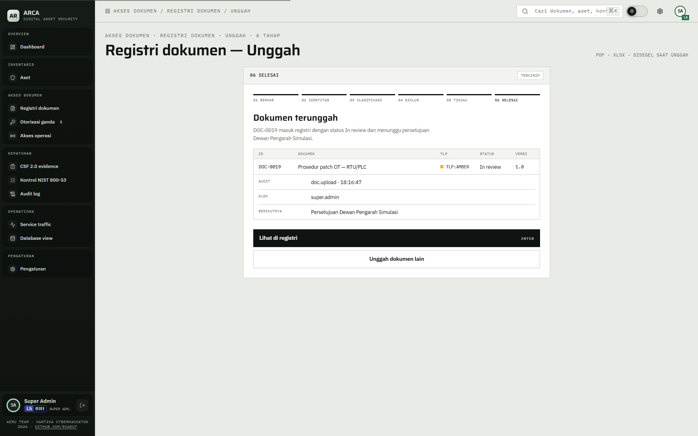
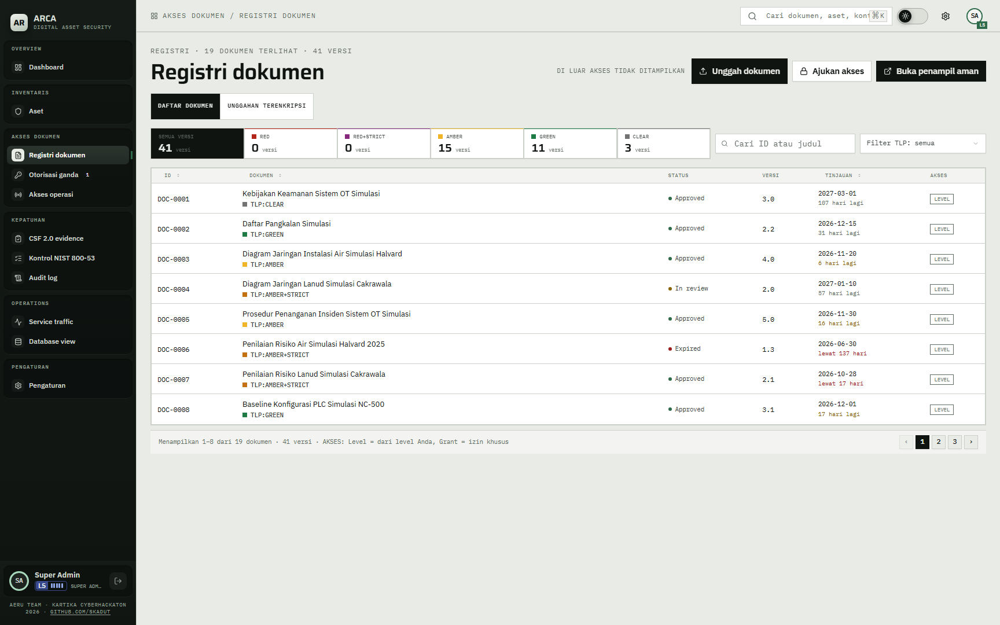

# 07 — Unggah terenkripsi

## Tujuan

Membuktikan dokumen baru disegel sebelum disimpan, hanya PAMA ke atas yang bisa mengunggah, dan isi berkas hanya terbuka lewat dekripsi di server.

## Akun

- `wahyu.hidayat` — Kapten, PAMA, level 2. Boleh membuat dokumen lewat wizard sampai TLP:AMBER dan boleh membuka tab `Unggahan terenkripsi`.
- `bagus.hartanto` — Prajurit Satu, level 1. Tidak punya izin `document.c`. Untuk membuktikan penolakan.

Kata sandi semua akun: `<DEMO_USER_PASSWORD>`.

## Langkah

1. Masuk sebagai `wahyu.hidayat`, buka `Registri dokumen`. Tombol `Unggah dokumen` tampil karena akun punya izin `document.c`.
2. Klik `Unggah dokumen`. Halaman `Registri dokumen — Unggah` terbuka di `/documents/upload?step=1`, dengan catatan `PDF · XLSX · DISEGEL SAAT UNGGAH` di kanan judul. Wizard punya enam tahap: `Berkas`, `Identitas`, `Klasifikasi`, `Siklus`, `Tinjau`, `Selesai`. Tombol utama setiap tahap menampilkan petunjuk `ENTER`.
3. Tahap `01 Berkas`: seret atau pilih berkas PDF atau XLSX, maksimal 10 MB. Berkas kosong, format lain, atau lebih dari 10 MB ditolak sebelum metadata diisi. Berkas yang lolos tampil dengan tanda `FORMAT & UKURAN DIPERIKSA`. Server memeriksa ulang ukuran dan magic bytes saat berkas diunggah. Klik `Lanjutkan`.

   

4. Tahap `02 Identitas`: ID dokumen berikutnya tampil sebagai pratinjau. Isi `Judul dokumen`, pilih `Jenis`, `Pemilik`, dan `Penyetuju`. `Versi` terisi `1.0` dan bisa diubah. Klik `Lanjutkan`.
5. Tahap `03 Klasifikasi`: pilih TLP. `Akses minimum` hanya dibaca dan ditetapkan server dari level akun. Untuk `wahyu.hidayat` (level 2), server menolak TLP di atas AMBER. Batas ini dihitung dari level dan tidak bisa dilewati dari UI. Bila server menolak saat unggah, wizard kembali ke tahap ini dengan pesan `TLP yang dipilih melebihi batas akses akun Anda.` Klik `Lanjutkan`.
6. Tahap `04 Siklus`: pilih `Status awal` (`Draft` atau `In review`), atur `Tinjauan berikutnya` atau pilih `Siklus` dalam bulan, lalu isi `Catatan perubahan` (wajib, maksimal 500 karakter). Klik `Lanjutkan`.
7. Tahap `05 Tinjau`: periksa ID, dokumen, jenis, TLP, status, versi, tinjauan, akses, pemilik, penyetuju, dan berkas. Klik `Unggah dokumen`. Untuk memperbaiki isian, klik `Ubah metadata`.

   

8. Tahap `06 Selesai` menampilkan `Dokumen terunggah` untuk dokumen baru, misalnya `DOC-0019`, dengan status `In review`, versi dari formulir (default `1.0`), audit `doc.upload`, nama pengunggah, dan penyetuju berikutnya.

   

9. Klik `Lihat di registri`. Daftar dokumen tampil dengan tombol `Unggah dokumen` dan tab `Unggahan terenkripsi`. Tangkapan ini diambil sebagai super admin, jadi jumlah barisnya lebih banyak dari yang dilihat `wahyu.hidayat`.

   

10. Di database, periksa versi dokumen baru (dari formulir, default `1.0`):

   ```sql
   SELECT document_id, version, protection FROM document_versions WHERE document_id = 'DOC-0019';
   ```

   Nilai `protection` harus `encrypted`. Kolom isi berisi ciphertext, bukan base64 polos. Untuk TLP selain CLEAR, judul dan nama berkas ditokenisasi dan ringkasan disegel.

11. Masuk sebagai `bagus.hartanto`. Tombol `Unggah dokumen` tidak tampil. Membuka `/documents/upload` langsung menampilkan `Tidak diizinkan mengunggah`. Jika `POST /api/documents` dikirim dari sesi ini, server membalas 403.
12. Masuk sebagai `wahyu.hidayat`, buka `Registri dokumen` > `Unggahan terenkripsi`, lalu lanjut ke bagian berikut.

## Tab `Unggahan terenkripsi` (unggahan lama)

Tab ini tampil untuk PAMA ke atas (`can.upload.r`). Isinya hanya berkas dari alur lama `/api/uploads` (tabel `uploaded_files`). Komponen dialog unggah lama tidak ada lagi di `frontend/src/features/documents/`; panel tab hanya menampilkan daftar berkas dan tombol `Buka (dekripsi)`.

1. Panel `Berkas terunggah · terenkripsi` menampilkan daftar berkas lama beserta jenis, ukuran, pengunggah, dan waktu.
2. Klik `Buka (dekripsi)`. Server memanggil `/unsealfile`, lalu isi tampil di browser tanpa disimpan sebagai berkas lokal.
3. Akun level 1 tidak melihat tab ini. `GET /api/uploads` dari akun itu membalas 403. Route `POST /api/uploads` masih terdaftar di `backend/server.mjs` untuk alur lama. Fungsi `uploadFile` masih ada di `uploads-api.ts`, tetapi tidak dipanggil dari UI.

   

## Hasil yang diharapkan

- `POST /api/documents` memakai `authorize('document.c')` dan batas TLP dari level. Akun di bawah PAMA membalas 403.
- Berkas disegel lewat crypto-api `/sealfile` dan diberi tag HMAC. Disimpan dengan `protection='encrypted'`. Server tidak menyimpan base64 polos.
- Unggah membuat baris baru di `documents` dan `document_versions` dengan versi dari formulir (default `1.0`). Audit action `doc.upload`. Respons 201.
- Jika crypto-api mengembalikan 503, server membalas 503 dan tidak ada baris baru yang dibuat.
- `GET /api/uploads/:id/content` untuk unggahan lama memanggil `/unsealfile`, lalu mengirim isi dengan `Content-Disposition: inline`, `Cache-Control: no-store`, dan CSP sandbox.
- Unggahan lama di `uploaded_files` tidak membuat versi dokumen. Berkas itu terpisah dari registri.

## Bukti

Lihat tangkapan layar di langkah 3, 7, 8, dan 9, serta di bagian tab lama.

## Catatan

Jangan mengunggah berkas berisi data pribadi atau operasional nyata. Data demo ini fiktif. Dokumen yang dibuat saat demo menjadi data demo yang tersimpan.
