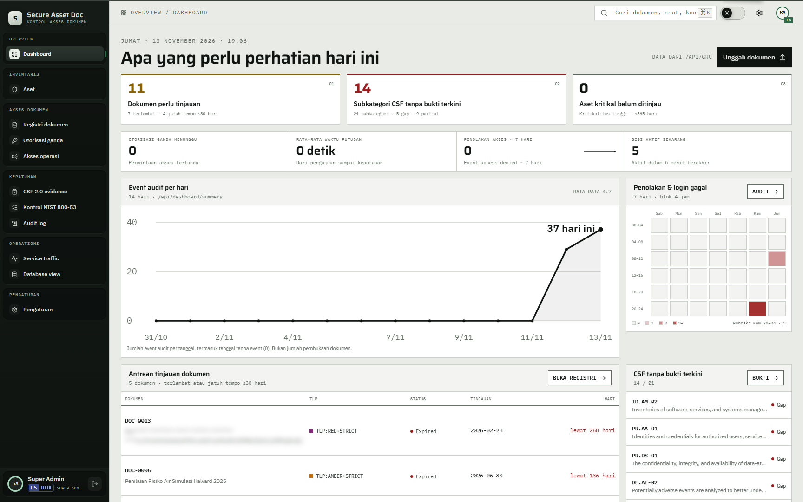
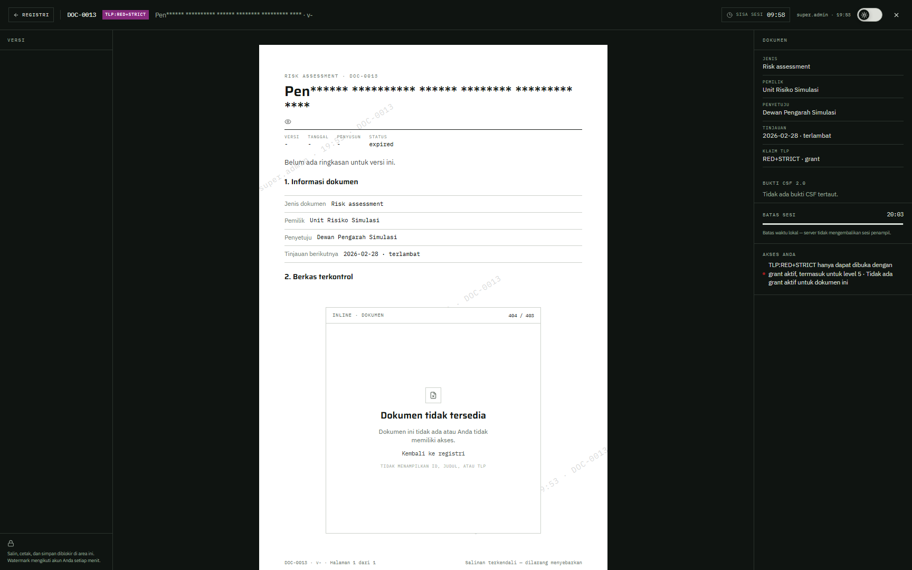

# 08 — Token super admin

## Tujuan

Membuktikan super admin hanya melihat baris token tersamar untuk RED+STRICT tanpa grant, tanpa isi dan tanpa versi.

## Akun

- `super.admin` — level 5 dengan flag super admin.
- `hendra.wiratama` — level 5 tanpa flag super admin, sebagai pembanding.
- `ratna.sekarsari` — penerima grant DOC-0011, sebagai pembanding baris lengkap.

## Langkah

1. Masuk sebagai `super.admin`, buka `Registri dokumen`.
2. Cari `DOC-0011` dan `DOC-0013`. Keduanya muncul sebagai baris dengan TLP RED+STRICT.
3. Perhatikan judulnya: hanya awalan tersamar yang tampil, bukan judul asli. Status menampilkan label `Terkunci`.
4. Klik ikon mata di samping judul. Tampilan berganti ke token mentah; klik lagi untuk menyembunyikan.
5. Buka detail `DOC-0011`. Judul tetap tersamar, riwayat versi kosong, dan tombol `Buka di penampil aman` tetap ada.
6. Klik `Buka di penampil aman` untuk `DOC-0011`. Viewer menampilkan `Dokumen tidak tersedia` secara inline di bagian isi. Kartu error tidak menampilkan ID, judul, atau TLP.
7. Lewat alat HTTP, `POST /api/documents/DOC-0011/viewer-sessions` sebagai `super.admin` membalas 404, dan `GET /api/files/DOC-0011/1.4` membalas 404. Flag super admin tidak membuka isi.
8. Masuk sebagai `hendra.wiratama`. `DOC-0011` dan `DOC-0013` tidak muncul sama sekali; level 5 tanpa flag tidak mendapat baris token.
9. Masuk sebagai `ratna.sekarsari`. `DOC-0011` muncul lengkap dengan judul asli dan riwayat versi karena grant aktif.

## Hasil yang diharapkan

- Dokumen di luar izin tetap tidak dikirim ke pengguna biasa, termasuk level 5.
- Super admin mendapat stub: ID, TLP, status, pemilik, penyetuju, dan tanggal tinjauan. Judul berupa token tersegel; versi kosong; `tokenOnly` benar.
- Judul asli tidak pernah dikirim untuk stub. Ikon mata hanya membuka token mentah yang tersimpan, bukan plaintext judul.
- Viewer dan rute berkas tetap memakai aturan grant. Tanpa grant, hasilnya 404.
- Grant DOC-0011 untuk `ratna.sekarsari` dan DOC-0013 untuk `rizky.firmansyah` membuat baris lengkap hanya untuk dua akun itu.

## Bukti

Tangkapan layar untuk keadaan ikon mata terbuka belum ada; perlu tangkapan baru tanpa menyalin token ke dokumen.

## Catatan

Jangan menyalin token mentah ke laporan, tiket, atau tangkapan layar. Token itu hanya bukti tampilan; isinya tetap tidak bisa dibuka tanpa grant.
