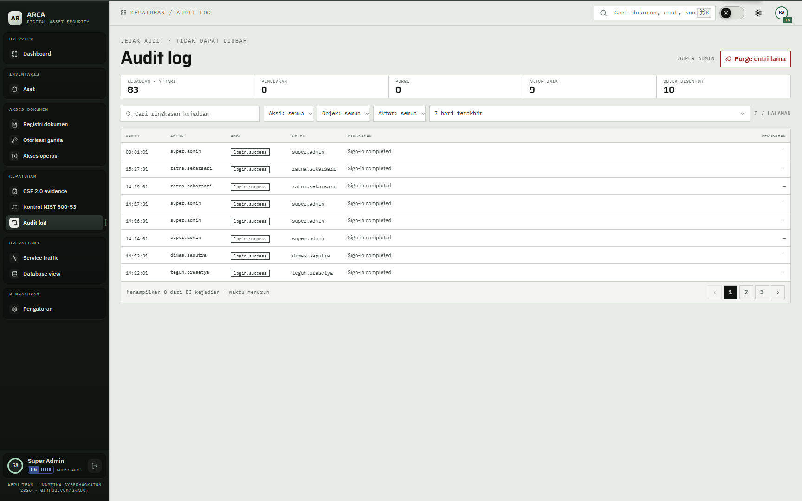

# 09 — Audit log

## Tujuan

Membuktikan jejak audit hanya bisa ditambah, bisa difilter, dan purge hanya tersedia untuk PATI.

## Akun

- `teguh.prasetya` — perwira keamanan, melihat audit log.
- `hendra.wiratama` — PATI level 5, punya tombol purge.
- `super.admin` — alternatif untuk melihat log.

## Langkah

1. Masuk sebagai `teguh.prasetya`, buka `Kepatuhan` > `Audit log`.
2. Periksa header `JEJAK AUDIT · TIDAK DAPAT DIUBAH`, ringkasan 7 hari, dan pager `8 / HALAMAN`.
3. Filter `Aksi`, `Objek`, dan `Aktor`. Cari kejadian login, perubahan dokumen, dan keputusan akses.
4. Buka satu baris untuk melihat ringkasan dan `PERUBAHAN`. Periksa bahwa isinya metadata perubahan, bukan isi dokumen.
5. Jalankan aksi yang tercatat: login gagal terkontrol, ajukan akses, setujui akses. Muat ulang audit dan temukan `login.password.fail`, `access.request`, dan `access.approve`.
6. Masuk sebagai `hendra.wiratama`, buka `/audit-log` langsung. Tombol `Purge entri lama` muncul.
7. Klik tombol itu. Dialog meminta tanggal dan frasa `PURGE AUDIT BEFORE <tanggal>`. Lihat pratinjau jumlah baris dan tanggal tertua. Jangan klik konfirmasi pada demo langsung.
8. Dari terminal database, coba `UPDATE audit_events SET summary = 'x' WHERE id = (SELECT max(id) FROM audit_events);`. Database menolak dengan `permission denied` atau pesan `audit_events is append-only`, tergantung peran yang dipakai.

## Hasil yang diharapkan

- Tabel audit menampilkan 8 baris per halaman. Filter dan pencarian berjalan di tampilan.
- `audit_events` menolak `UPDATE`, `DELETE`, dan `TRUNCATE` lewat trigger. Aplikasi hanya menambah baris lewat fungsi audit.
- Setiap keputusan penting tercatat: login, permintaan akses, persetujuan, penolakan, grant, pencabutan, perubahan level, dan derive.
- Purge menghapus baris lebih lama dari tanggal potong, tetapi kejadian purge itu sendiri tetap dicatat.
- Tombol purge hanya muncul untuk akun dengan izin `audit.purge`, yaitu PATI dan super admin. Perwira keamanan bisa melihat log tanpa tombol purge.

## Bukti

## Catatan

Purge bersifat permanen. Jangan menjalankannya pada demo langsung. Cukup buktikan pratinjau dan frasa konfirmasi.
