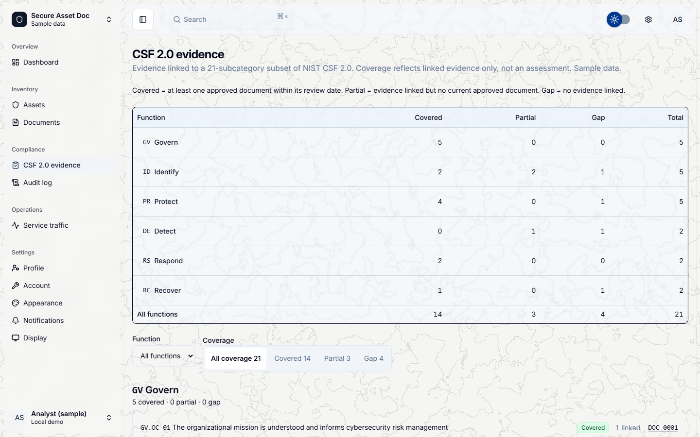
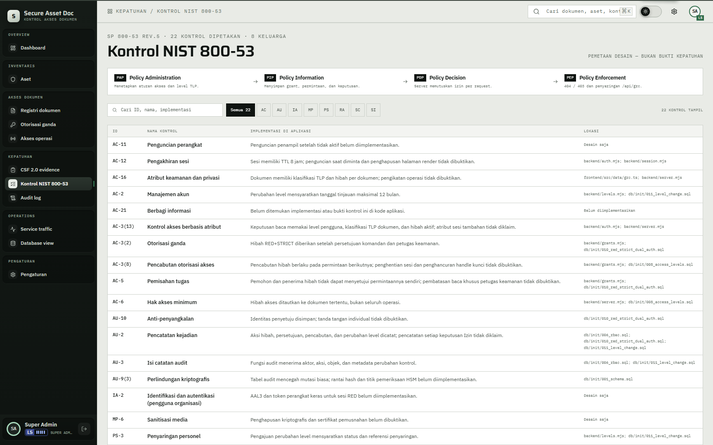

# 10 — CSF dan NIST

## Tujuan

Membuktikan bukti CSF 2.0 dan pemetaan kontrol NIST 800-53 hanya menampilkan aset dan dokumen yang boleh dilihat akun.

## Akun

- `super.admin` — melihat seluruh tampilan.
- `teguh.prasetya` — perwira keamanan, melihat kontrol NIST.
- `bagus.hartanto` — level 1, pembanding untuk tautan bukti yang tersembunyi.

## Langkah

1. Masuk sebagai `super.admin`, buka `Kepatuhan` > `CSF 2.0 evidence`.
2. Periksa header `CSF 2.0 · 21 SUBKATEGORI · 6 FUNGSI` dan catatan `COVERAGE DARI BUKTI TERTAUT, BUKAN PENILAIAN`.
3. Ganti filter `Coverage` ke `Gap`, `Partial`, lalu `Covered`. Jumlah baris berubah sesuai bukti yang tertaut.
4. Buka `ID.AM-01`. Periksa aset dan dokumen terkait. Kode `AST-*` dan lokasi fiktif.
5. Buka `Kepatuhan` > `Kontrol NIST 800-53`. Periksa header `SP 800-53 REV.5 · 22 KONTROL DIPETAKAN · 8 KELUARGA`.
6. Buka `AC-3(2)` (`Otorisasi ganda`). Baca implementasi dan lokasi kode: `backend/grants.mjs`, `db/init/010_red_strict_dual_auth.sql`.
7. Cari kontrol lain lewat kolom pencarian dan chip keluarga `AC`, `AU`, `IA`, `MP`, `PS`, `RA`, `SC`, `SI`.
8. Masuk sebagai `bagus.hartanto`, buka `/evidence`. Bukti yang menunjuk dokumen di luar izin tidak ikut dihitung atau ditautkan.

## Hasil yang diharapkan

- CSF 2.0 menampilkan 21 subkategori dalam 6 fungsi: GV, ID, PR, DE, RS, RC.
- NIST 800-53 menampilkan 22 kontrol dalam 8 keluarga. Halaman menyebut `PEMETAAN DESAIN — BUKAN BUKTI KEPATUHAN`.
- Bukti dan tautan mengikuti filter akses. Dokumen di luar izin tidak muncul sebagai tautan, dan subkategori yang hanya punya bukti tersembunyi tidak dihitung.
- Halaman ini memetakan desain kontrol ke kode. Ia bukan sertifikasi dan bukan penilaian kepatuhan.

## Bukti

## Catatan

Angka 21 subkategori dan 22 kontrol berasal dari data seed. Jangan menambah klaim sertifikasi.
