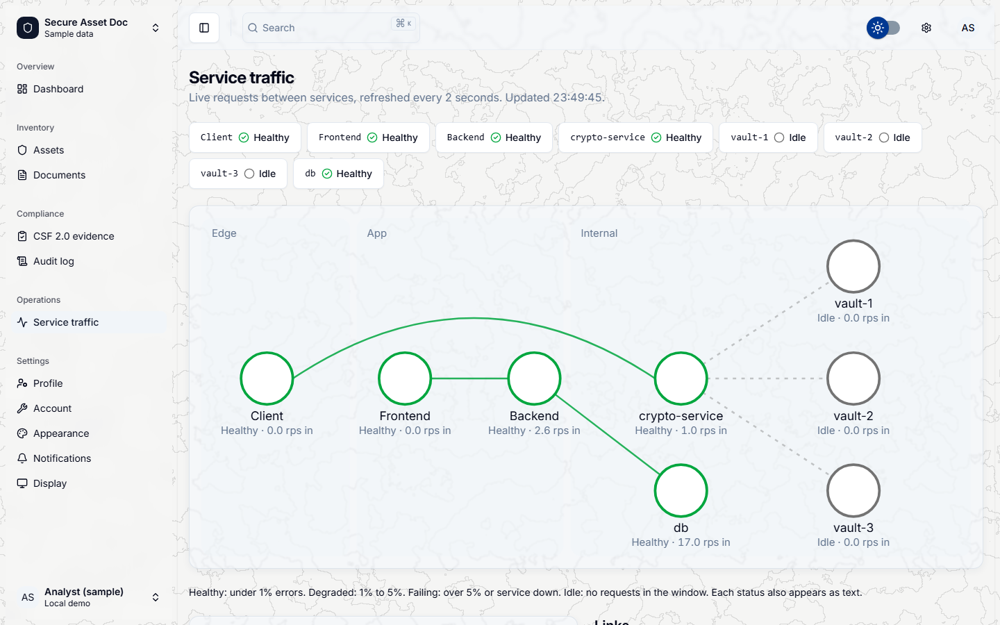
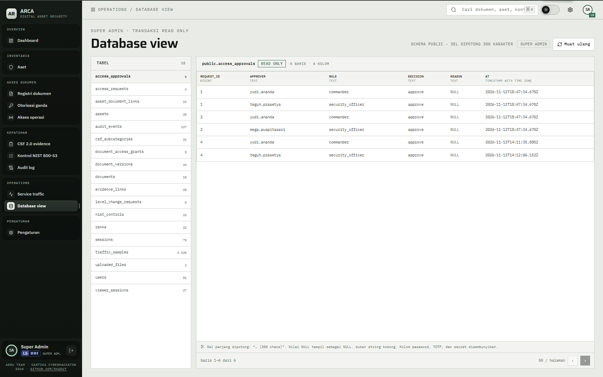

# 11 — Traffic dan database

## Tujuan

Membuktikan tampilan traffic dan database hanya untuk super admin, dan database view bersifat baca saja.

## Akun

- `super.admin` — satu-satunya akun dengan akses.
- `hendra.wiratama` — level 5 tanpa flag, untuk membuktikan penolakan.

## Langkah

1. Masuk sebagai `super.admin`, buka `Operations` > `Service traffic`.
2. Periksa header `SUPER ADMIN · POLLING 2 DETIK`, jendela 10 detik, dan lima node: `client`, `frontend`, `backend`, `crypto-service`, `db`.
3. Lihat tabel `TOPOLOGI & EDGE`, daftar `PANGGILAN CRYPTO-API`, dan grafik permintaan per detik serta tingkat error.
4. Buka `Operations` > `Database view`. Periksa label `SUPER ADMIN · TRANSAKSI READ ONLY` dan daftar 18 tabel.
5. Pilih `uploaded_files`. Periksa kolom `ciphertext`: isinya ciphertext, bukan isi berkas. Pilih `users`; kolom kata sandi, TOTP, dan secret ditampilkan `[DISEMBUNYIKAN]`.
6. Pindah halaman tabel. Batas 50 baris per halaman. Sel panjang dipotong pada 300 karakter.
7. Masuk sebagai `hendra.wiratama`. Sidebar tidak memuat `Service traffic` atau `Database view`.
8. Buka `/traffic` dan `/database` langsung. Halaman menampilkan `Hanya super admin`, bukan data.
9. Lewat alat HTTP, `GET /api/traffic` sebagai `hendra.wiratama` membalas 403.

## Hasil yang diharapkan

- Server menolak `/api/traffic`, daftar tabel, dan isi tabel bila flag super admin tidak ada. Menyembunyikan menu saja tidak cukup.
- Traffic memakai snapshot 10 detik dan polling 2 detik. Angka berasal dari sampel layanan, bukan klaim operasional.
- Database view hanya mengirim `SELECT`. Tidak ada jalur tulis dari tampilan.
- Kolom dengan nama yang mengandung kata sandi, TOTP, secret, atau hash sesi disamarkan di server. Ciphertext dan integrity tag tetap terlihat karena tujuannya memperlihatkan data saat disimpan.
- Sel dipotong 300 karakter. Halaman tabel dibatasi 50 baris.

## Bukti

## Catatan

Traffic dan database view memperlihatkan data teknis. Jangan menampilkan token, hash, atau ciphertext penuh di laporan.
