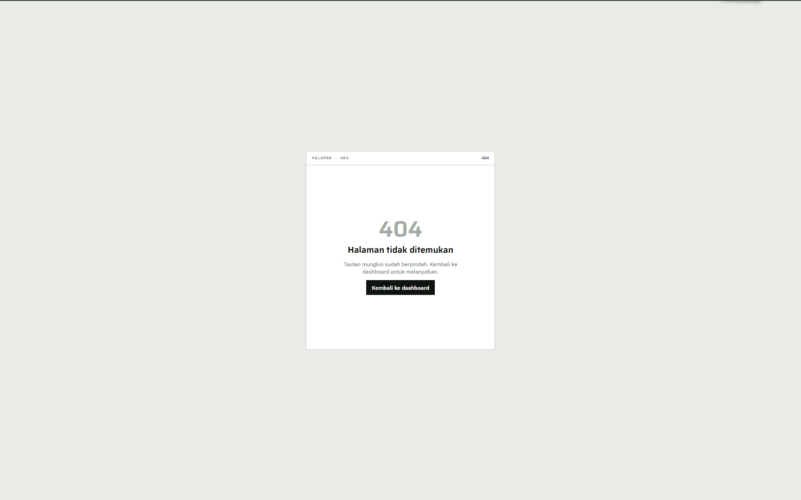
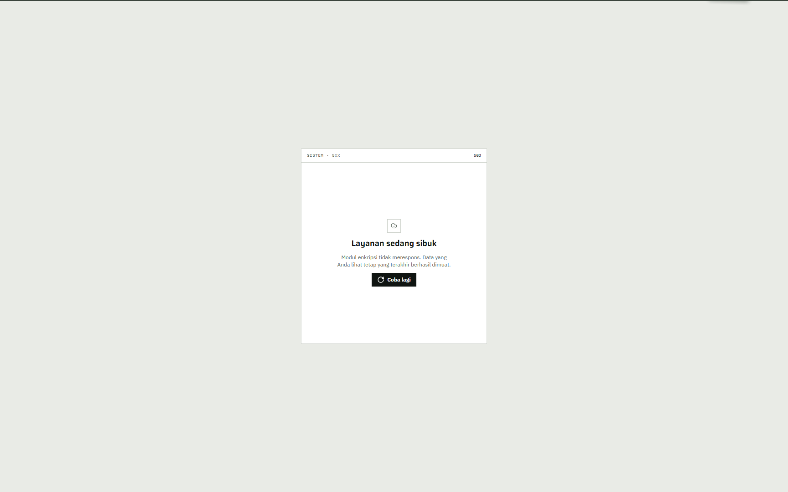
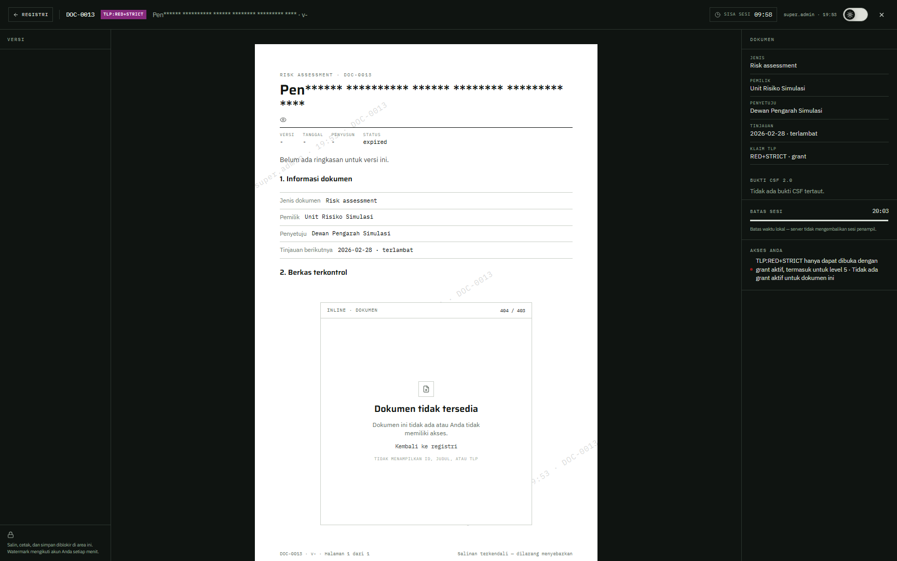

# 12 — Keadaan error

## Tujuan

Membuktikan setiap keadaan error tampil jelas dan tidak membocorkan keberadaan dokumen di atas izin.

## Akun

- `bagus.hartanto` — level 1, untuk dokumen di luar izin dan filter kosong.
- `hendra.wiratama` — level 5, untuk 403 dan sesi.
- `super.admin` — pembanding tampilan.
- Akun sekali pakai — untuk menguji lockout tanpa mengunci akun demo.

## Langkah

1. **404 halaman:** buka `/tidak-ada` atau `/404`. Muncul `Halaman tidak ditemukan` dengan tombol `Kembali ke dashboard`.
2. **403 mode gelap:** masuk sebagai `hendra.wiratama`, buka `/403` atau `/errors/forbidden`. Muncul `Fitur ini di luar peran Anda` dengan latar gelap.
3. **Dokumen di luar izin:** sebagai `bagus.hartanto` (tanpa level atau grant), buka `/viewer?doc=DOC-0011`. Tidak muncul kartu `Dokumen tidak tersedia`. Penampil kembali ke pilihan dengan teks `Pilih dokumen yang tersedia untuk akun Anda.`, dan DOC-0011 tidak ada dalam daftar.
4. **Kartu inline di penampil super admin:** masuk sebagai `super.admin`, buka `/viewer?doc=DOC-0013` (tanpa grant). Di bagian `2. Berkas terkontrol` muncul kartu inline `Dokumen tidak tersedia` dengan keterangan `Dokumen ini tidak ada atau Anda tidak memiliki akses.` dan footer `TIDAK MENAMPILKAN ID, JUDUL, ATAU TLP`.
5. **Sesi berakhir:** diamkan 5 menit lalu klik menu. Muncul `Sesi berakhir` dan tombol `Masuk kembali`.
6. **Memuat:** muat ulang `Registri dokumen` atau `Audit log`. Skeleton bar dengan label `Memuat tabel` tampil sebelum data.
7. **Filter kosong:** di `Registri dokumen`, isi pencarian dengan teks yang tidak ada. Muncul `Tidak ada yang cocok` dan tombol `Reset filter`.
8. **Akun terkunci:** pada akun sekali pakai, salahkan kata sandi lima kali. Muncul `Akun dikunci`, batas 15 menit, dan waktu aktif kembali.
9. **503:** hentikan crypto-service sementara, lalu buka halaman yang butuh enkripsi. Muncul `Layanan sedang sibuk` dengan tombol `Coba lagi`. Nyalakan lagi layanan setelah uji.

## Hasil yang diharapkan

- Dokumen di atas izin dibalas 404, bukan 403, sehingga keberadaan dokumen tidak bocor.
- Kartu `Dokumen tidak tersedia` tidak memuat ID, judul, atau TLP. Pesan yang sama dipakai untuk dokumen yang tidak ada dan dokumen yang tidak boleh dibaca.
- Sesi yang idle lebih dari 5 menit ditolak server, bukan hanya di browser. Batas keras sesi 30 menit.
- Lockout berlaku setelah 5 kegagalan dan bertahan 15 menit. Setiap kegagalan dicatat di audit.
- 503 muncul saat modul enkripsi tidak merespons. Data terakhir yang berhasil dimuat tetap terlihat.
- Filter kosong menyediakan `Reset filter`; skeleton muncul saat data dimuat, bukan layar kosong.

## Bukti

Tangkapan layar untuk sesi berakhir, skeleton, filter kosong, dan akun terkunci belum ada; perlu tangkapan baru.

## Catatan

Jangan memicu lockout pada akun yang dipakai skenario lain. Jangan membiarkan crypto-service mati saat demo berlangsung.
