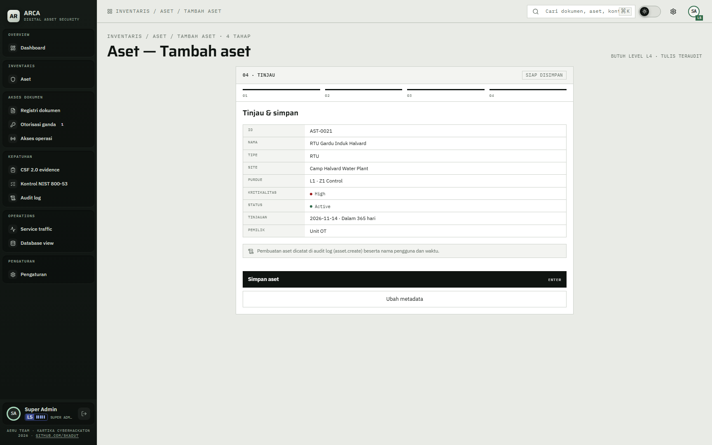
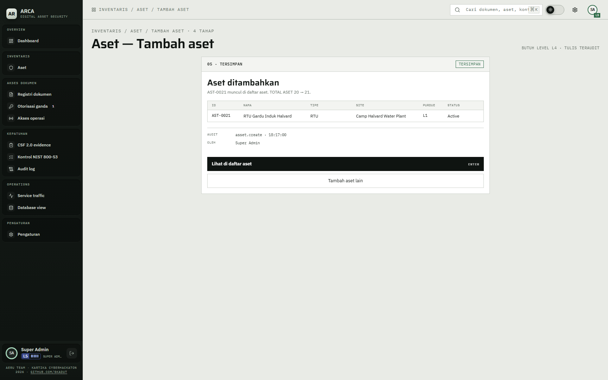
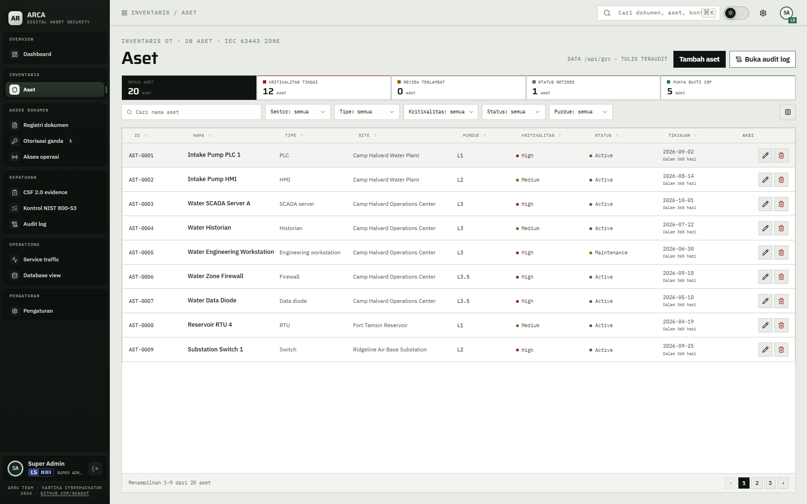
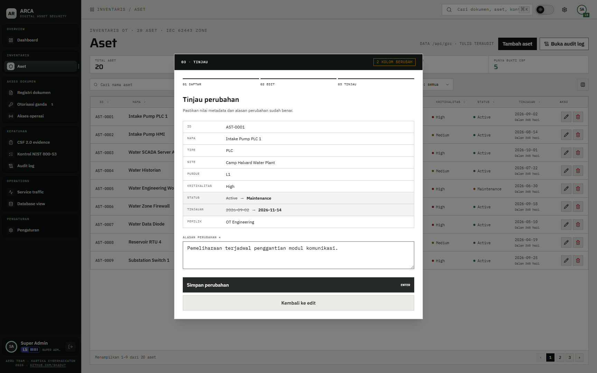
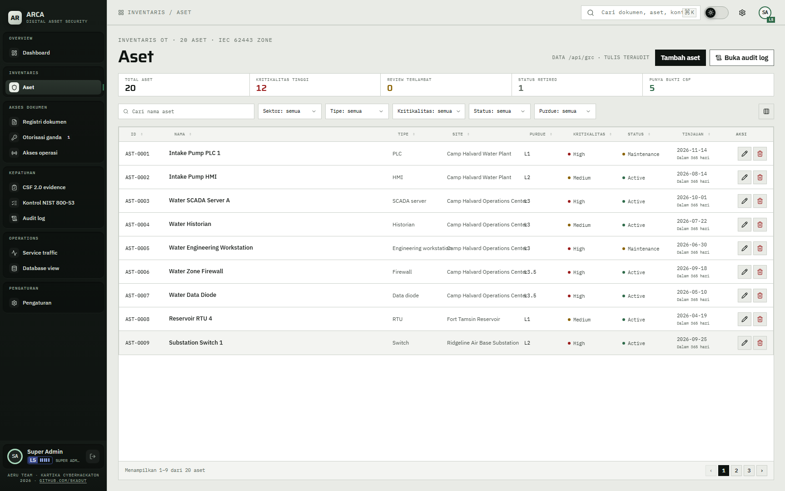
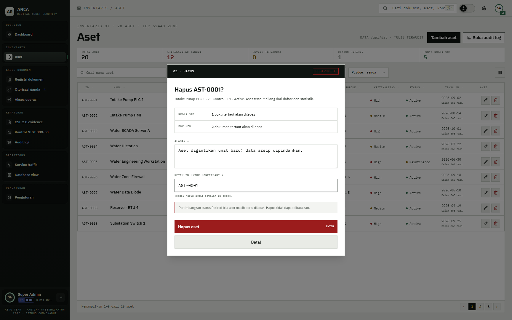

# 13 — Kelola aset

## Tujuan

Membuktikan aset bisa dibuat, diubah, dan dihapus lewat UI, setiap tulisan tercatat di audit log, dan zona Purdue dihitung dari level, bukan diisi manual.

## Akun

- `hendra.wiratama` — Jenderal TNI, PATI, level 5. Punya `asset.c`, `asset.u`, dan `asset.d`.
- `bagus.hartanto` — Prajurit Satu, level 1. Tidak punya izin tulis aset. Untuk membuktikan penolakan.

Kata sandi semua akun: `<DEMO_USER_PASSWORD>`.

## Langkah

1. Masuk sebagai `hendra.wiratama`, buka `Aset`. Tombol `Tambah aset` tampil karena akun PATI punya `asset.c`; backend juga mensyaratkan level 4 ke atas.
2. Klik `Tambah aset`. Form `Aset — Tambah aset` terbuka di `/assets/new` dengan empat tahap input: `01 · IDENTITAS`, `02 · LOKASI & ZONA`, `03 · RISIKO & SIKLUS`, dan `04 · TINJAU`. Setelah aset disimpan, layar hasil `05 · TERSIMPAN` tampil terpisah. Tahap `IDENTITAS`: isi nama, pilih tipe, lalu isi vendor, model, firmware, dan IP address (IPv4). Klik `Lanjutkan`.
3. Tahap `LOKASI & ZONA`: pilih site dan `Level Purdue`. `ZONA IEC 62443` terisi otomatis: L0 dan L1 menjadi Z1 Control, L2 menjadi Z2 Supervisory, L3 menjadi Z3 Engineering hanya bila tipe `Engineering workstation` (selain itu Z2), L3.5 menjadi DMZ, dan L4 menjadi Z4 Enterprise. Klik `Lanjutkan`.
4. Tahap `RISIKO & SIKLUS`: pilih kritikalitas (`High`, `Medium`, `Low`) dan status (`Active`, `Maintenance`, `Retired`), isi tanggal tinjauan terakhir, dan pilih pemilik. Klik `Tinjau aset`.
5. Tahap `TINJAU`: periksa ID, nama, tipe, site, purdue beserta zona, kritikalitas, status, tinjauan, dan pemilik. ID adalah pratinjau ID berikutnya dari daftar, misalnya `AST-0021`; server tetap menetapkan ID final saat simpan. Klik `Simpan aset`, atau `Ubah metadata` untuk kembali.

   

6. Tahap `05 · TERSIMPAN` menampilkan `Aset ditambahkan`, baris aset baru, audit `asset.create`, dan nama pengguna. Teks `TOTAL ASET n → n+1` menunjukkan total naik satu. Klik `Lihat di daftar aset`.

   

7. Daftar aset menampilkan 9 baris per halaman. Pager berbunyi `Menampilkan a–b dari n aset`. Cari nama aset baru di kolom pencarian.
   Ubin di atas tabel (`SEMUA ASET`, `KRITIKALITAS TINGGI`, `REVIEW TERLAMBAT`, `STATUS RETIRED`, `PUNYA BUKTI CSF`) menyaring tabel; klik ubin yang sama sekali lagi untuk menghapus saringan.

   

8. Klik ikon pensil di kolom `AKSI`. Dialog `02 · EDIT` terbuka dengan judul `Edit metadata`. Semua kolom bisa diubah kecuali ID, dan kolom yang berubah diberi keterangan `Diubah dari …`. Ubah `Status` dari `Active` ke `Maintenance`, lalu klik `Tinjau perubahan`.
9. Dialog `03 · TINJAU` dengan judul `Tinjau perubahan` menampilkan nilai lama dan baru, misalnya `Active → Maintenance`. Nilai yang berubah diberi coretan dan panah, dan chip di kanan atas menyebut jumlah kolom berubah. Kolom `ALASAN PERUBAHAN` wajib diisi. Tanpa alasan, tombol `Simpan perubahan` nonaktif dan muncul pesan `Isi alasan perubahan sebelum menyimpan.` Isi alasan, lalu klik `Simpan perubahan`. `Kembali ke edit` membuka lagi formulir.

   

10. Dialog hasil `Metadata diperbarui` menampilkan audit `asset.update`, kolom yang berubah, nama pengguna, dan alasan. Klik `Kembali ke daftar`. Baris di daftar langsung memakai nilai baru, misalnya status `Maintenance` dan tanggal tinjauan baru.

    

11. Klik ikon tempat sampah di baris yang sama. Dialog `05 · HAPUS` berlabel `DESTRUKTIF` menampilkan `Hapus AST-xxxx?` dan jumlah bukti CSF serta dokumen yang tautannya akan dilepas. Kolom `ALASAN` wajib diisi. Kolom `KETIK ID UNTUK KONFIRMASI` harus berisi ID aset persis, misalnya `AST-0001`. Tombol `Hapus aset` aktif hanya setelah alasan terisi dan ID cocok.

    

    Jangan klik `Hapus aset` pada demo langsung. Tutup dengan `Batal`.

12. Masuk sebagai `bagus.hartanto`, buka `Aset`. Tombol `Tambah aset` tidak tampil. Tombol edit dan hapus juga tidak tampil.
13. Buka `Audit log` sebagai `teguh.prasetya`. Menu tampil karena flag perwira keamanan (gerbang di `frontend/src/components/layout/data/sidebar-data.ts`). Gerbang ini hanya di UI; backend tidak punya izin baca audit terpisah, dan `/api/grc` mengembalikan audit ke sesi mana pun, disaring keterbacaan dokumennya. Cari `asset.create`, `asset.update`, dan `asset.delete` di filter `Aksi`.

## Hasil yang diharapkan

- `POST /api/assets` memakai `asset.c` dan `accessLevel >= 4`. `PATCH /api/assets/:id` memakai `asset.u`. `DELETE /api/assets/:id` memakai `asset.d`. Akun yang tidak punya izin membalas 403 dan penolakan tercatat.
- Nama aset unik per site, tanpa membedakan huruf besar dan kecil. Nama ganda membalas 409 dan form menampilkan pesan di kolom nama.
- `model` dan `firmware` disegel. `ip_address` ditokenisasi. Keduanya tidak tampil sebagai teks biasa di database.
- `PATCH` wajib menyertakan `reason` 1–500 karakter. Alasan disegel dan masuk ke `changes` audit `asset.update`.
- `DELETE` wajib menyertakan `reason` dan `confirmId` yang sama dengan ID di URL. Server menghapus baris `evidence_links` dan `asset_document_links` untuk aset itu, lalu menghapus aset dalam satu transaksi. Alasan disegel dan masuk ke audit `asset.delete`.
- Setelah hapus, aset hilang dari daftar dan statistik. Tautan bukti CSF dan dokumen ikut terlepas.

## Bukti

Lihat tangkapan layar di langkah 5 sampai 11.

## Catatan

Hapus bersifat permanen dan tidak bisa dibatalkan. Untuk demo langsung, hapus hanya aset yang dibuat di langkah 2 sampai 6, bukan aset demo lain. Data demo ini fiktif.
