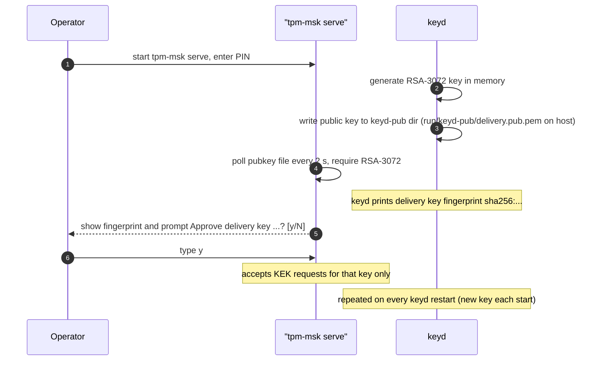
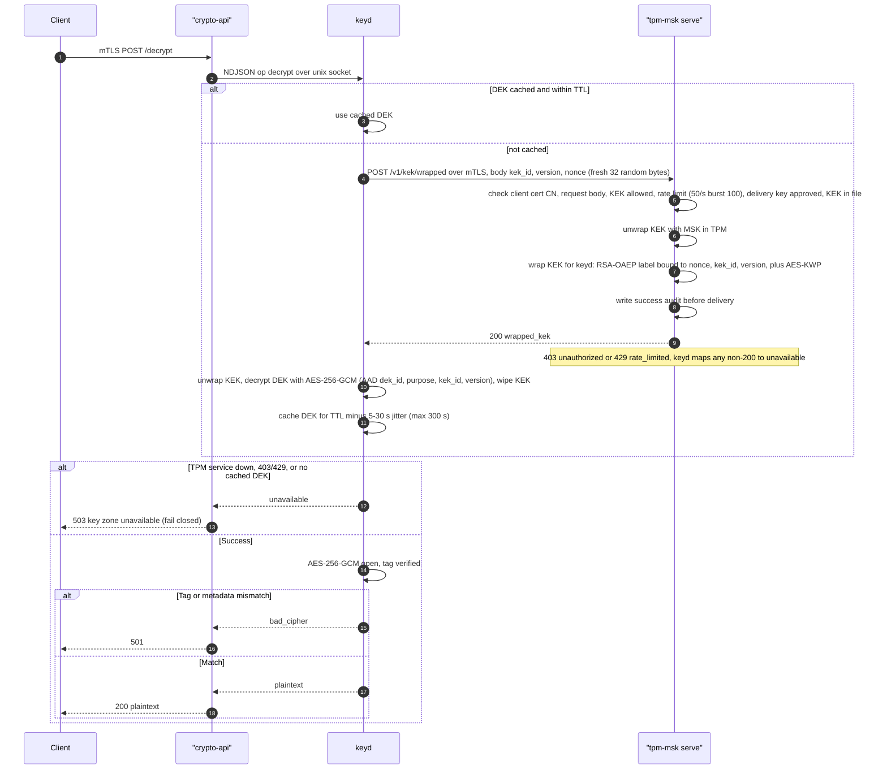

# Desain keamanan

Detail teknis di balik ringkasan di [README](../../README.md): crypto-api, hierarki kunci, perlindungan data di database, model akses, dan pemetaan kode ke [blueprint TPM](../referensi/tpm-blueprint.md). Perintah operasional ada di [run.md](../operasi/run.md).

## Isi

- [Crypto API](#crypto-api)
- [Zeroisasi](#zeroisasi)
- [Endpoint](#endpoint)
- [Role database aplikasi](#role-database-aplikasi)
- [Perlindungan dokumen per TLP](#perlindungan-dokumen-per-tlp)
- [Judul yang ditokenisasi](#judul-yang-ditokenisasi)
- [Lalu lintas layanan](#lalu-lintas-layanan)
- [Level akses dan grant dokumen](#level-akses-dan-grant-dokumen)
- [Catatan keamanan dan batas yang diketahui](#catatan-keamanan-dan-batas-yang-diketahui)
- [Kesesuaian dengan blueprint](#kesesuaian-dengan-blueprint)

## Crypto API

`crypto-api` (Go, Gin; `CRYPTO_MODE=tpm`) melayani mTLS pada port container 2796, dipublikasikan sebagai 127.0.0.1:2896. Lihat [blueprint TPM](../referensi/tpm-blueprint.md).

### Mode

crypto-api yang dipakai menggunakan `CRYPTO_MODE=tpm`. Ciphertext dan nilai HMAC memakai format `skadut-t1:`.

| Aspek | `tpm` |
| --- | --- |
| Sumber kunci | keyd lewat Unix socket (`KEYD_SOCKET`, default `/run/keyd/keyd.sock`) |
| `versionkey` ciphertext | `skadut-t1:<DEK id>` |
| Output seal | `skadut-t1:<DEK id>:<b64 iv+ct>` |
| Output HMAC | `skadut-t1:<DEK id>:<b64 tag>` |
| Crypto tidak tersedia | 503, fail closed |

Output tokenize adalah teks yang dimasking diikuti nilai asli yang di-seal.

### Hierarki kunci

**Hierarki TPM:** MSK (di dalam TPM, tidak dapat diekspor) > KEK (dibungkus di bawah MSK, disimpan sebagai file) > DEK (dibungkus di bawah KEK, ditahan di memori keyd maksimal 5 menit). Lihat [bagian 4 blueprint](../referensi/tpm-blueprint.md#4-hierarki-kunci).

keyd juga menahan kunci delivery RSA-3072. Kunci ini dibuat di memori saat keyd start (`cryptography-service/key-container/src/main.rs:42`), tidak pernah ditulis ke disk, dan baru pada setiap start. MSK dibuat di dalam TPM oleh `tpm-msk init` secara default. `tpm-msk init --import` menerima 32 sampai 64 byte hex lewat stdin. Shamir share yang dicetak `serve` hanya demo dan tidak memulihkan MSK.

| Kunci (proyek TPM) | Disimpan sebagai | Lokasi plaintext | Masa hidup |
| --- | --- | --- | --- |
| MSK | Objek keyedHash TPM, terikat TPM (`fixedTPM`, `fixedParent`), tidak dapat diekspor | Hanya di dalam TPM | Tidak berlaku |
| KEK | File envelope, AES-256-GCM di bawah kunci yang diturunkan dari MSK | `tpm-msk` saat unwrap, keyd saat dipakai | Dihapus setelah dipakai |
| DEK | Dibungkus di bawah KEK di `deks.json` (volume `keyd-deks`) | Hanya memori keyd | Maksimal 300 s, dikurangi jitter 5 sampai 30 s |
| Kunci delivery RSA-3072 | Public key PEM di `run/keyd-pub/delivery.pub.pem` | Hanya memori keyd | Sampai keyd berhenti |

Desain TPM meminta AAD yang mengikat tenant, record, dan versi skema. Mode TPM mengikat AAD: lihat [Kesesuaian dengan blueprint](#kesesuaian-dengan-blueprint) bagian 8.


#### Startup mode TPM



#### Dekripsi mode TPM



## Zeroisasi

- **TTL:** `CRYPTO_KEY_TTL` default `5m`. Nilai di atas `5m` atau sama dengan/di bawah nol menghentikan startup. Saat kedaluwarsa, DEK dihapus (`zeroize reason=ttl count=N`) dan panggilan berikutnya membuka DEK baru.
- **Mode TPM:** keyd menegakkan `KEYD_DEK_TTL`, rentang valid 31 sampai 300 s, default 300 (`cryptography-service/key-container/src/main.rs:41`). Nilai dikurangi jitter 5 sampai 30 s dan memakai single-flight loading. Kedaluwarsa juga terpicu oleh lompatan jam realtime, sehingga mencakup suspend. Lihat [TTL keyd](../services/keyd.md#ttl-dan-zeroization).
- **Per panggilan:** setiap buffer kunci per panggilan dihapus dengan `defer`.
- **Error key-zone:** keyd menghapus DEK yang di-cache saat ada error layanan kunci dan mengembalikan 503. Alasan error layanan lama didokumentasikan bersama implementasi yang diarsipkan.
- **Panic:** middleware recovery mengembalikan 500 dan membersihkan cache DEK (`zeroize reason=panic`).
- **Shutdown:** pada SIGINT atau SIGTERM, DEK yang di-cache dibersihkan (`zeroize reason=shutdown`), lalu master key dihapus.
- **Memori dan core dump:** `mlock` bersifat best-effort. Jika gagal, log menampilkan `mlock unavailable` sekali. Container memakai `cap_add: IPC_LOCK`. Core dump dimatikan lewat `ulimits.core: 0` dan `setrlimit(RLIMIT_CORE, 0)` di Linux saat startup.

## Endpoint

Semua endpoint hanya menerima POST. Crypto-api melayani mTLS pada port container 2796, dipublikasikan sebagai 127.0.0.1:2896. `GET /` tidak diimplementasikan dan mengembalikan 404. Body request dibatasi 20 MiB, dan `CountByte` dibatasi 1024.

| Endpoint | Body request | Key respons |
| --- | --- | --- |
| `/genrand` | `{"CountByte":8}` | `Random` (string hex) |
| `/encrypt` | `{"Plaintext":[{"Text":"data 1"}]}` | `Ciphertext`: daftar `versionkey` (`skadut-t1:<DEK id>`), `text`, `mac`, `iv` |
| `/decrypt` | `{"Ciphertext":[{"versionkey":"t1:<DEK id>","text":"...","mac":"...","iv":"..."}]}` | `Plaintext`: daftar `text` |
| `/seal` | `{"Plaintext":[{"Text":"data 1"}]}` | `Ciphertext`: daftar `text` (berawalan `skadut-t1:`) |
| `/unseal` | `{"Ciphertext":[{"text":"t1:<DEK id>:..."}]}` | `Plaintext`: daftar `text` |
| `/sealfile` | `{"Data":"<base64>"}` | `Ciphertext` (berawalan `skadut-t1:`) |
| `/unsealfile` | `{"Ciphertext":"t1:..."}` | `Data` (base64) |
| `/hmac` | `{"Message":"password"}` | `Value` (tag, `skadut-t1:<DEK id>:<b64 tag>`) |
| `/verifyhmac` | `{"Message":"password","HMACstring":"t1:<DEK id>:<b64 tag>"}` | `Value` (bool) |
| `/tokenize` | `{"Masking":[{"Format":"LEFT","Length":3,"Text":"..."}]}` | `Ciphertext`: daftar `text` |
| `/detokenize` | `{"Masking":[{"text":"***...:t1:<DEK id>:<b64 iv+ct>"}]}` | `Ciphertext`: daftar `text` |

`skadut-` hanya label output. Ia bukan bagian dari AAD atau input HMAC. Input menerima nilai dengan atau tanpa label.

`Format` untuk `/tokenize` adalah `LEFT` atau `RIGHT` dengan `Length`, `MID` dengan `Position` dalam bentuk `start:end`, atau pola per karakter di mana `$` dimasking dan `%` ditampilkan. Contoh untuk nomor ID:

Payload ini memerlukan sertifikat client crypto-api dari `run\pki` pada request PowerShell; mTLS TLS 1.3 wajib.

```powershell
$body = '{"Masking":[{"Format":"%$%%%%%%%%%$%%%$","Text":"3302271000000001"}]}'
Invoke-RestMethod -Uri https://127.0.0.1:2896/tokenize -Method Post -ContentType 'application/json' -Body $body
```

Setiap request menulis satu baris log berisi method, path, status, durasi, dan IP client. Body, query string, dan header tidak dicatat.

## Role database aplikasi

Backend terhubung ke PostgreSQL sebagai `sad_app`, role non-superuser. Password-nya adalah `APP_DB_PASSWORD` di `.env` root (placeholder di `.env.example`).

- Grant dari `005_app_role.sh`: `CONNECT` pada database dan `USAGE` pada `public`. `SELECT` pada `assets`, `documents`, `document_versions`, `csf_subcategories`, `evidence_links`, `asset_document_links`, `audit_events`. `SELECT` dan `INSERT` pada `uploaded_files`.
- Grant dari `006_rbac.sql`:
  - `SELECT` pada `ranks`.
  - `SELECT`, `INSERT`, `UPDATE`, `DELETE` pada `users` dan `sessions`.
  - `INSERT`, `UPDATE`, `DELETE` pada `documents`, `document_versions`, `assets`.
  - `INSERT`, `DELETE` pada `asset_document_links`, `evidence_links`.
  - `DELETE` pada `uploaded_files`, dan `UPDATE` pada kolom `name`-nya.
  - `EXECUTE` pada `log_audit` dan `log_access_denied`.
- `EXECUTE` pada `purge_audit_events` dari `007_audit_purge.sql`.
- Grant dari `008_access_levels.sql`: `SELECT` pada `document_access_grants` dan `EXECUTE` pada `revoke_document_access`. `010_red_strict_dual_auth.sql` mencabut `EXECUTE` pada `grant_document_access` dari `sad_app`; grant hanya ditulis lewat fungsi persetujuan ganda. `sad_app` punya `EXECUTE` pada fungsi request 010 (`request_document_access`, `decide_access_request`) dan `revoke_document_access`, dan tidak punya `EXECUTE` pada `grant_document_access`.
- `010_red_strict_dual_auth.sql` menambah tabel dan fungsi request persetujuan ganda serta CHECK bahwa security officer tidak pernah level 5. `011_level_change.sql` menambah fungsi request, decide, dan lower perubahan level. `010` juga menambah `users.unit`; `012_unit_head.sql` menambah `users.unit_head` dengan partial unique index (satu kepala per unit).
- `audit_events`: hanya `SELECT`. Tidak ada `INSERT`, `UPDATE`, `DELETE`, atau `TRUNCATE` langsung. Baris audit ditulis lewat `log_audit`.
- Tidak ada grant `TRUNCATE` dan tidak ada grant `CREATE`.
- `006_rbac.sql` berjalan setelah `005_app_role.sh` pada init volume baru. Untuk alur mulai bersih, lihat [Mulai dari awal](../operasi/run.md#mulai-dari-awal).
- Dibuat oleh `db/init/005_app_role.sh` pada init baru. Skrip init Postgres hanya berjalan pada volume kosong.
- Role admin `sad` (`POSTGRES_USER`) hanya dipakai service `db` dan skrip migrasi.

## Perlindungan dokumen per TLP

| TLP | Disimpan di `document_versions` | Integritas | Kerahasiaan |
|---|---|---|---|
| CLEAR, GREEN, AMBER, AMBER+STRICT, RED, RED+STRICT | `content_ciphertext` (`skadut-t1:` AES-256-GCM lewat crypto-api `/sealfile`), `content_base64` NULL | Tag HMAC di `integrity_tag` | terenkripsi |

Setiap versi file dokumen, termasuk CLEAR, di-seal lewat `/sealfile` dan disimpan sebagai `content_ciphertext`. Upload baru di-seal saat upload dan didekripsi saat dibuka. Baris lama dengan `protection='integrity'` dimigrasikan oleh `protect-documents.mjs` dan menjadi `encrypted`.

Nilai `protection`: `none` (belum diproteksi: tidak ada file atau menunggu migrasi), `integrity` (baris CLEAR lama yang belum dimigrasikan; read path masih melayaninya sampai `protect-documents.mjs` men-seal), `encrypted` (keadaan saat ini untuk setiap file yang sudah diproteksi). Skema: `db/init/004_document_protection.sql`. CHECK bentuk memaksa kombinasi yang valid.

Read path `/api/files/:doc/:ver` memverifikasi tag atas base64 yang dipulihkan:

- Pemeriksaan integritas gagal: HTTP 500 `{"error":"integrity check failed"}`. Byte tidak pernah dikirim.
- Crypto tidak tersedia: 503.
- Kegagalan crypto lain: 502.

## Judul yang ditokenisasi

Untuk TLP selain CLEAR, `documents.title` dan `document_versions.file_name` disimpan sebagai token `<masked>:<sealed>`. Mask menyimpan 3 karakter pertama, spasi, dan tanda baca, lalu menyembunyikan sisanya. Bagian sealed adalah nilai asli yang di-seal oleh crypto-api.

- `db/scripts/tokenize-titles.mjs` men-tokenisasi baris plaintext. Deployment VPS menjalankannya setiap deploy; run lokal manual (lihat [Mulai dari awal](../operasi/run.md#mulai-dari-awal)). Baris yang sudah berupa token dilewati. Baris baru perlu dijalankan ulang.
- `/api/grc` men-detokenisasi dokumen yang bisa dibaca dalam satu panggilan `/detokenize`. Jika crypto-api tidak tersedia atau mengembalikan error, dokumen yang bisa dibaca jatuh ke bagian masked, tidak pernah ke token. Dokumen yang tidak bisa dibaca dibuang dari payload (`filterGrc` di `backend/grc-filter.mjs`); tautan evidence, tautan aset, dan referensi audit-nya juga dihapus.
- Skrip tokenize memakai crypto-api `/tokenize` dan `/detokenize` per baris dan melaporkan kegagalan per baris. Error crypto-api membuat skrip keluar dengan kode 1 jika ada baris yang gagal.
- UI sudah memuat state frame-08 (status terkontrol pada bagian controlled-files) dan baris super-admin yang hanya menampilkan token.

## Lalu lintas layanan

- **Edge yang dicatat:** `client>crypto-service` dicatat oleh crypto-api. `frontend>backend` dan `backend>db` dicatat oleh backend. Backend menggabungkan data crypto-api dengan mengambil `http://crypto-api:2797/internal/traffic`.
- **Respons `GET /api/traffic`:** `{"ts":...,"edges":[{"source","target","rps","errorRate","avgMs"}],"down":[...]}`. `down` mencantumkan `crypto-service` jika pengambilan internal gagal dan `db` jika `SELECT 1` gagal. Semua edge yang dikenal selalu ada, dengan default nol.
- **Jendela:** 10 detik, di memori. Hanya metadata: ID, jumlah, durasi, dan kelas status. Reset saat restart.
- **Rate limit:** nginx mengizinkan 5 request/s dengan burst 10 untuk `/api/traffic` dan mengembalikan 429. Backend juga menerapkan token bucket 5 request/s dan mengembalikan 429 `{"error":"rate_limited"}`.
- **Autentikasi:** sesi wajib.

Port internal crypto-api 2797 hanya melayani `GET /internal/traffic` dan tidak dipublikasikan ke host.

## Level akses dan grant dokumen

Pangkat dan level akses terpisah. Pangkat menentukan apa yang bisa diubah user. Level akses dan grant menentukan dokumen mana yang bisa dibaca user.

- **Pangkat (golongan):** enam tingkat, dipetakan oleh `TIER` di `backend/auth.mjs`. Pangkat menentukan izin create, update, approve, delete, dan purge (`can()` di `backend/auth.mjs`). Pangkat tidak menentukan akses baca.
- **Level akses:** setiap user punya `users.access_level`, dari 1 sampai 5. Terpisah dari pangkat.
- **Baca:** CLEAR bisa dibaca semua. User level L membaca TLP sampai min(L, 4):

| Level | TLP yang bisa dibaca |
| --- | --- |
| 1 | CLEAR, GREEN |
| 2 | CLEAR sampai AMBER |
| 3 | CLEAR sampai AMBER+STRICT |
| 4 | CLEAR sampai RED |
| 5 | CLEAR sampai RED. RED+STRICT tidak pernah terbaca lewat level; grant wajib. |

RED+STRICT adalah indeks 5 di `TLP_ORDER`; `canReadLevel` membatasi indeks yang bisa dibaca pada `min(level, 4)`, sehingga tidak ada level yang membacanya tanpa grant aktif.

- **Grant:** dokumen bisa dibaca jika TLP-nya dalam jangkauan level, atau user punya grant aktif atasnya. Grant aktif bila belum dicabut dan `expires_at` kosong atau di masa depan. Grant baru hanya lewat alur request persetujuan ganda di bawah; route langsung `POST /api/documents/:id/grants` sudah tidak ada.
- **Tulis:** `authorize()` di `backend/auth.mjs` memeriksa izin pangkat. Create memerlukan `ctx.newTlp` yang valid dalam batas level akses; ia memeriksa batas dokumen yang ada hanya bila `ctx.docTlp` diberikan. Update memeriksa `ctx.docTlp` hanya bila diberikan, dan memeriksa `ctx.newTlp` terhadap level akses hanya bila diberikan. Grant aktif menaikkan batas dokumen yang ada untuk create, update, approve, dan version create, tetapi tidak pernah menaikkan batas TLP baru. Approve, delete, dan version create memerlukan `ctx.docTlp` yang valid dalam batas level atau grant; nilai yang hilang atau tidak valid menolak aksi. `authorize()` adalah fungsi kebijakan murni tanpa pemanggil route saat ini; route create, update, approve, delete, dan version dokumen belum terhubung. Saat dihubungkan, route tersebut harus mengirim `{docTlp, newTlp, granted}` sesuai kebutuhan. Lihat Celah kontrol akses yang diketahui di bawah.
- **Daftar dokumen:** dokumen yang tidak bisa dibaca dibuang dari payload `/api/grc` (`filterGrc` di `backend/grc-filter.mjs`); tautan evidence, tautan aset, dan referensi audit-nya juga dihapus. `GET /api/files/:doc/:ver` mengembalikan 404 di atas batas tanpa grant. Security officer juga menerima `restrictedDocuments`: metadata saja (`id`, `tlp`, `createdAt`, `versionCount`, `grantees`), tanpa judul, nama file, atau isi. User level 5 yang bukan officer tidak menerima daftar itu.
- **API grant** (level 5 atau security officer, `canManage`; selain itu mendapat 403 dan baris audit `access.denied`):
  - `GET /api/documents/:id/grants`
  - `DELETE /api/documents/:id/grants/:username` adalah pencabutan lunak. Ia mengisi `revoked_at`. Baris tidak pernah dihapus.
  - `GET /api/users` mengembalikan `[{username, rankName, golongan, accessLevel, unit, unitHead, securityOfficer}]`.
  - Penulisan memerlukan content-type JSON, `Origin` yang diizinkan, dan body maksimal 4 KiB.
- Setiap grant dan revoke menulis baris audit (action `grant` atau `revoke`, object type `document`). Revoke lewat fungsi SECURITY DEFINER `revoke_document_access` (`db/init/010_red_strict_dual_auth.sql`); grant disisipkan oleh `decide_access_request` setelah kedua persetujuan. `sad_app` hanya punya SELECT pada `document_access_grants` dan tidak punya tulisan langsung ke tabel itu.
- `GET /api/me` mengembalikan `accessLevel`, `tlpMax`, `securityOfficer`, `unit`, `unitHead`, dan `can.access` = `{grant, request, approve, revoke}`. `grant` hanya untuk level 5; sisanya untuk level 5 atau security officer.

### Persetujuan ganda untuk akses RED+STRICT

- `POST /api/documents/:id/access-requests` membuat request; `GET /api/access-requests` menampilkan daftar; `POST /api/access-requests/:id/decision` menyetujui atau menolak.
- Satu komandan (level 5) dan satu security officer (`security_officer`) harus menyetujui, dalam urutan apa pun. Requester dan penerima grant tidak boleh menyetujui. Grant ditulis hanya setelah kedua persetujuan (`decide_access_request` di `010_red_strict_dual_auth.sql`).
- Penolakan oleh salah satu peran menutup request.
- Komandan atau officer dapat mencabut; pencabutan mengisi `revoked_at` dan berlaku pada request berikutnya. Grant dan revoke tidak menghapus sesi.

### Alur perubahan level (1-5)

- `POST /api/users/:username/level-requests` (raise: hanya officer; lower: komandan atau officer), `GET /api/level-requests`, `POST /api/level-requests/:id/decision` (approve: komandan; deny: salah satu peran). Fungsi DB-nya adalah `request_level_change`, `decide_level_change` (approve menerapkan level), dan `lower_user_level` di `011_level_change.sql`.
- Field wajib: justifikasi (AC-6), screening terverifikasi plus referensi (PS-3), perjanjian akses ditandatangani plus tanggal (PS-6), `review_due` dalam 12 bulan (AC-2), `fips199_basis` (AC-3(2)).
- Pemetaan FIPS 199: level 1-2 LOW, level 3 MODERATE, level 4-5 HIGH.
- Tidak ada perubahan untuk diri sendiri (requester, target, dan approver diperiksa). Penurunan langsung berlaku. Kenaikan butuh request officer lalu persetujuan komandan.
- Sesi target dihapus saat apply dan saat lower.
- Baris audit pada request/approve/apply/deny/lowered memuat ID kontrol (AC-2, AC-3(2), AC-5, AC-6, PS-3, PS-6, AU-2, AU-3).
- Pemetaan ini adalah pemetaan desain, bukan bukti kepatuhan.

### Unit dan kepala unit

`users.unit` adalah label tampilan dan tidak pernah dipakai di jalur otorisasi. `users.unit` ditambahkan oleh `010_red_strict_dual_auth.sql`. Maksimal satu kepala per unit ditegakkan oleh partial unique index di `012_unit_head.sql`; seed mengisi satu kepala per unit. Security officer pada data demo: `teguh.prasetya` (level 4), `mega.puspitasari` (level 3), `arif.budiman` (level 2), `heru.susanto` (level 2), semuanya Unit Intelijen. Tidak ada yang level 5 (CHECK DB).

RED/AMBER/GREEN adalah skema yang diusulkan di sini; aturan klasifikasi nasional lebih diutamakan.

## Catatan keamanan dan batas yang diketahui

- **Autentikasi:** username dan password, lalu kode TOTP 6 digit yang divalidasi crypto-api `/totpvalidate`. Password disimpan sebagai `hmac$<salt>$<tag>`, salt acak per user ditambah HMAC berkunci dari keyd lewat crypto-api `/hmac`. Password dan kode sama-sama fail closed saat crypto-api tidak tersedia. Lima percobaan gagal mengunci akun 15 menit; limiter per IP mengembalikan HTTP 429.
- **Sesi:** token acak 32 byte di cookie `sid` (HttpOnly, SameSite=Strict, Path=/, batas keras 30 menit, kunci idle 5 menit). Hanya hash SHA-256 token yang disimpan, di tabel `sessions`. Tidak ada flag Secure, karena stack berjalan HTTP biasa di dalam compose. Sesi wajib untuk semua route API kecuali health, login, dan device check.
- **Penulisan:** request non-GET/HEAD memerlukan header `Origin` dalam daftar yang diizinkan (env `APP_ORIGINS`, default origin localhost 8088 dan 5173) dan content-type JSON. Jika tidak, request mendapat 403 atau 415.
- **RBAC:** berbasis pangkat, enam tingkat: `TAMTAMA`, `BINTARA`, `BINTARA_TINGGI`, `PAMA`, `PAMEN`, `PATI`, dipetakan dari kelompok pangkat oleh `TIER` di `backend/auth.mjs`. Izin didefinisikan di `can()` di `backend/auth.mjs`. Hanya PATI yang punya izin purge audit. Pembacaan dokumen bergantung pada level akses dan grant, bukan pangkat. Lihat [Level akses dan grant dokumen](#level-akses-dan-grant-dokumen).
- **Celah kontrol akses yang diketahui:**
  - `POST /api/uploads` tidak memanggil pemeriksaan `upload.c` secara eksplisit. Semua tingkat punya `upload.c` saat ini.
  - `/api/grc` mengembalikan event audit ke sesi mana pun, difilter oleh keterbacaan dokumen.
  - Tidak ada izin baca audit.
  - Pemeriksaan `authorize()` sisi tulis di atas belum terhubung ke route mana pun.
- **`/api/traffic`, `/api/traffic/history`, dan view database** memerlukan flag super-admin (`users.super_admin` dan level akses 5). Keduanya memperlihatkan topologi layanan dan isi tabel hanya ke role itu.
- **Byte file database** disimpan sebagai ciphertext `t1:` di `document_versions.content_ciphertext`, dengan `content_base64` NULL, setelah `protect-documents.mjs` berjalan. Hanya baris yang masih `protection='none'` atau `integrity` lama yang menyimpan base64 plaintext. Setiap file dibuffer di memori (batas 25 MiB).
- **Log audit:** `reject_audit_mutation()` menolak setiap UPDATE, DELETE, dan TRUNCATE pada `audit_events`, kecuali DELETE baris non-`purge` saat `audit.purge_ok` bernilai `on` untuk transaksi berjalan (UPDATE dan TRUNCATE tidak pernah diizinkan; baris tombstone `purge` tidak pernah dihapus). Hanya `purge_audit_events` yang mengisinya (`007_audit_purge.sql:54`). `PUBLIC` dicabut UPDATE, DELETE, dan TRUNCATE-nya pada tabel (`001_schema.sql:97`), dan EXECUTE-nya dicabut pada `log_audit` dan `log_access_denied` (`006_rbac.sql:90,104`) serta pada `purge_audit_events` (`007_audit_purge.sql:69`). `sad_app` hanya punya SELECT pada `audit_events` (`005_app_role.sh:10`) dan EXECUTE pada `purge_audit_events` (`007_audit_purge.sql:70`), sehingga ia bisa memanggil purge langsung, melewati pemeriksaan PATI di lapisan aplikasi. Komentar tabel menyatakan log tidak tahan manipulasi terhadap table owner atau superuser (`001_schema.sql:98`). Repo tidak menegakkan apa pun terhadap role tersebut.
- **Urutan versi** bersifat leksikal (`ORDER BY version DESC`), sehingga versi 10 ke atas salah urut.

## Kesesuaian dengan blueprint

Memetakan setiap bagian [docs/referensi/tpm-blueprint.md](../referensi/tpm-blueprint.md) ke kode di `cryptography-service/`. Nilai status: **Implemented**, **Partial**, **Deviation**, **Not built**, **Open**. Path kode relatif terhadap `cryptography-service/`.

#### §1 Tujuan

- MSK di TPM, tidak dapat diekspor: **Implemented** (`tpm-services/internal/tpm/tpm.go`).
- KEK disimpan sebagai file yang dibungkus di bawah MSK: **Implemented**.
- DEK dibungkus di bawah KEK, di memori keyd maksimal 300 s: **Implemented** (lihat [Zeroisasi](#zeroisasi)).

#### §2 Asumsi

| Asumsi | Status |
| --- | --- |
| Arsitektur di §3 dipakai seperti digambar | **Partial**: layanan TPM, keyd, dan crypto-api berjalan seperti digambar. Backend aplikasi memanggil crypto-api lewat mTLS. |
| Satu laptop, TPM 2.0, Docker Desktop WSL2, BitLocker aktif | Setup operator, tidak ditegakkan tooling. `selftest` non-admin lulus pada STMicro ST33 TPM 2.0 (lihat §16). |
| Aplikasi mencapai port 2796 hanya dengan mTLS | **Implemented** untuk crypto-api: `127.0.0.1:2896` memetakan ke port container 2796, mTLS wajib. |
| Integrasi crypto-api di stack root | **Implemented**: stack root hanya menjalankan crypto-api; Vault bukan bagian dari stack |
| Upacara Shamir awal selesai, MSK diimpor | **Tidak terpenuhi**: `init --import` ada, tetapi tidak ada share nyata yang dihasilkan. Hanya demo (§11.1). |
| Recovery opsional, hanya jika TPM dibersihkan atau diganti | **Not built** (§11.3). |

#### §3 Arsitektur

- Diagram: [Arsitektur](../arsitektur/sistem.md), proyek berakar TPM.
- **Implemented** seperti digambar: keyd memanggil layanan TPM lewat mTLS, crypto-api terhubung ke keyd lewat Unix socket.
- **Deviation:** layanan TPM adalah prototipe Go `tpm-msk` (lihat §13). keyd mencapainya lewat `host.docker.internal:2798`.

#### §4 Hierarki kunci

- Tabel dan detail: lihat [Hierarki kunci](#hierarki-kunci), paragraf dan tabel proyek TPM.
- **Implemented**: MSK tetap objek TPM; envelope KEK disimpan di file yang dikonfigurasi; DEK disimpan terbungkus di volume `keyd-deks`. Kunci privat delivery ada di memori keyd; public key PEM-nya dipublikasikan ke file yang dikonfigurasi.

#### §5 Komponen

| Komponen | "Tidak boleh" | Status |
| --- | --- | --- |
| TPM | Mengekspor MSK | **Implemented**: MSK adalah objek TPM dengan `fixedTPM`, `fixedParent`. |
| Layanan TPM | Mengembalikan KEK plaintext | **Implemented**: hanya KEK terbungkus yang dikembalikan (`tpm-services/internal/service/service.go:196`). |
| keyd (container Rust) | Mencatat atau mengekspor kunci | **Implemented**: record audit hanya memuat ID, versi, dan hasil. stderr hanya mencetak fingerprint dan status memlock. |
| crypto-api (container Go) | Menahan KEK, DEK, atau kunci privat RSA | **Partial**: tidak menahan byte kunci, tetapi data request dan respons plaintext melewati string Go, yang tidak dapat dihapus. |

#### §6 Alur operasional

**§6.1 Startup**

- PIN minimal 6 byte (`tpm-services/cmd/tpm-msk/main.go:508-510`). PIN salah dihitung terhadap lockout TPM (`tpm.go:300-307`).
- keyd mencetak `delivery key fingerprint: sha256:<SPKI DER hex>` ke stderr (`key-container/src/main.rs:46`) dan menulis PEM lewat temp file lalu rename (`main.rs:100-106`).
- `tpm-msk serve` mem-poll file pubkey setiap 2 s dan mewajibkan RSA-3072 (`serve.go:296,342`). Ia mencetak `Delivery key fingerprint: sha256:...` ke stdout (`serve.go:356`).
- Prompt: `Approve delivery key sha256:<hex>? [y/N]` (`serve.go:354-357`). Hanya baris `y` yang menyetujui.
- Setiap perubahan pada file pubkey, termasuk penghapusan, mencabut kunci aktif (`pubkey.revoke`, `serve.go:329`) dan membatalkan prompt tertunda (`pubkey.cancel`). Satu kunci aktif pada satu waktu.

**§6.2 Pengiriman KEK**

- Body request: `kek_id`, `version`, `nonce` (32 byte acak, base64) (`key-container/src/tls.rs:13,72-73`).
- Urutan pemeriksaan layanan TPM (`tpm-services/internal/service/service.go:81-166`): path dan method, CN client `crypto-service` (`:109`), body (maks 4096 B, field tidak dikenal ditolak), allow-list KEK (`--allow-kek`), rate limit (`--rate`, default 50/s, burst 100), delivery key disetujui, lookup KEK di file.
- Penolakan: 403 `{"error":"unauthorized"}` (detail di audit), 429 `rate_limited`, 400 `bad_request`.
- Audit sukses `kek.request ok` ditulis sebelum respons (`service.go:205-211`). Jika penulisan audit gagal, respons 503 `unavailable` dan tidak ada KEK yang dikirim.
- Negative cache keyd: setelah pengambilan gagal, semua pengambilan KEK mengembalikan `unavailable` selama 2 s (`key-container/src/main.rs:157-163`). Gate bersifat global, bukan per KEK.
- keyd memetakan setiap non-200 dari layanan TPM ke `unavailable` (`tls.rs:46`). crypto-api mengembalikan 503 `key zone unavailable`.

**§6.3 Siklus hidup DEK**

- Kedaluwarsa adalah TTL dikurangi jitter acak 5 sampai 30 s (`store.rs:143`). Kedaluwarsa terpicu pada CLOCK_BOOTTIME atau realtime (`time.rs:28-33`, `store.rs:127-152`). Lompatan realtime mundur dihitung sebagai kedaluwarsa.
- Aktivitas tidak memperpanjang TTL.
- Request yang sedang berjalan menahan `Arc`. Kunci dihapus saat referensi terakhir lepas (`crypto.rs:71-77`).
- Deviation: record audit `dek.expire` dan `dek.zeroize` ditulis saat sweep (`main.rs:68`), bukan saat drop terakhir. Request yang sedang berjalan masih bisa menahan kunci setelah baris log.
- Request baru setelah kedaluwarsa memuat ulang DEK secara single-flight, dengan pengiriman KEK baru.
- SIGTERM atau SIGINT: `cache.clear()` mencatat `dek.zeroize` per DEK, lalu `container.stop` (`main.rs:93-97`).
- SIGKILL: tidak ada penghapusan. Mitigasi: mlock (best effort), `RLIMIT_CORE` 0 dan `PR_SET_DUMPABLE` 0 (`main.rs:33-34`), dan compose `memswap_limit: 256m` sama dengan `mem_limit` (`compose.yaml`).

**§6.4 Rotasi**

| Kunci | Status |
| --- | --- |
| DEK | Deviation: DEK baru dipilih per tahun UTC per purpose (`data`, `mac`) (`main.rs:183-189`, `store.rs:67-69`). DEK data juga dirotasi pada 2^32 − 2^20 = 4.293.918.720 pemakaian (`main.rs:167`). Counter bersifat per proses dan tidak dibagi antar instance (catatan ponytail di `main.rs:165`). |
| KEK | Partial: `tpm-msk kek create --id kek-01` menaikkan versi dan menyimpan versi lama di file (`tpm-services/internal/tpm/kek.go:117-121`). keyd memakai `KEK_VERSION` (default 1, `main.rs:40`) untuk DEK baru. **Not built**: tidak ada alat rewrap; DEK lama harus di-rewrap manual. |
| Kunci delivery RSA | **Implemented**: kunci baru setiap start keyd. Kunci lama dicabut saat file berubah (`serve.go:313-331`). |

#### §7 API layanan TPM

- Hanya `POST /v1/kek/wrapped` yang ada. Path lain mengembalikan 404 `not_found`, method lain 405 `method_not_allowed` (`service.go:81-90`).
- Body 200: `{kek_id, version, wrapped_kek}`, base64, header `Cache-Control: no-store` (`service.go:209-216`).
- Error: 400 `bad_request`, 403 `unauthorized`, 429 `rate_limited`, 503 `unavailable` (`service.go:37-43`).
- `X-Request-ID` harus cocok dengan `^[A-Za-z0-9-]{8,64}$`. Jika tidak, layanan menghasilkan 16 byte acak sebagai hex. Nilai dikembalikan di respons (`service.go:34,79-80,232-241`).
- TLS 1.3, `RequireAndVerifyClientCert`, CA `keyzone-ca`, terpisah dari CA `api` (`crypto-api-ca`). CN client harus `crypto-service` (`tpm-services/internal/pki/pki.go:33-39`, `cmd/tpm-msk/serve.go:236-248`).
- Flag: `--listen` default `127.0.0.1:2798`, `--allow-kek` default `kek-01` (`serve.go:36,39`).
- Tidak ada endpoint yang menerima public key. Kunci hanya berasal dari `--pubkey-file` dan persetujuan konsol (`serve.go:38`).

#### §8 Spesifikasi kriptografi

| Tujuan | Kode |
| --- | --- |
| MSK | Objek TPM keyed-hash HMAC-SHA256, `fixedTPM`, `fixedParent`, `UserWithAuth`. Auth adalah SHA-256(PIN). Tanpa PCR binding. Tanpa `noDA`, sehingga proteksi dictionary-attack TPM berlaku (`tpm.go:44-52,107-127`). |
| ID kunci MSK | Hex dari HMAC(MSK, `tpm-msk/key-id/v1`)[:16] (`tpm.go:291`). MSK sama, ID sama. |
| Sesi TPM | Di-salt ke SRK, enkripsi parameter AES-128. |
| KEK at rest | Kunci per-envelope = HMAC(MSK, `tpm-msk/kek/v1` 0x00 label 0x00 nonce32), dipakai sebagai AES-256-GCM dengan IV 12 byte. AAD = `tpm-msk/v1` diikuti label. Label = `kek/<id>/<version>` (`internal/tpm/envelope.go:27-28,128-144`, `kek.go:129`). |
| Pengiriman KEK | Kunci AES sementara 32 byte dibungkus dengan RSA-OAEP-SHA256 (384 B), KEK dibungkus dengan AES-256-KWP (40 B). Total 424 B (`key-container/src/crypto.rs:15,143-151`, `tpm-services/internal/delivery/delivery.go:17,87-97`). |
| Pengikatan delivery | Label OAEP = `tpm-msk/delivery/v1` 0x00 nonce kek_id 0x00 u32be(version). Tidak ada separator antara nonce dan kek_id. |
| DEK at rest | AES-256-GCM, IV 12 byte, AAD = `dek_id` 0x00 purpose 0x00 `kek_id` 0x00 u32be(kek_version) (`key-container/src/crypto.rs:131-140`, `store.rs:77,82-84`). |
| Data aplikasi (mode TPM) | AES-256-GCM, IV acak 12 byte, AAD = byte `dek_id` (`key-container/src/main.rs:224-225,237`). |

- Pengiriman KEK mengikuti konstruksi `CKM_RSA_AES_KEY_WRAP`. Kepatuhan PKCS#11 tidak diklaim.
- Batas 2^32 ditangani oleh ambang rotasi di §6.4, hanya per proses.

#### §9 Persyaratan keamanan

**Key zone**

- **Implemented:** `127.0.0.1:2798`, dijangkau dari container lewat `host.docker.internal` (`serve.go:36`, `main.rs:58`).
- **Tidak ditegakkan tooling:** blokir inbound Windows Firewall.
- KEK di memori terkunci: **Implemented** di layanan TPM, yang mengembalikan 503 jika `LockMemory` gagal (`service.go:184-188`). **Deviation** di keyd: mlock best effort dan hanya memberi peringatan sekali.

**Service zone (keyd dan crypto-api)**

- keyd: filesystem read-only, `cap_drop: ALL`, `cap_add: IPC_LOCK`, `no-new-privileges`, core limit 0, memlock 64 MiB, `mem_limit` dan `memswap_limit` 256m, tanpa `pid: host`, distroless uid 65532 (`compose.yaml`, `key-container/Dockerfile`). **Implemented.**
- Mode socket 0600 plus `SO_PEERCRED`. Koneksi dari uid selain `KEYD_ALLOWED_UID` (default 65532) dibuang (`main.rs:76,122-124`). **Implemented.**
- crypto-api: read-only, `cap_drop: ALL`, core 0, socket di-mount `:ro` (`compose.yaml`). **Implemented.**
- Tanpa cgo: crypto-api dibangun dengan `CGO_ENABLED=0`. keyd adalah Rust. **Implemented.**
- **Deviation:** network `crypto-tpm-net` adalah bridge biasa, bukan `internal` (`compose.yaml:102-104`).
- Pengerasan laptop: lihat [laptop hardening](../services/tpm-msk.md#hardening-laptop). Manual, tidak ditegakkan tooling.

**Event audit**

| Layanan | Action di kode | Catatan |
| --- | --- | --- |
| Layanan TPM | `service.start`, `service.stop`, `pin.fail`, `pubkey.approve`, `pubkey.reject`, `pubkey.cancel`, `pubkey.revoke`, `kek.request`, `authz.fail`, `audit.sign` | Event upacara recovery: not built. |
| keyd | `container.start`, `container.stop`, `kek.delivery`, `dek.create`, `dek.load`, `dek.unwrap_fail`, `dek.expire`, `dek.zeroize`, `op.encrypt`, `op.decrypt`, `op.hmac`, `authz.fail`, `conn.reject` | Event siklus hidup memiliki `request_id` kosong. |
| crypto-api | `op.encrypt`, `op.decrypt`, `op.seal`, `op.unseal`, `op.hmac`, `op.verifyhmac`, `op.tokenize`, `op.detokenize`, `op.sealfile`, `op.unsealfile`, `op.genrand`, `authz` | |

- Field record: time, request_id, service, identity, key_id, key_version, action, result, prev_hash, hash (`tpm-services/internal/audit/audit.go:33-44`). Rantai SHA-256, genesis semua nol (`audit.go:46-50`).
- Request ID mengalir dari `X-Request-ID` ke `id` keyd ke header TPM. e2e menunjukkan satu ID di ketiga log.
- Fail-closed: crypto-api mengembalikan 503 `audit unavailable` jika tidak bisa menulis (`encryption-services/audit.go:243-268`). Audit sukses TPM (`kek.request ok`) fail-closed: jika tidak bisa ditulis, tidak ada KEK yang dikirim (`service.go:205-211`). keyd mengembalikan `unavailable` jika record suksesnya gagal. Record penolakan TPM (`authz.fail`, `kek.request` ditolak atau error) best effort: error tulis diabaikan (`service.go:101-107`). Record kegagalan dan siklus hidup keyd best effort.
- `audit.sign`: HMAC atas `tpm-msk/audit-sign/v1` dan hash sebelumnya, setiap 60 s atau 100 record (`audit.go:46,48,175-179`).
- **Deviation:** `audit verify` hanya memeriksa rantai, bukan tanda tangan (`audit.go:218`).
- **Deviation:** salinan terpisah tidak terpenuhi. Log di-bind mount dan dapat ditulis container. Hanya log TPM yang ditandatangani.
- Data sensitif: tidak ada material kunci, PIN, atau plaintext di log. Share demo tidak pernah diaudit (`serve.go:141-162`).

#### §10 Perilaku kegagalan

| Event | Perilaku kode |
| --- | --- |
| Layanan TPM berhenti | DEK yang di-cache tetap bekerja sampai kedaluwarsa (maksimal 300 s). Setelah itu, request mengembalikan 503 `key zone unavailable`. |
| PIN salah | Audit `pin.fail`. Dihitung terhadap lockout TPM (`tpm.go:300-307`). |
| Lockout TPM | Startup gagal dengan pesan lockout dictionary-attack (`tpm.go:300-307`). |
| Restart keyd | Kunci hilang dari memori. Kunci delivery baru, persetujuan ulang diperlukan. |
| Banyak DEK kedaluwarsa bersamaan | Jitter 5 sampai 30 s (`store.rs:143`), reload single-flight, negative cache 2 s. |
| TPM dibersihkan atau diganti | Semua KEK terbungkus tidak dapat dipulihkan. Tidak ada alat recovery (§11). |
| Hard kill keyd | Tidak ada penghapusan. Mitigasi seperti §6.3. |

#### §11 Backup dan recovery

- **§11.1 Upacara demo:** `tpm-msk serve` mencetak share demo ke stdout secara default (`--demo-ceremony`, default true, `serve.go:46,141-162`). Share berasal dari secret sekali pakai. Share tidak dicetak oleh `init`, dan tidak pernah diaudit. **Demo only**: MSK nyata tidak dipecah. Konfirmasi upacara masih terbuka (§16).
- **§11.2 Backup:** `msk.key` terikat TPM, sehingga salinannya hanya berguna pada TPM yang sama. Cadangkan file KEK dan volume `keyd-deks`. **Deviation:** tidak ada nilai verifikasi MSK.
- **§11.3 Upacara recovery:** **Not built.**
- **§11.4 Aturan akses share:** **Not built** (tidak ada PIN per share, TOTP, Argon2id, atau share unlock).
- **§11.5 Batasan demo:** share demo tidak memulihkan apa pun.

#### §12 Batas keamanan

| Item | Status |
| --- | --- |
| File KEK dan DEK terbungkus yang disalin | Terlindungi. File KEK dibungkus MSK dan hanya bekerja pada TPM yang sama. File DEK dibungkus di bawah KEK. |
| Lalu lintas jaringan container ke layanan TPM | Terlindungi: mTLS TLS 1.3, dan KEK dibungkus untuk keyd. |
| Sertifikat client dicuri saja | Terlindungi: penyerang hanya mendapat KEK terbungkus 424 B (e2e). |
| Laptop mati dicuri, BitLocker aktif, PIN tidak diketahui | Terlindungi, jika BitLocker aktif. BitLocker manual. |
| Memori yang sudah di-zeroisasi | Ada test (`key-container/src/memdump_test.rs`, hanya Linux). PASS pada run `cargo test` terakhir (17/17, `rust:1.85-bookworm`). |
| Malware dengan admin Windows, penyerang mengendalikan keyd, aplikasi dengan sertifikat valid | Tidak terlindungi, seperti di blueprint. |
| Pemisahan zona fisik | Tidak terpenuhi: semuanya berjalan di satu laptop. |

#### §13 Keputusan bahasa

- Layanan TPM: prototipe Go (`tpm-msk`). **Deviation:** blueprint menginginkan Rust untuk penggunaan nyata. Belum dilakukan.
- Key container: Rust (keyd). **Implemented.**
- Layanan API: Go (crypto-api). **Implemented.**

#### §14 Fase implementasi

| Fase | Status |
| --- | --- |
| 1. Validasi TPM | **Partial**: `selftest` non-admin lulus pada STMicro ST33 TPM 2.0. `selftest` admin penuh tidak tercatat. ID kunci MSK tetap (`tpm.go:291`). |
| 2. Bangun layanan TPM | **Implemented**: mode service, file KEK, wrapping, persetujuan fingerprint, audit, upacara demo. |
| 3. Bangun key container Rust | **Implemented**. |
| 4. Hubungkan API Go | **Implemented** di crypto-api (`CRYPTO_MODE=tpm`). Backend aplikasi terhubung lewat compose root. |
| 5. Pengerasan | **Implemented** sesuai §9, dengan deviation yang tercantum di atas. |
| 6. Uji | **Partial**: e2e 22/22 dengan software TPM. `hw-acceptance.ps1` belum dijalankan pada perangkat keras nyata. |
| 7. Alat recovery (opsional) | **Not built**. |

#### §15 Uji penerimaan

| Uji | Status |
| --- | --- |
| Ekspor MSK | **Partial**: atribut objek TPM (`fixedTPM`, `fixedParent`) diperiksa `hw-acceptance.ps1` selftest. |
| Client tidak dikenal | e2e: tanpa sertifikat dan CA salah ditolak. |
| Sertifikat client dicuri | e2e: KEK terbungkus 424 B, tidak dapat dipakai. |
| Respons diputar ulang | Unit test di keyd. PASS pada run `cargo test` terakhir. |
| DEK terbungkus ditukar | e2e: 501. |
| Kedaluwarsa 5 menit | e2e: suspend `docker pause`, 200 lalu 503 lalu reload dengan `kek.delivery`. Uji tidur `hw-acceptance.ps1` (minimal 6 menit) belum dijalankan. |
| Memory dump | `memdump_test.rs`, hanya Linux. PASS pada run `cargo test` terakhir: test KEK, DEK, dan tail menemukan 1 sebelum zeroize, 0 setelahnya. |
| Layanan TPM mati | e2e: 503. |
| Jejak audit | e2e: satu request ID di tiga log. |
| Manipulasi audit | e2e: edit dan delete terdeteksi. |
| Isi audit | e2e: secret scan. |
| Baris recovery (opsional) | **Not built**. |
| PIN salah, lockout, hard kill, reboot | Tidak tercakup. |
| TPS | e2e hanya memeriksa minimal 1 req/s. Tidak ada target (§16). |

#### §16 Item terbuka

| Item | Status |
| --- | --- |
| Perbaiki ID kunci MSK | **Fixed** di kode (`tpm.go:291`). |
| Konfirmasi upacara awal | **Open**: hanya demo. |
| `selftest` pada perangkat keras nyata | **Partial**: lulus non-admin pada STMicro ST33 TPM 2.0, bukan Intel PTT. `selftest` admin penuh tidak tercatat. |
| Pensiunkan container Vault | **Done**: Vault bukan bagian dari stack. Data mulai dari nol (tanpa rekey). |
| Port layanan TPM | **Set**: 2798. |
| Target TPS dekripsi puncak | **Open**: belum didefinisikan. |
| Host produksi terpisah | **Open**. |
