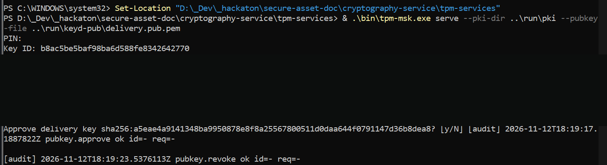
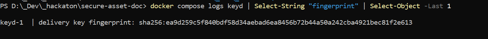
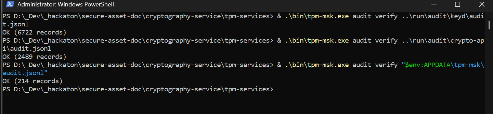

# Demo TPM native di laptop Windows

Jalur native memakai TPM 2.0 perangkat keras laptop lewat TBS (TPM Base Services) Windows. `tpm-msk.exe serve` berjalan langsung di host, aplikasi berjalan di Docker, dan keyd meminta KEK ke layanan TPM itu lewat `host.docker.internal:2798`. Stack TPM tidak memakai emulator.

VPS memakai jalur berbeda: TPM virtual (vTPM) lewat `swtpm`, dengan overlay `cryptography-service/compose.vps.yaml`. Jalur native di halaman ini tidak menyentuh vTPM.

PIN dan share TIDAK PERNAH ditampilkan di dokumentasi. Nilai Shamir share pada screenshot sudah disensor (dihitamkan) sebelum dipublikasikan; jangan membuat ulang atau menjelaskan nilainya.

## Urutan start

Dari `cryptography-service\tpm-services`, jalankan layanan TPM di jendela PowerShell terpisah:

```powershell
Set-Location "D:\_Dev\_hackaton\secure-asset-doc\cryptography-service\tpm-services"
& .\bin\tpm-msk.exe serve --pki-dir ..\run\pki --pubkey-file ..\run\keyd-pub\delivery.pub.pem
```

Layanan berjalan di `127.0.0.1:2798`, meminta PIN operator saat start, lalu menunggu fingerprint keyd untuk disetujui. Jendela ini harus tetap terbuka.



Di jendela lain, dari root repo, jalankan aplikasi lalu baca fingerprint keyd:

```powershell
Set-Location "D:\_Dev\_hackaton\secure-asset-doc"
docker compose up -d --build
docker compose logs keyd | Select-String "fingerprint"
```

## Persetujuan fingerprint

Bandingkan baris `delivery key fingerprint: sha256:...` dari log keyd dengan baris `Delivery key fingerprint: sha256:...` di jendela `serve`. Ketik `y` hanya jika keduanya sama persis. keyd membuat kunci delivery baru setiap start, jadi persetujuan diperlukan ulang setelah keyd restart. Jika fingerprint berbeda, jangan setujui; periksa apakah `run\keyd-pub\delivery.pub.pem` berasal dari startup keyd saat ini.



## Verifikasi audit

Ketiga layanan menulis log audit JSONL berantai hash. Dari `cryptography-service\tpm-services`, verifikasi semuanya:

```powershell
& .\bin\tpm-msk.exe audit verify ..\run\audit\keyd\audit.jsonl
& .\bin\tpm-msk.exe audit verify ..\run\audit\crypto-api\audit.jsonl
& .\bin\tpm-msk.exe audit verify "$env:APPDATA\tpm-msk\audit.jsonl"
```

Hasil yang diharapkan untuk setiap file: `OK (<jumlah> records)` dan exit code `0`. Pada run yang tertangkap screenshot ini, keyd mencatat 6722 record, crypto-api 2489 record, dan layanan TPM 214 record. Angka itu adalah isi run tersebut, bukan konstanta; jumlah record bertambah seiring pemakaian. `audit verify` memeriksa rantai hash, bukan tanda tangan audit.



## Referensi

- [run.md](run.md) — start, stop, dan operasi TPM
- [tutorial-operator.md](tutorial-operator.md) — tutorial operator langkah demi langkah
- [blueprint TPM](../referensi/tpm-blueprint.md) — desain hierarki kunci dan batas keamanan
