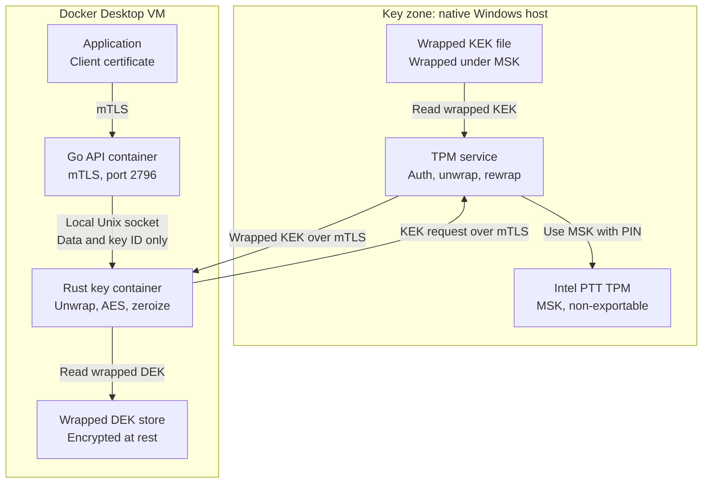

# Blueprint KEK dan DEK berakar TPM

**Status:** Draf untuk review
**Tanggal:** 2026-11-03
**Lingkungan target:** Satu laptop Windows dengan Intel PTT dan Docker Desktop

## 1. Tujuan

Desain ini melindungi kunci enkripsi data dengan hierarki kunci yang berakar pada TPM laptop.

- MSK tidak pernah meninggalkan TPM.
- KEK meninggalkan Key zone hanya dalam bentuk terbungkus, dan hanya untuk `crypto-service`.
- DEK disimpan terenkripsi, dan ditahan di memori plaintext maksimal 5 menit.

## 2. Asumsi

| Asumsi | Status |
|---|---|
| Arsitektur di bagian 3 dipakai seperti digambar, sehingga layanan TPM menyimpan dan mengirim KEK alih-alih Vault | Terkonfirmasi |
| Enkripsi baru tetap di bawah 1 juta per hari | Terkonfirmasi |
| Sebagian besar TPS berasal dari dekripsi | Terkonfirmasi |
| Aplikasi mencapai port 2796 hanya dengan mTLS | Terkonfirmasi |
| `crypto-service` berjalan di Docker | Terkonfirmasi |
| Layanan TPM berjalan native di Windows dan memakai TPM laptop | Terkonfirmasi |
| Upacara Shamir awal sudah selesai, dan MSK diimpor ke TPM | Diasumsikan |
| Recovery opsional dan hanya berjalan jika TPM dibersihkan atau diganti | Terkonfirmasi |

## 3. Arsitektur



## 4. Hierarki kunci

| Kunci | Tujuan | Disimpan sebagai | Lokasi plaintext | Masa hidup di memori |
|---|---|---|---|---|
| **MSK** | Melindungi KEK | File kunci TPM terikat pada TPM ini, plus 3 Shamir share offline | Hanya di dalam TPM, kecuali sebentar saat upacara recovery | Tidak berlaku |
| **KEK** | Melindungi DEK | Dibungkus di bawah MSK | Layanan TPM dan key container Rust | Dihapus segera setelah dipakai |
| **DEK** | Mengenkripsi data aplikasi | Dibungkus di bawah KEK | Hanya key container Rust | Maksimal 5 menit |
| **Kunci delivery RSA** | Melindungi pengiriman KEK | Hanya memori Rust | Hanya key container Rust | Sampai container berhenti |

## 5. Komponen

| Komponen | Berjalan di | Tanggung jawab | Tidak boleh menahan atau melakukan |
|---|---|---|---|
| **TPM** | Perangkat keras laptop | Menahan MSK, memeriksa PIN, menerapkan lockout | Mengekspor MSK |
| **Layanan TPM** | Binary native Windows | Mengautentikasi request, membuka dan membungkus ulang KEK, menyimpan log audit | Mengembalikan KEK plaintext |
| **Key container Rust** | Docker | Meminta KEK, membuka DEK, menjalankan AES, menegakkan timer, zeroisasi, menulis record audit | Mencatat atau mengekspor kunci |
| **Container API Go** | Docker | Menangani mTLS, izin aplikasi, routing, dan record audit | Menahan KEK, DEK, atau kunci privat RSA |
| **Wrapped DEK store** | Volume Docker | Menyimpan DEK terbungkus dan metadata | Menahan KEK atau DEK plaintext |
| **Aplikasi** | Docker | Memanggil crypto API dengan sertifikat client-nya | Menahan KEK atau DEK |

## 6. Alur operasional

### 6.1 Startup

1. Operator menjalankan layanan TPM dan memasukkan PIN.
2. Key container Rust membuat pasangan kunci RSA di memori.
3. Operator membandingkan fingerprint public key dan menyetujuinya di konsol host.
4. Layanan TPM mulai menerima request KEK untuk public key tersebut.

Jika container Rust restart, langkah 2 sampai 4 berjalan lagi.

### 6.2 Pengiriman KEK

1. Rust memanggil layanan TPM lewat mTLS dengan KEK ID, versi, dan nonce baru.
2. Layanan memeriksa sertifikat client, public key terdaftar, KEK yang diizinkan, dan rate limit.
3. Layanan memakai MSK di TPM untuk membuka KEK.
4. Layanan membungkus KEK untuk Rust, menghapus salinannya, menulis record audit, dan merespons.
5. Rust membuka KEK dan memakainya untuk mendekripsi DEK.
6. Rust segera menghapus KEK dan kunci AES sementara.

### 6.3 Siklus hidup DEK

1. Rust memulai batas keras 5 menit saat DEK dimuat. Aktivitas tidak memperpanjangnya.
2. Batas menghitung waktu saat laptop suspend.
3. Saat kedaluwarsa, Rust memblokir pekerjaan baru pada DEK itu dan membiarkan request yang berjalan selesai.
4. Rust menghapus DEK dan key schedule AES.
5. Request berikutnya memulai pengiriman KEK baru.

Rust juga menghapus kunci saat shutdown dan pada setiap error yang dapat ditangkap.

### 6.4 Rotasi

| Kunci | Rotasi | Versi lama |
|---|---|---|
| **DEK** | Buat DEK baru untuk enkripsi setiap tahun | Simpan untuk mendekripsi data lama |
| **KEK** | Rotasi sesuai jadwal atau setelah dugaan kebocoran | Simpan sampai semua DEK-nya dibungkus ulang |
| **Kunci delivery RSA** | Diganti setiap start container Rust | Dicabut saat diganti |

## 7. API layanan TPM

### Meminta KEK terbungkus

```http
POST /v1/kek/wrapped
```

```json
{
  "kek_id": "kek-01",
  "version": 3,
  "nonce": "<random 32 bytes, base64>"
}
```

```json
{
  "kek_id": "kek-01",
  "version": 3,
  "wrapped_kek": "<RSA-OAEP and AES-KWP, base64>"
}
```

### Aturan API

- Wajibkan sertifikat client mTLS dari CA khusus.
- Izinkan hanya identitas sertifikat `crypto-service`.
- Izinkan hanya KEK ID yang ditugaskan ke identitas itu.
- Jangan pernah menyediakan endpoint yang mengembalikan KEK plaintext.
- Jangan pernah menerima public key baru lewat API ini.
- Kembalikan error otorisasi generik, dan simpan detailnya di log audit.

## 8. Spesifikasi kriptografi

| Tujuan | Spesifikasi |
|---|---|
| **MSK** | Kunci TPM HMAC-SHA256 dengan `fixedTPM` dan `fixedParent`, diimpor dari upacara Shamir |
| **ID kunci MSK** | Dihitung dari HMAC di bawah MSK, sehingga tetap sama setelah recovery |
| **Lalu lintas TPM** | Sesi HMAC di-salt dengan enkripsi parameter AES-128-CFB |
| **KEK at rest** | AES-256-GCM di bawah kunci sekali pakai yang diturunkan TPM |
| **Pengiriman KEK** | Kunci AES-256 sementara dibungkus dengan RSA-OAEP SHA-256, dan KEK dibungkus dengan AES-KWP |
| **Pengikatan delivery** | Label OAEP memuat nonce, KEK ID, dan versi KEK |
| **DEK at rest** | AES-256-GCM di bawah KEK |
| **Associated data DEK** | DEK ID, purpose, KEK ID, dan versi KEK |
| **Data aplikasi** | AES-256-GCM dengan nonce acak |

Pengiriman KEK mengikuti konstruksi yang sama dengan PKCS#11 `CKM_RSA_AES_KEY_WRAP`. Jangan mengklaim kepatuhan PKCS#11 sampai interoperabilitas diuji.

**Batas enkripsi DEK:** AES-GCM dengan nonce acak dibatasi 2^32 enkripsi per kunci. Pada 1 juta enkripsi per hari, itu sekitar 11,8 tahun. Rotasi tahunan memakai sekitar 8,5% batas. Hitung enkripsi di semua instance, dan rotasi lebih cepat jika volume tumbuh.

## 9. Persyaratan keamanan

### Key zone

- Listen hanya di tempat container dapat menjangkau layanan, biasanya lewat `host.docker.internal`.
- Bind ke loopback jika itu bekerja pada setup ini, dan blokir akses jaringan masuk di Windows Firewall.
- Simpan PIN dan KEK plaintext apa pun di memori terkunci.
### Service zone

- Jalankan container Rust dengan filesystem read-only dan hanya capability `IPC_LOCK` yang ditambahkan.
- Matikan core dump, dan jangan bagikan process namespace.
- Batasi Unix socket sehingga hanya API Go yang dapat terhubung.
- Jangan pakai cgo untuk penanganan kunci, agar Rust dan Go memakai memori terpisah.

### Laptop

- Aktifkan BitLocker.
- Matikan hibernasi.
- Set `swap=0` di `.wslconfig`.
- Stop container Rust sebelum tidur, atau matikan sepenuhnya saat laptop keluar dari kendali Anda.

### Log audit

Log audit mencakup layanan TPM, key container Rust, dan API Go.

| Layanan | Event yang dicatat |
|---|---|
| **Layanan TPM** | Start dan stop layanan, kegagalan PIN, persetujuan public key, request KEK, kegagalan otorisasi, event upacara recovery |
| **Key container Rust** | Start dan stop container, hasil pengiriman KEK, pemuatan DEK, kedaluwarsa dan zeroisasi, kegagalan unwrap |
| **API Go** | Identitas aplikasi, operasi, key ID, hasil otorisasi, hasil request |

Aturan:

- **Format record:** Sertakan waktu, request ID, layanan, identitas, key ID dan versi, action, dan result.
- **Request ID:** Pakai ID yang sama di ketiga layanan, sehingga satu operasi dapat dilacak end to end.
- **Data sensitif:** Jangan pernah mencatat material kunci, PIN, secret atau kode TOTP, share, atau plaintext.
- **Bukti manipulasi:** Sertakan hash record sebelumnya di setiap record. Layanan TPM secara berkala menandatangani hash terbaru dengan kunci yang diturunkan dari MSK.
- **Salinan terpisah:** Kirim record ke lokasi yang tidak dapat diubah container, dan jika mungkin ke luar laptop.

Log menunjukkan kapan record lama diubah atau dihapus. Penyerang yang mengendalikan sebuah layanan masih dapat menghentikan logging-nya atau menulis record baru palsu.

## 10. Perilaku kegagalan

| Event | Perilaku |
|---|---|
| Layanan TPM berhenti | Operasi crypto fail closed setelah DEK yang termuat kedaluwarsa, dalam 5 menit |
| PIN salah | Percobaan gagal dan dihitung terhadap lockout TPM |
| Lockout TPM | Layanan tetap tidak tersedia sampai TPM pulih |
| Container Rust restart | Kunci hilang dari memori, dan public key baru harus disetujui |
| Banyak DEK kedaluwarsa bersamaan | Offset kedaluwarsa acak dan refresh single-flight membatasi beban |
| TPM dibersihkan atau diganti | Jalankan upacara recovery opsional di bagian 11 |
| Hard kill Rust | Kode wipe tidak dapat berjalan, sehingga memory locking serta swap dan dump yang dimatikan mengurangi paparan |

## 11. Backup dan recovery

### 11.1 Upacara awal (diasumsikan selesai)

MSK dibuat offline, dipecah menjadi 3 Shamir share dengan kuorum 2, dan diimpor ke TPM. Setiap anggota memegang satu share dengan share ID-nya sendiri. Shamir tidak dipakai dalam operasi normal atau saat restart laptop, yang memakai PIN operasional.

**Demo only:** Binary Windows tidak memecah MSK di TPM. Saat startup, ia membuat kunci demo sekali pakai, memecahnya menjadi 3 Shamir share dengan kuorum 2, mencetak share di terminal, dan membuangnya. Output berbentuk:

```text
[DEMO] Initial ceremony: 3 Shamir shares, quorum 2 of 3
[DEMO] These shares belong to a throwaway key. They cannot rebuild the MSK.
[DEMO] Share 1: <hex>
[DEMO] Share 2: <hex>
[DEMO] Share 3: <hex>
```

MSK nyata dan share nyata apa pun tidak boleh pernah dicetak, karena 2 share apa pun membangun ulang kunci. Share demo juga harus tetap di luar log audit.

### 11.2 Backup

Jaga ini tetap mutakhir, karena share hanya memulihkan MSK:

- File KEK terbungkus
- Wrapped DEK store
- Nilai verifikasi MSK

### 11.3 Upacara recovery (opsional)

Jalankan hanya jika TPM dibersihkan atau diganti. Pakai mesin bersih, dan masukkan PIN operasional baru saat mengimpor MSK.

```text
Member 1: Share ID + PIN + TOTP -> approved -> share unlocked
Member 2: Share ID + PIN + TOTP -> approved -> share unlocked
                  |
          2 different share IDs
                  |
Rebuild MSK -> check verification value -> import into TPM -> wipe shares and MSK
```

Setelah impor, pastikan data yang ada dapat dibuka, lalu pulihkan layanan TPM.

### 11.4 Aturan akses share

| Aturan | Alasan |
|---|---|
| PIN dan secret TOTP terpisah per share ID | Persetujuan satu anggota tidak dapat dihitung untuk share lain |
| Dua share ID berbeda wajib | Anggota yang sama tidak dapat mencapai kuorum sendiri |
| Kode TOTP ditolak jika dipakai ulang pada recovery yang sama | Kode yang dilihat orang lain tidak dapat diputar ulang |
| Percobaan gagal dibatasi per share ID | Memperlambat tebakan lewat tool, dan setiap kegagalan diaudit |
| Sesi recovery dibatasi, misalnya 10 menit | Share pertama yang terbuka tidak menunggu di memori |
| PIN disimpan hanya sebagai hash Argon2id bergaram | Tool tidak pernah menyimpan PIN yang dapat dibaca |
| Setiap share disimpan di USB drive terpisah, terenkripsi dengan kunci yang diturunkan dari PIN-nya | Share tetap terpisah dan tidak disimpan plaintext |
| MSK hasil rebuild diperiksa terhadap nilai verifikasi | Share salah tertangkap sebelum impor |

### 11.5 Batasan demo

Pemeriksaan PIN dan TOTP memberi kontrol akses dan persetujuan kuorum untuk demo ini. Keduanya berjalan di software, sehingga seseorang dengan file share yang disalin dapat melewati pemeriksaan TOTP dan menyerang PIN secara offline. Produksi sebaiknya menyimpan setiap share di hardware token yang menegakkan PIN-nya sendiri, seperti smart card.

## 12. Batas keamanan

**Terlindungi:**

- File KEK dan DEK terbungkus yang disalin
- Lalu lintas jaringan antara container dan layanan TPM
- Sertifikat client yang dicuri sendirian
- Laptop mati yang dicuri, jika BitLocker aktif dan PIN tidak diketahui
- Kunci di memori setelah di-zeroisasi

**Tidak terlindungi:**

- Malware dengan hak administrator Windows
- Penyerang yang mengendalikan container Rust yang berjalan, yang dapat membaca DEK aktif dan menangkap KEK berikutnya
- Aplikasi yang dikompromikan memakai sertifikat validnya sendiri untuk meminta dekripsi
- Pemisahan fisik zona, karena semuanya berjalan di satu laptop

Setup ini cocok untuk pengembangan dan demonstrasi. Produksi sebaiknya menjalankan Key zone di mesin terpisah.

## 13. Keputusan bahasa

| Komponen | Bahasa | Alasan |
|---|---|---|
| Prototipe layanan TPM | Go | Memakai ulang kode `tpm-msk` yang ada |
| Layanan TPM untuk penggunaan nyata | Rust | Memberi kontrol lebih kuat atas KEK plaintext di memori |
| Key container | Rust | Menangani DEK, AES, dan zeroisasi |
| Layanan API | Go | Sesuai layanan yang ada dan tidak pernah menyentuh kunci |

## 14. Fase implementasi

1. **Validasi TPM:** Jalankan `tpm-msk selftest` di laptop, dan perbaiki ID kunci MSK agar data yang ada dapat dibuka setelah recovery.
2. **Bangun layanan TPM:** Tambah mode service, file KEK, wrapping, persetujuan fingerprint, log audit, dan output upacara demo.
3. **Bangun key container Rust:** Tambah pembuatan kunci RSA, unwrap KEK, cache DEK, AES, zeroisasi, dan log audit.
4. **Hubungkan API Go:** Ganti penanganan kunci in-process dengan panggilan lewat Unix socket, dan tambah record audit.
5. **Pengerasan laptop dan container:** Terapkan bagian 9.
6. **Uji:** Jalankan uji penerimaan.
7. **Bangun alat recovery (opsional):** Tambah share unlock, pemeriksaan TOTP, rebuild MSK, dan verifikasi.

## 15. Uji penerimaan

| Uji | Kondisi lulus |
|---|---|
| Ekspor MSK | TPM menolak mengekspor MSK |
| Client tidak dikenal | Layanan TPM menolak request tanpa sertifikat valid |
| Sertifikat client dicuri | Penyerang hanya mendapat KEK yang tidak dapat dibuka |
| Respons diputar ulang | Rust menolak respons yang tidak cocok dengan nonce-nya |
| DEK terbungkus ditukar | Rust menolak DEK yang metadatanya tidak cocok |
| Kedaluwarsa 5 menit | DEK tidak dapat dipakai setelah 5 menit, termasuk waktu suspend |
| Memory dump | KEK dan DEK uji yang diketahui tidak ada di memori proses setelah zeroisasi |
| Layanan TPM mati | Operasi crypto fail closed dalam 5 menit |
| Jejak audit | Satu request ID dapat diikuti di ketiga layanan |
| Manipulasi audit | Perubahan atau penghapusan record lama terdeteksi |
| Isi audit | Log tidak memuat material kunci, PIN, data TOTP, share, atau plaintext |
| Recovery dengan 2 anggota (opsional) | MSK dipulihkan dan data yang ada dapat dibuka |
| Recovery dengan 1 anggota (opsional) | Recovery berhenti, dan MSK tidak dapat dibangun ulang |
| PIN atau TOTP salah (opsional) | Share ditolak dan kegagalan diaudit |
| Share ID sama dua kali (opsional) | Dihitung sekali, sehingga kuorum tidak terpenuhi |
| Kode TOTP dipakai ulang (opsional) | Ditolak |
| Share rusak (opsional) | Verifikasi gagal, dan tidak ada yang diimpor |
| TPS | Throughput dan latensi dekripsi memenuhi target dengan Unix socket terpasang |

## 16. Item terbuka

| Item | Owner | Catatan |
|---|---|---|
| Perbaiki ID kunci MSK di `tpm-msk` | Claude | MSK yang dipulihkan saat ini tidak dapat membuka envelope yang ada, karena ID berubah saat impor |
| Konfirmasi upacara awal sesuai bagian 11.1 | Amerta | Output demo tidak membuat share yang dapat dipakai. Recovery butuh share nyata dan kunci TPM yang melaporkan asalnya sebagai imported |
| Konfirmasi `selftest` lulus pada Intel PTT nyata | Amerta | `tpm-msk` sejauh ini hanya diuji pada software TPM |
| Pensiunkan container Vault yang ada | Amerta | Periksa dulu bahwa tidak ada hal lain yang bergantung padanya |
| Tetapkan port layanan TPM | Amerta | Belum dipilih |
| Definisikan target TPS dekripsi puncak | Amerta | Diperlukan untuk uji TPS |
| Putuskan cara melindungi KEK untuk host produksi terpisah | Amerta | Diperlukan jika ini pindah dari laptop |
