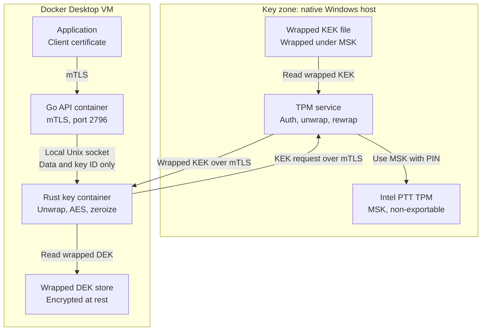

# TPM-Rooted KEK and DEK Blueprint

**Status:** Draft for review
**Date:** 2026-11-03
**Target environment:** One Windows laptop with Intel PTT and Docker Desktop

## 1. Purpose

This design protects data encryption keys with a key hierarchy rooted in the laptop's TPM.

- The MSK never leaves the TPM.
- The KEK leaves the Key zone only in wrapped form, and only for `crypto-service`.
- The DEK is stored encrypted, and is held in plaintext memory for at most 5 minutes.

## 2. Assumptions

| Assumption | Status |
|---|---|
| The architecture in section 3 is used as drawn, so the TPM service stores and delivers KEKs instead of Vault | Confirmed |
| New encryptions stay below 1 million per day | Confirmed |
| Most TPS comes from decryption | Confirmed |
| Applications reach port 2796 only with mTLS | Confirmed |
| `crypto-service` runs in Docker | Confirmed |
| The TPM service runs natively on Windows and uses the laptop's TPM | Confirmed |
| The initial Shamir ceremony is already complete, and the MSK was imported into the TPM | Assumed |
| Recovery is optional and runs only if the TPM is cleared or replaced | Confirmed |

## 3. Architecture



## 4. Key hierarchy

| Key | Purpose | Stored as | Plaintext location | Lifetime in memory |
|---|---|---|---|---|
| **MSK** | Protects KEKs | TPM key file bound to this TPM, plus 3 offline Shamir shares | Inside the TPM only, except briefly during a recovery ceremony | Not applicable |
| **KEK** | Protects DEKs | Wrapped under the MSK | TPM service and Rust key container | Wiped immediately after use |
| **DEK** | Encrypts application data | Wrapped under the KEK | Rust key container only | 5 minutes maximum |
| **RSA delivery key** | Protects KEK delivery | Rust memory only | Rust key container only | Until the container stops |

## 5. Components

| Component | Runs on | Responsibilities | Must never hold or do |
|---|---|---|---|
| **TPM** | Laptop hardware | Holds the MSK, checks the PIN, applies lockout | Export the MSK |
| **TPM service** | Native Windows binary | Authenticates requests, unwraps and rewraps KEKs, keeps audit logs | Return a plaintext KEK |
| **Rust key container** | Docker | Requests KEKs, unwraps DEKs, runs AES, enforces the timer, zeroizes, writes audit records | Log or export keys |
| **Go API container** | Docker | Handles mTLS, app permissions, routing and audit records | Hold a KEK, DEK or RSA private key |
| **Wrapped DEK store** | Docker volume | Stores wrapped DEKs and metadata | Hold a plaintext KEK or DEK |
| **Application** | Docker | Calls the crypto API with its client certificate | Hold a KEK or DEK |

## 6. Operational flows

### 6.1 Startup

1. The operator starts the TPM service and enters the PIN.
2. The Rust key container generates an RSA key pair in memory.
3. The operator compares the public key fingerprint and approves it on the host console.
4. The TPM service begins accepting KEK requests for that public key.

If the Rust container restarts, steps 2 to 4 run again.

### 6.2 KEK delivery

1. Rust calls the TPM service over mTLS with a KEK ID, version and fresh nonce.
2. The service checks the client certificate, registered public key, allowed KEK and rate limit.
3. The service uses the MSK in the TPM to unwrap the KEK.
4. The service wraps the KEK for Rust, wipes its copy, writes an audit record and responds.
5. Rust unwraps the KEK and uses it to decrypt the DEK.
6. Rust wipes the KEK and temporary AES key immediately.

### 6.3 DEK lifecycle

1. Rust starts a 5-minute hard limit when the DEK is loaded. Activity does not extend it.
2. The limit counts time while the laptop is suspended.
3. At expiry, Rust blocks new work on that DEK and lets current requests finish.
4. Rust wipes the DEK and the AES key schedule.
5. The next request starts a new KEK delivery.

Rust also wipes keys on shutdown and on any error it can catch.

### 6.4 Rotation

| Key | Rotation | Older versions |
|---|---|---|
| **DEK** | Create a new DEK for encryption each year | Keep for decrypting older data |
| **KEK** | Rotate on a set schedule or after suspected exposure | Keep until all its DEKs are rewrapped |
| **RSA delivery key** | Replaced on every Rust container start | Revoked when replaced |

## 7. TPM service API

### Request a wrapped KEK

```http
POST /v1/kek/wrapped
```

```json
{
  "kek_id": "kek-01",
  "version": 3,
  "nonce": "<random 32 bytes, base64>"
}
```

```json
{
  "kek_id": "kek-01",
  "version": 3,
  "wrapped_kek": "<RSA-OAEP and AES-KWP, base64>"
}
```

### API rules

- Require an mTLS client certificate from a dedicated CA.
- Allow the `crypto-service` certificate identity only.
- Allow only the KEK IDs assigned to that identity.
- Never provide an endpoint that returns a plaintext KEK.
- Never accept a new public key through this API.
- Return a generic authorization error, and keep details in the audit log.

## 8. Cryptographic specification

| Purpose | Specification |
|---|---|
| **MSK** | TPM HMAC-SHA256 key with `fixedTPM` and `fixedParent`, imported from the Shamir ceremony |
| **MSK key ID** | Computed from an HMAC under the MSK, so it stays the same after recovery |
| **TPM traffic** | Salted HMAC session with AES-128-CFB parameter encryption |
| **KEK at rest** | AES-256-GCM under a TPM-derived, one-time key |
| **KEK delivery** | Temporary AES-256 key wrapped with RSA-OAEP SHA-256, and the KEK wrapped with AES-KWP |
| **Delivery binding** | OAEP label contains the nonce, KEK ID and KEK version |
| **DEK at rest** | AES-256-GCM under the KEK |
| **DEK associated data** | DEK ID, purpose, KEK ID and KEK version |
| **Application data** | AES-256-GCM with random nonces |

KEK delivery follows the same construction as PKCS#11 `CKM_RSA_AES_KEY_WRAP`. Do not claim PKCS#11 compliance until interoperability has been tested.

**DEK encryption limit:** Random-nonce AES-GCM is limited to 2^32 encryptions per key. At 1 million encryptions per day, that takes about 11.8 years. Yearly rotation uses about 8.5% of the limit. Count encryptions across all instances, and rotate sooner if volume grows.

## 9. Security requirements

### Key zone

- Listen only where containers can reach the service, normally through `host.docker.internal`.
- Bind to loopback if that works on this setup, and block inbound network access in Windows Firewall.
- Keep the PIN and any plaintext KEK in locked memory.
### Service zone

- Run the Rust container with a read-only filesystem and only the `IPC_LOCK` capability added.
- Disable core dumps, and do not share a process namespace.
- Restrict the Unix socket so only the Go API can connect.
- Do not use cgo for key handling, so Rust and Go keep separate memory.

### Laptop

- Turn on BitLocker.
- Disable hibernation.
- Set `swap=0` in `.wslconfig`.
- Stop the Rust container before sleep, or shut down fully when the laptop leaves your control.

### Audit logging

The audit log covers the TPM service, Rust key container and Go API.

| Service | Events to record |
|---|---|
| **TPM service** | Service start and stop, PIN failures, public key approvals, KEK requests, authorization failures, recovery ceremony events |
| **Rust key container** | Container start and stop, KEK delivery results, DEK load, expiry and zeroization, unwrap failures |
| **Go API** | Application identity, operation, key ID, authorization result, request result |

Rules:

- **Record format:** Include the time, request ID, service, identity, key ID and version, action and result.
- **Request ID:** Use the same ID across all three services, so one operation can be traced end to end.
- **Sensitive data:** Never log key material, PINs, TOTP secrets or codes, shares, or plaintext.
- **Tamper evidence:** Include the hash of the previous record in each record. The TPM service regularly signs the latest hash with a key derived from the MSK.
- **Separate copy:** Send records to a location the containers can't change, and off the laptop if possible.

The log shows when past records were altered or removed. An attacker controlling a service can still stop its logging or write false new records.

## 10. Failure behavior

| Event | Behavior |
|---|---|
| TPM service stops | Crypto operations fail closed once loaded DEKs expire, within 5 minutes |
| Wrong PIN | The attempt fails and counts toward TPM lockout |
| TPM lockout | The service stays unavailable until the TPM recovers |
| Rust container restarts | Keys are lost from memory, and a new public key must be approved |
| Many DEKs expire together | Random expiry offsets and single-flight refresh limit the load |
| TPM cleared or replaced | Run the optional recovery ceremony in section 11 |
| Hard kill of Rust | Wipe code cannot run, so memory locking and disabled swap and dumps reduce exposure |

## 11. Backup and recovery

### 11.1 Initial ceremony (assumed complete)

The MSK was generated offline, split into 3 Shamir shares with a quorum of 2, and imported into the TPM. Each member holds one share with its own share ID. Shamir is not used in normal operation or at a laptop restart, which use the operational PIN.

**Demo only:** The Windows binary does not split the MSK in the TPM. At startup, it generates a throwaway demo key, splits it into 3 Shamir shares with a quorum of 2, prints the shares in the terminal, and discards them. The output has this form:

```text
[DEMO] Initial ceremony: 3 Shamir shares, quorum 2 of 3
[DEMO] These shares belong to a throwaway key. They cannot rebuild the MSK.
[DEMO] Share 1: <hex>
[DEMO] Share 2: <hex>
[DEMO] Share 3: <hex>
```

The real MSK and any real shares must never be printed, because any 2 shares rebuild the key. The demo shares must also stay out of the audit log.

### 11.2 Backups

Keep these up to date, because the shares restore only the MSK:

- Wrapped KEK files
- Wrapped DEK store
- Verification value for the MSK

### 11.3 Recovery ceremony (optional)

Run this only if the TPM is cleared or replaced. Use a clean machine, and enter a new operational PIN when importing the MSK.

```text
Member 1: Share ID + PIN + TOTP -> approved -> share unlocked
Member 2: Share ID + PIN + TOTP -> approved -> share unlocked
                  |
          2 different share IDs
                  |
Rebuild MSK -> check verification value -> import into TPM -> wipe shares and MSK
```

After import, confirm that existing data opens, then restore the TPM service.

### 11.4 Share access rules

| Rule | Reason |
|---|---|
| Separate PIN and TOTP secret per share ID | One member's approval can't count for another share |
| Two different share IDs required | The same member can't reach the quorum alone |
| TOTP code rejected if reused in the same recovery | A code seen by someone else can't be replayed |
| Failed attempts limited per share ID | Slows guessing through the tool, and each failure is audited |
| Recovery session limited, for example to 10 minutes | The first unlocked share doesn't wait in memory |
| PIN stored only as a salted Argon2id hash | The tool never keeps a readable PIN |
| Each share kept on a separate USB drive, encrypted with a key derived from its PIN | Shares stay separated and aren't stored in plaintext |
| Rebuilt MSK checked against a verification value | A wrong share is caught before import |

### 11.5 Demo limitation

PIN and TOTP checks provide access control and quorum approval for this demo. They run in software, so someone with copied share files can skip the TOTP check and attack the PIN offline. Production should keep each share on a hardware token that enforces its own PIN, such as a smart card.

## 12. Security boundaries

**Protected:**

- Copied wrapped KEK and DEK files
- Network traffic between the containers and the TPM service
- A stolen client certificate on its own
- A stolen, powered-off laptop, if BitLocker is on and the PIN is unknown
- Keys in memory after they have been zeroized

**Not protected:**

- Malware with Windows administrator rights
- An attacker controlling the running Rust container, who can read the active DEK and capture the next KEK
- A compromised application using its own valid certificate to request decryption
- Physical separation of zones, because everything runs on one laptop

This setup suits development and demonstrations. Production should run the Key zone on a separate machine.

## 13. Language decisions

| Component | Language | Reason |
|---|---|---|
| TPM service prototype | Go | Reuses the existing `tpm-msk` code |
| TPM service for real use | Rust | Gives stronger control over the plaintext KEK in memory |
| Key container | Rust | Handles DEKs, AES and zeroization |
| API service | Go | Matches the existing service and never touches keys |

## 14. Implementation phases

1. **Validate the TPM:** Run `tpm-msk selftest` on the laptop, and fix the MSK key ID so existing data opens after recovery.
2. **Build the TPM service:** Add service mode, the KEK file, wrapping, fingerprint approval, audit logging and the demo ceremony output.
3. **Build the Rust key container:** Add RSA key generation, KEK unwrap, DEK cache, AES, zeroization and audit logging.
4. **Connect the Go API:** Replace in-process key handling with calls over the Unix socket, and add audit records.
5. **Harden the laptop and containers:** Apply section 9.
6. **Test:** Run the acceptance tests.
7. **Build the recovery tool (optional):** Add share unlock, TOTP checks, MSK rebuild and verification.

## 15. Acceptance tests

| Test | Pass condition |
|---|---|
| MSK export | The TPM refuses to export the MSK |
| Unknown client | The TPM service rejects a request without a valid certificate |
| Stolen client certificate | The attacker gets only a KEK they cannot unwrap |
| Replayed response | Rust rejects a response that doesn't match its nonce |
| Swapped wrapped DEK | Rust rejects a DEK whose metadata doesn't match |
| 5-minute expiry | The DEK is unusable after 5 minutes, including time spent suspended |
| Memory dump | A known test KEK and DEK are absent from process memory after zeroization |
| TPM service outage | Crypto operations fail closed within 5 minutes |
| Audit trace | One request ID can be followed across all three services |
| Audit tampering | Changing or removing a past record is detected |
| Audit content | Logs contain no key material, PINs, TOTP data, shares or plaintext |
| Recovery with 2 members (optional) | The MSK is restored and existing data opens |
| Recovery with 1 member (optional) | Recovery stops, and the MSK can't be rebuilt |
| Wrong PIN or TOTP (optional) | That share is rejected and the failure is audited |
| Same share ID twice (optional) | It counts once, so the quorum isn't met |
| Reused TOTP code (optional) | It is rejected |
| Damaged share (optional) | Verification fails, and nothing is imported |
| TPS | Decrypt throughput and latency meet the target with the Unix socket in place |

## 16. Open items

| Item | Owner | Note |
|---|---|---|
| Fix the MSK key ID in `tpm-msk` | Claude | Restored MSKs currently can't open existing envelopes, because the ID changes on import |
| Confirm the initial ceremony matches section 11.1 | Amerta | The demo output doesn't create usable shares. Recovery needs real shares and a TPM key that reports its origin as imported |
| Confirm `selftest` passes on real Intel PTT | Amerta | `tpm-msk` has so far been tested only on a software TPM |
| Retire the existing Vault containers | Amerta | Check that nothing else depends on them first |
| Set the TPM service port | Amerta | Not yet chosen |
| Define the peak decrypt TPS target | Amerta | Needed for the TPS test |
| Decide how to protect the KEK for separate production hosts | Amerta | Needed if this moves off the laptop |