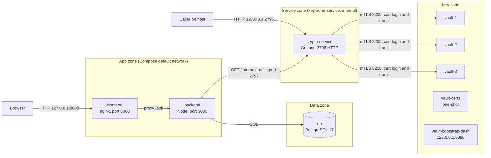
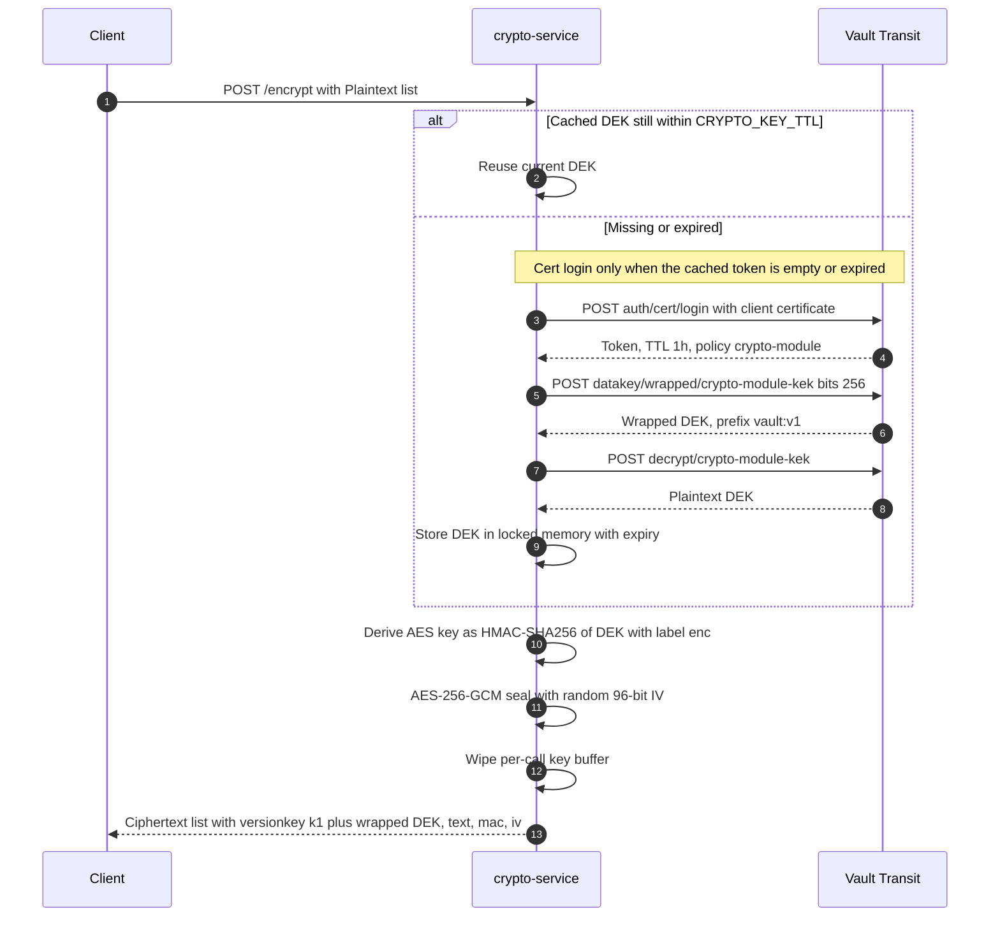
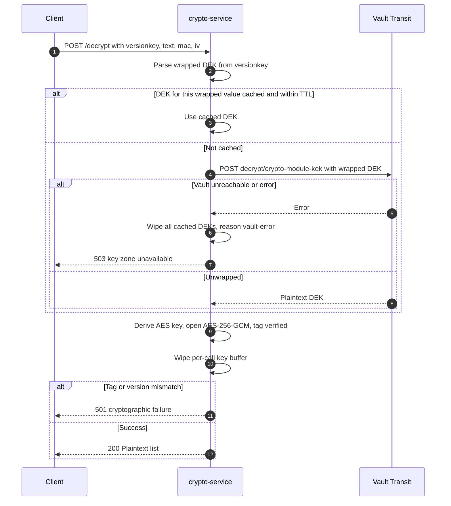

# Vault stack (pre-blueprint design)
Pre-blueprint Vault design, superseded on 2026-11-04 by the TPM blueprint (../tpm-development-crypto-service.md), kept for reference and for the one-time rekey (`k1:` to `t1:`).

## Architecture

Root stack (Vault, transitional):



| Zone | Containers | Networks | Host ports |
| --- | --- | --- | --- |
| Service | `crypto-service` | Compose default network and `key-zone-service` (internal, 172.30.20.0/24, static IP 172.30.20.10) | 127.0.0.1:2796. Port 2797 is `expose` only (internal) |
| Key | `vault-1`, `vault-2`, `vault-3`, `vault-certs` (one-shot), `vault-bootstrap-dash` | `key-zone` (internal, 172.30.10.0/24, vault nodes .11-.13) and `key-zone-service` (172.30.20.0/24, vault nodes .11-.13, dash .20). Dash also on `keyzone-dash`. `vault-certs` uses `network_mode: none` | `vault-1/2/3` none. `vault-bootstrap-dash` 127.0.0.1:8090 |

The "Service zone" and "Key zone" names follow this repo's `./Crypto_Module_Management.md`, which names the zones Key, Service, and Data and adds an offline group. The App zone is this repo's own label.

## Key hierarchy (Vault)

| Tier | Key | Implementation in this repo | Design target (`docs/versi-lama/Crypto_Module_Management.md`) |
| --- | --- | --- | --- |
| 0 | Unseal shares | `vault-bootstrap-dash` init generates 5 Shamir shares (3-of-5). Safe mode (default) stores none, and unseal needs 3 shares entered in the dashboard. Unsafe mode stores them in the `keyzone-custodians` volume. This simulates custodians and is not offline custody | 5 custodians, offline |
| 1 | Vault root and barrier keys | Raft storage in volumes `keyzone-raft-1` (vault-1), `keyzone-raft-2b` (vault-2), `keyzone-raft-3b` (vault-3) | AES-256-GCM, encrypted by tier 0 |
| 2 | KEK `transit/keys/crypto-module-kek` | `aes256-gcm96`, `exportable=false`, `allow_plaintext_backup=false`, `auto_rotate_period=8760h` | Same |
| 3 | DEK | One DEK per cache window, at most `CRYPTO_KEY_TTL` (max 5 minutes). Created by `transit/datakey/wrapped`. The DEK is not stored in the database. Its wrapped form is carried in each ciphertext's `versionkey` | One DEK per tenant or object, stored wrapped in the database |

## Safe-mode encrypt



## Safe-mode decrypt



## Modes (safe and unsafe columns)

`CRYPTO_MODE` is pinned to `safe` in `compose.yaml`. The stack does not switch it.

| Aspect | `safe` (default) | `unsafe` |
| --- | --- | --- |
| Key source | DEK wrapped by Vault KEK `crypto-module-kek`, unwrapped through Transit | Master key from `CRYPT_KEY` (64 hex) in `cryptography-service/encryption-services/.env` |
| Ciphertext `versionkey` | `k1:<wrapped DEK>` | `s0` |
| Seal output | `k1:<b64 wrapped>:<b64 iv+ct>` | `s0:<b64 iv+ct>` |
| HMAC output | `k1:<b64 wrapped>:<b64 tag>` | `s0:<b64 tag>` |
| Vault down or sealed | 503 `{"fault":{"code":503,"message":"key zone unavailable"}}`. No fallback to a local key | Vault is not called |
| Cross-mode ciphertext | 501 | 501 |
| `CRYPT_KEY` | Ignored, logged as `safe mode: CRYPT_KEY ignored` | Required |

## Vault access control

Policy `crypto-module` (`cryptography-service/key-zone/vault-bootstrap-dash/policies/crypto-module.hcl`) grants three paths, all `update` or `decrypt`:

- `transit/datakey/wrapped/crypto-module-kek`
- `transit/decrypt/crypto-module-kek`
- `transit/rewrap/crypto-module-kek`

Reading keys, exporting, and encrypting are denied. configure.sh checks this with the `crypto-module` token: key read, key export, and encrypt are rejected, and datakey, decrypt, and rewrap succeed.

Login uses cert auth role `crypto-module`: certificate CN `client-crypto-module`, token TTL 1 hour, and `token_bound_cidrs` 172.30.20.0/24 (service zone). configure.sh also creates an AppRole `crypto-module`, which writes only its `role_id` to the custodians volume. crypto-service does not use AppRole.

This deviates from the design doc, which names AppRole. crypto-service logs in with its own client certificate and renews its token without a `secret_id` distributed into the container.

## Quick start (Vault stack)

Compose reads `cryptography-service/encryption-services/.env` as `env_file`, so that file must exist. For `unsafe` mode, put a 64-hex `CRYPT_KEY` in it (for example from `openssl rand -hex 32`).

Restart and unseal:

```powershell
docker compose restart vault-1 vault-2 vault-3
docker compose ps
```

In safe mode (default), nodes stay sealed after restart. Enter 3 shares in the dashboard at http://127.0.0.1:8090. In unsafe mode they unseal automatically.

Warning from the Stop section:

> **Warning:** `docker compose down -v` deletes all named volumes. That includes PostgreSQL data, Vault Raft storage, audit logs, `keyzone-dash-data`, and `keyzone-custodians`, which holds the unseal shares in unsafe mode only. Vault cannot be recovered without them. This is irreversible.

## Legacy security notes

- **crypto-service:** in the root stack, it serves plain HTTP with no mTLS. It is on the Compose default network as well as `key-zone-service`, so any container on that network can call it.
- **Unseal shares:** In unsafe mode all five shares are in one volume, `keyzone-custodians`, and unseal is automatic from it. In safe mode no shares are stored. This is a simulation, not custodial storage.
- **Vault Community** is not FIPS 140-3 validated. Each Vault node is capped at 512 MB. Vault runs with `disable_mlock = true` because the containers drop `IPC_LOCK`. The design doc specifies 4 GB per node.
- **Certificates** come from a simulation PKI: CA valid 730 days, leaf valid 365 days. The repo has no rotation schedule.
- **Safe-mode AES-GCM uses a nil AAD**, so ciphertext is not bound to a tenant, record, or version. TPM mode is different: app-data AAD is the `dek_id` bytes, with a random 12-byte IV. TPM mode is different: app-data AAD is the `dek_id` bytes, with a random 12-byte IV.
- **Vault token** issued to crypto-service is not revoked on shutdown. Its TTL is 1 hour.
- **Cert-auth check** (`enable-cert-auth.sh`) fails hard, no WARN, because `token_bound_cidrs` restricts login to the service zone. configure.sh exits non-zero on the first FAIL.
- **Transient raft error:** `tls: internal error` appears on raft forwarding for about two minutes after unseal and clears on its own. The cause is not known.

## Test row (Key zone, configure.sh)

| Area | Command | Last result |
| --- | --- | --- |
| Key zone | configure.sh (run by `vault-bootstrap-dash` on first init) runs PASS/FAIL checks: key config, `datakey/wrapped`, policy denials, Raft peers | Not re-run after 3-node change |

configure.sh prints PASS and FAIL lines only. It never prints shares, the root token, private keys, the role ID, or plaintext DEKs.
